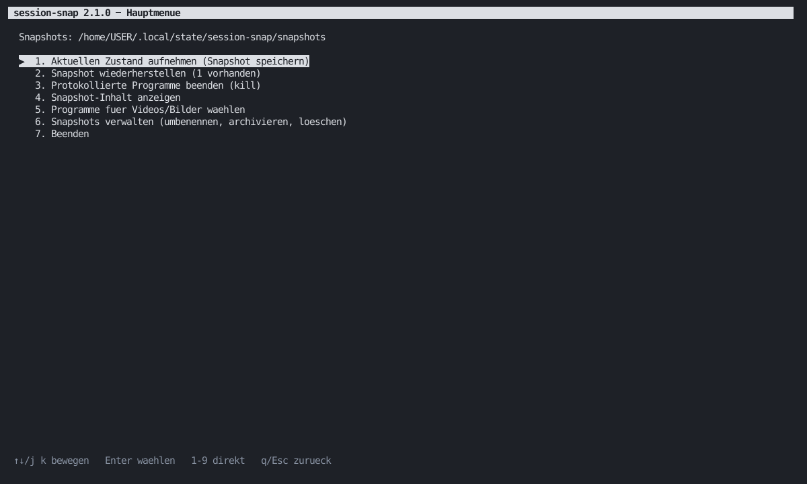
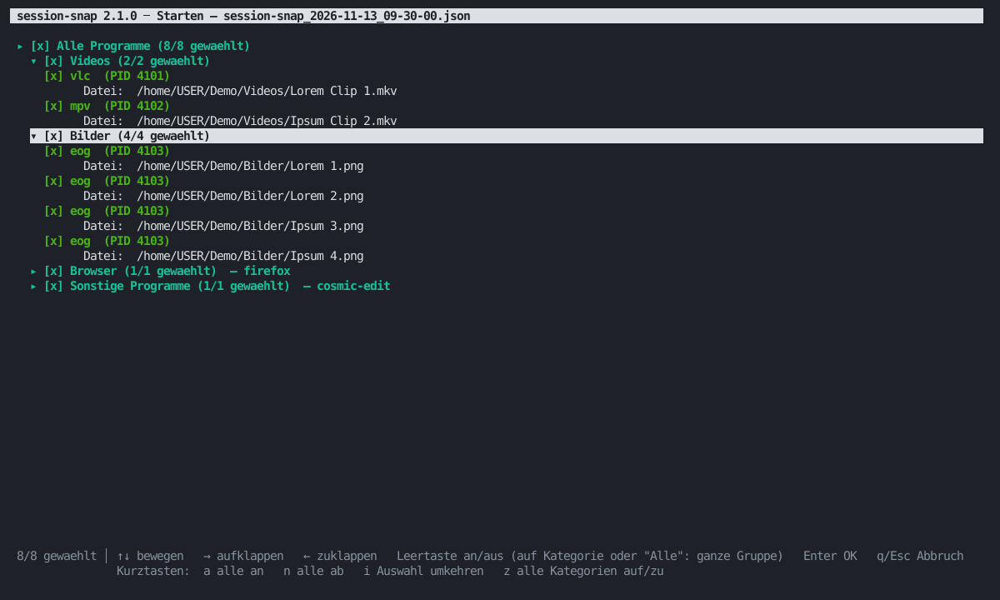
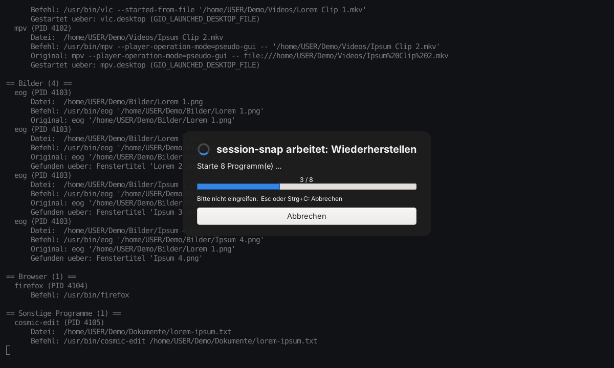

# session-snap

Record the open videos, images, browsers and other desktop programs of a session, restore them
after a cold boot, and terminate them on request — a lightweight replacement for hibernation on
**Pop!_OS 24.04 with the COSMIC desktop (Wayland)**.

session-snap runs as the normal desktop user and uses the Python standard library only. Its
user interface is German; the documentation is English.

## What it is for

- **Shut down without losing your place.** Evening: `session-snap save`, switch off. Morning:
  `session-snap restore` reopens every video at its file (paused), every image fullscreen, the
  browsers with their tabs and the other programs — in the Alt-Tab order you left them.
- **Clear the desktop in one step.** `session-snap kill` closes the recorded programs after
  showing what will close, so a presentation or a screen share starts from a clean desktop;
  `restore` brings everything back afterwards.
- **Keep several working sets.** Snapshots carry a label ("Evening", "Project A"); restore a
  whole set, one category (only the videos) or single files picked in a tree.

Hibernation (suspend to disk) keeps the complete memory image instead and needs a swap area
about as large as the memory in use; session-snap records only what is needed to reopen the
programs.

## Features

- **Snapshots** of all open videos, images, browsers and other programs, with complete file
  paths and the exact command line, stored as time-stamped JSON files.
- **Restore** everything, one category, or a selection in a keyboard-driven tree (all programs →
  categories → programs). Every file reopens with the program and the options it was shown with;
  videos start **paused**, video windows are **maximized** and images open **fullscreen** through
  the COSMIC compositor.
- **Browser sessions**: Chrome with all last profiles, windows and tabs; Firefox per profile.
  Chrome app windows (for example Claude, WhatsApp) are recorded and started again.
- **All images of single-instance viewers** (eog) are recovered from the window titles.
- **Alt-Tab order**: a small background process records window activations; a restore rebuilds
  the order.
- **Terminate** the recorded programs — never the terminal it runs in — after comparing the
  selection with what is open now; windows that would close as a side effect are shown first.
- **Progress display above all windows** while programs start or close: spinner, progress bar
  and time left; keyboard and mouse are blocked so a click cannot land in a window that is
  just opening. Esc, Ctrl+C or the button *Abbrechen* cancel.
- **Entry in the application menu** with its own icon; it opens the menu in a terminal.
- **Update and live update**: `session-snap update` installs a newer release; the running
  background process switches to it without a restart (`session-snap reload`).

## Requirements

| Item | Requirement |
|------|-------------|
| Desktop | Pop!_OS 24.04 LTS with COSMIC (Wayland). Without COSMIC, window functions are skipped. |
| Python | Python 3.12 or newer with the `venv` module (`sudo apt install python3-venv`). |
| Tools | `git` (for `install.sh` and `update`). |
| Progress display | GTK 3 with gtk-layer-shell for the system Python (`sudo apt install python3-gi gir1.2-gtk-3.0 gir1.2-gtklayershell-0.1 python3-gi-cairo`); without it, a desktop notification is shown instead. |
| User | Runs as the normal desktop user; refuses to run as root. |

## Installation

As the normal user (nothing outside your home directory is changed):

~~~bash
git clone https://github.com/peddanet/session-snap.git ~/Projects/session-snap
cd ~/Projects/session-snap && ./install.sh && ~/.local/bin/session-snap --version
~~~

`install.sh` installs the newest release tag into `~/.local/share/session-snap/venv` and links
the command `~/.local/bin/session-snap` (Ubuntu adds `~/.local/bin` to `PATH` at the next
login). Configuration lives in `~/.config/session-snap/`, snapshots and logs in
`~/.local/state/session-snap/`. Coming from 1.8.0 or older (`~/scripts/session-snap`): the old
files move automatically on the first start — see
[moving from the old layout](docs/user.md#sec-migration).

## Usage

After the installation, **session-snap** is in the application menu. In a terminal:

~~~bash
session-snap                      # interactive main menu
session-snap save -l "Evening"    # record the session with a label
session-snap restore -s latest    # restore the newest snapshot
session-snap kill -s latest       # terminate the recorded programs
session-snap update               # install a newer release
session-snap --help
~~~

A safe way to try it: [`examples/`](examples/) contains a demo snapshot and a script that
generates Lorem-ipsum images and short test videos for it in a temporary folder:

~~~bash
demo=$(mktemp -d) && python3 examples/make_demo_media.py "$demo"
session-snap show "$demo/demo-snapshot.json"
~~~

A snapshot given as a path is accepted once at least one snapshot of your own exists
(`session-snap save` once).

While session-snap starts or closes programs, this card stays above all windows:

The screenshots show Lorem-ipsum demo data from `examples/`.

## Documentation

| Document | Content |
|----------|---------|
| [docs/user.md](docs/user.md) | User guide: installation, commands, interface, configuration, use cases, troubleshooting |
| [docs/developer.md](docs/developer.md) | Developer guide: platform analysis, architecture, data model, algorithms, verification |
| [docs/glossary.md](docs/glossary.md) | Every technical term with a link for further reading |
| [CHANGELOG.md](CHANGELOG.md) | Version history |
| [CONTRIBUTING.md](CONTRIBUTING.md) | Branches, quality gates, release procedure |

## Development

The code must pass seven quality gates — privacy, shell, format, lint (pylint 10.00/10 with
Google-style docstrings), types, security, tests with at least 90 % branch coverage — locally,
in the pre-push hook and on GitHub Actions (Python 3.12 and 3.14):

~~~bash
tools/check.sh
~~~

Set-up and release procedure: [CONTRIBUTING.md](CONTRIBUTING.md).

## Licence

No licence has been chosen yet; until then, all rights are reserved by the author.
