# session-snap — Developer Guide

> Version 2.0.0. The terminal captures were recorded with 1.8.0 and still show its paths below `~/scripts/session-snap.d`; since 2.0.0 the files are in the XDG folders (see Installation). Generated from the documentation source; the PDF edition (with rendered figures, index and the complete source listing) and its Markdown source are attached to every [GitHub release](https://github.com/peddanet/session-snap/releases). Terms are explained in the [glossary](glossary.md).

<a id="sec-platform"></a>

# Platform analysis

## Wayland and COSMIC

Pop!_OS 24.04 LTS was released in December 2025 with System76's [COSMIC](glossary.md#gl-cosmic) desktop environment [[lwn]](#ref-lwn), [[register]](#ref-register). COSMIC is [Wayland](glossary.md#gl-wayland)-native; X11 applications run through [Xwayland](glossary.md#gl-xwayland) [[alternativeto]](#ref-alternativeto). Under Wayland an ordinary client cannot enumerate the windows of other clients — a deliberate security property of the protocol [[wikiwayland]](#ref-wikiwayland). Tools built on X11 window-manager hints (`wmctrl`, `xdotool`) therefore see at most Xwayland windows.

**Design decision.** The process table in the [proc filesystem](glossary.md#gl-procfs) is the primary source: it is independent of desktop, compositor and display protocol, and it is the only source that knows commands, files and process identities. The COSMIC compositor is used **in addition**, where only it has the information or the power: window titles (single-instance viewers), maximizing, and window activation (Alt-Tab order). Without COSMIC, these functions are skipped and everything else works.

## Data sources

Table: Data sources.

| Source | Content | Used for |
|--------|---------|----------|
| `/proc/<pid>/cmdline` | NUL-separated argument vector | file arguments, `file://` URIs, app flags, restart command |
| `/proc/<pid>/cwd` | link to the working directory | resolving relative paths |
| `/proc/<pid>/exe` | link to the executable | program name, restart binary, child detection |
| `/proc/<pid>/fd/*` | links to all open [file descriptors](glossary.md#gl-fd) [[procfd]](#ref-procfd) | files a program holds open (video players) |
| `/proc/<pid>/fdinfo/*` | per descriptor; for [inotify](glossary.md#gl-inotify) one line per watch with inode and device [[procfdinfo]](#ref-procfdinfo) | folders an image viewer watches (single-instance viewers) |
| `/proc/<pid>/stat` | field 3 state, field 4 `ppid`, field 22 `starttime` [[procstat]](#ref-procstat) | parent chain, [process identity](glossary.md#gl-identity) |
| `/proc/<pid>/environ` | environment of the process | origin (`GIO_LAUNCHED_DESKTOP_FILE`), appearance variables, session template |
| `/proc/<pid>/cgroup` | systemd unit of the process | origin (`app-…-<ID>-<rand>.scope`) |
| `/proc/<pid>/root/.flatpak-info` | sandbox metadata [[flatpakmeta]](#ref-flatpakmeta) | recognising [Flatpak](glossary.md#gl-flatpak) apps |
| COSMIC `zcosmic_toplevel_info_v1` | windows: app_id, title, state [[cosmicproto]](#ref-cosmicproto) | window titles, maximize, activation order |
| `~/.local/share/recently-used.xbel` | recently used files with the registering program [[xbel]](#ref-xbel) | resolving window titles to paths |

Reading `/proc/<pid>/fd` and `fdinfo` is subject to a [ptrace access check](glossary.md#gl-ptrace) (`PTRACE_MODE_READ_FSCREDS`) [[procfd]](#ref-procfd), which succeeds for processes of the same user.

## Observations from the verification

1. **Image viewers close their files after loading.** Video players keep their file open, so it is visible in `fd/`; for images only the command line identifies the file.
2. **eog is single-instance:** one process with several windows; the command line names only the first file ([single-instance viewers](user.md#sec-single)).
3. **eog watches the folders of its images with inotify**, visible in `fdinfo` as `inotify wd:… ino:… sdev:…` (inode and device in hexadecimal) [[procfdinfo]](#ref-procfdinfo), [[inotify7]](#ref-inotify7).
4. **GTK writes the exec attribute of `recently-used.xbel` with the whole command in quotes:** `exec="'eog %u'"`; a shell split yields one token `eog %u`, which must be split again (found by a test).
5. **VLC with `--started-from-file`** hands further files to its first instance and replaces the current item ([videos](user.md#sec-videos)).
6. **Programs started from the file manager and from a terminal can look different** (dark/light), because their environments differ ([appearance](user.md#sec-look)).
7. **The COSMIC switcher keeps its own most-recently-used list** in the pop-launcher plugin `cosmic_toplevel`; the compositor reports windows only in creation order (`toplevel_info.rs`: `bind` sends the registered toplevels in their stored order) [[poplauncher]](#ref-poplauncher), [[cosmiccomp]](#ref-cosmiccomp).
8. **On systemd systems `cosmic-session` does not read autostart folders itself**; its target `cosmic-session.target` contains `Wants=xdg-desktop-autostart.target`, and systemd's generator turns the autostart entries into services [[cosmicsession]](#ref-cosmicsession), [[xdgautostartgen]](#ref-xdgautostartgen).
9. **Ubuntu's default `~/.profile` adds `~/.local/bin` without a duplicate check** after sourcing `~/.bashrc` [[skel]](#ref-skel).
10. **Chrome runs one browser process per profile** ([browsers](user.md#sec-browser)) [[pscheck]](#ref-pscheck).
11. **Programs started from a desktop entry carry their original options** [[mpvdesktop]](#ref-mpvdesktop); a restart must keep them ([exact restart](user.md#sec-exact)).
12. **COSMIC lets unsandboxed clients list, maximize and activate windows** [[cosmiccomp]](#ref-cosmiccomp), [[cosmicproto]](#ref-cosmicproto); the protocols carry no process IDs ([window control](#sec-window)).

<a id="sec-architecture"></a>

# Architecture

## Component overview

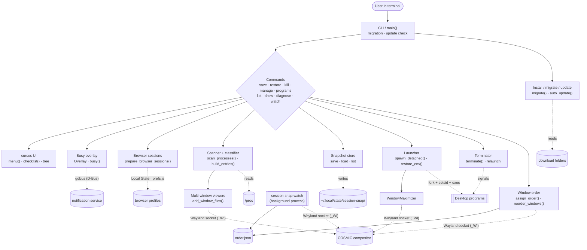

## Source structure

The file `session-snap` is divided into sections; each section starts with a comment line `# ===…`. The *Code Primer* explains every section with excerpts; the following table is the function reference.

Table: Function reference by section.

| Section | Functions and classes | Responsibility |
|--------------|----------------------------------------|----------------------|
| paths | `init_paths()`, `migrate_layout()` | XDG layout, `SESSION_SNAP_DIR` override, one-time move of the 1.8.0 layout |
| helpers | `check_not_root()`, `setup_logging()`, `load_config()`, `parse_maximize()` | guards, log, configuration (incl. `fullscreen`, `overlay`, `browser_session`) |
| /proc scan | `Proc`, `read_stat()`, `scan_processes()`, `argv_files()`, `argv_file_args()`, `file_cmd()`, `_read_environ()`, `launched_from()`, `fd_files()`, `desktop_exec_names()` | raw process data, exact restart command, origin |
| applications | `desktop_apps()`, `exec_tokens()`, `app_flag()`, `app_launch()`, `browser_family()`, `browser_app_windows()`, `app_window_entries()`, `desktop_aliases()`, `mime_of()`, `handlers_for()`, `load_programs()`, `save_programs()`, `program_cmd()`, `apply_programs()`, `player_of()`, `apply_player_options()` | desktop entries, MIME, program choice, start options |
| browser sessions | `chrome_data_dir()`, `chrome_profiles()`, `firefox_profile_dir()`, `annotate_browser_sessions()`, `firefox_set_resume()`, `end_background_browser()`, `prepare_browser_sessions()` | profiles at save, session restore at restore |
| entries | `is_look_var()`, `look_env()`, `session_look_env()`, `restore_env()`, `_entry()`, `_file_entries()`, `_flatpak_entries()`, `_host_entries()`, `build_entries()`, `signature()` | appearance variables, classification into entries, process identity |
| snapshots | `snapshot_name()`, `save_snapshot()`, `load_snapshot()`, `list_snapshots()`, `archive_dir()`, `list_archived()`, `rename_snapshot()`, `move_snapshot()`, `delete_snapshot()` | storage rule, atomic write, management |
| launching | `launch()`, `spawn_detached()`, `window_names()`, `window_mode()`, `_app_window_appears()`, `run_launches()` | checks, detached start, maximizing / fullscreen |
| busy overlay | `parse_overlay()`, `Overlay`, `busy()`, `overlay_keyboard()`; helper module `overlay_gtk.py` | progress display above all windows (GTK layer-shell helper with the system Python, fallback notification), cancel by button / Esc / Ctrl+C |
| menu entry | `ICON_FILE`, `desktop_entry_paths()`, `desktop_entry_text()`, `cmd_desktop_entry()` | `.desktop` file and the icon `src/session_snap/data/session-snap.svg` (package data) copied below `XDG_DATA_HOME` |
| terminating | `protected_pids()`, `kill_targets()`, `force_safe()`, `terminate()`, `_relaunch_apps()` | targets, signals (SIGKILL without question for players/viewers), relaunch |
| window control | `WaylandError`, `_Wl`, `app_matches()`, `WindowMaximizer` | Wayland wire protocol, maximizing, fullscreen |
| multi-window programs | `list_windows()`, `title_candidates()`, `recent_files()`, `inotify_dirs()`, `resolve_title()`, `add_window_files()` | images of single-instance viewers |
| window order | `watcher_alive()`, `watch_once()`, `cmd_watch()`, `install_watcher()`, `watcher_start_problem()`, `restart_watcher()`, `_match_windows()`, `current_order()`, `assign_order()`, `list_windows_states()`, `reorder_windows()` | background process, Alt-Tab order |
| installation / update | `static_version()`, `download_dirs()`, `find_downloads()`, `backup_file()`, `docs_dir()`, `_pdf_title()`, `doc_version()`, `install_docs()`, `migrate()`, `add_path_block()`, `cmd_install()`, `auto_update()`, `cmd_update()` | install, migration, update, documentation |
| curses UI | `_getkey()`, `menu()`, `checklist()`, `_fold_header()`, `checklist_folding()`, `scope_count()`, `choose_scope()`, `choose_programs()` | interactive interface, tree selection |
| commands | `cmd_save()`, `choose_order()`, `running_signatures()`, `cmd_restore()`, `cmd_kill()`, `cmd_manage()`, `cmd_programs()`, `cmd_diagnose()`, `cmd_list()`, `cmd_show()`, `cmd_config()`, `interactive_menu()` | user-visible functions |
| CLI | `build_parser()`, `main()` | arguments, aliases, exit codes |

**Files besides the code:** `src/session_snap/data/` holds package data installed with the program (the icon); `examples/` holds a sample of every file that lives outside the clone (`config.ini.sample`, `programs.ini.sample`, `privacy/denylist.sample.txt`, `privacy/allowlist.sample.txt`, the Lorem-ipsum `demo-snapshot.json` and `make_demo_media.py`); `docs/images/` holds the screenshots and the social preview of GitHub (`social-preview.svg` is the source of `social-preview.png`). Test T59d keeps the samples in step with the code; [CONTRIBUTING.md](../CONTRIBUTING.md) says where each file goes.

**Conventions:** standard library only; lines at most 99 characters (the PDF listings must not wrap); code and comments in English, user interface texts in German without umlauts; functions that touch the user's processes always re-validate the process identity.

<a id="sec-datamodel"></a>

# Data model

## Snapshot file

Table: Fields of a snapshot file (JSON, UTF-8 with surrogateescape).

| Field | Type | Meaning |
|-------|------|---------|
| `format` | int | file format version, currently 1 |
| `tool`, `version` | string | `session-snap`, tool version that wrote the file |
| `created` | string | ISO 8601 local time, seconds precision |
| `label` | string | free-text label (`-l`) |
| `host`, `user` | string | host name and user name |
| `session_type`, `desktop` | string | `XDG_SESSION_TYPE`, `XDG_CURRENT_DESKTOP` at capture time |
| `order_source` | string | `watch` (background process), `creation` (fallback) or empty (no window list) — since 1.7.0 |
| `entries` | list | recorded entries (below) |

Table: Fields of an entry.

| Field | Type | Meaning |
|-------|------|---------|
| `category` | string | `vlc` (videos; key kept for compatibility), `image`, `browser`, `rest` |
| `program` | string | binary name, Flatpak ID, or launcher name of an app window (e.g. `Claude`) |
| `cmd` | list | restart command (absolute binary + arguments) |
| `cwd` | string | working directory of the recorded process |
| `files` | list | recorded files (videos/images: exactly one per entry) |
| `pid`, `start` | int | PID and start time at capture time (informative; never used for signals without re-validation) |
| `flatpak` | string | Flatpak application ID or empty |
| `protect` | string | reason why `kill` must not touch the process, or empty |
| `app` | bool | present and `true` for a browser app window entry |
| `argv` | list | original command line of the process (videos/images) |
| `launched_from`, `launched_via` | string | desktop file ID of the launcher entry and how it was determined |
| `found_via` | string | `Fenstertitel '…'` for images recovered from a window title (since 1.5.0) |
| `env` | object | appearance variables of the recorded process (since 1.5.1; used only without desktop session) |
| `order` | int | Alt-Tab position, 0 = oldest (since 1.7.0) |

Fields added in later versions are read with defaults, so older snapshots remain valid. The run-time fields `via` (program chosen for a restore) and `started` (inserted player options) are never written to a snapshot.

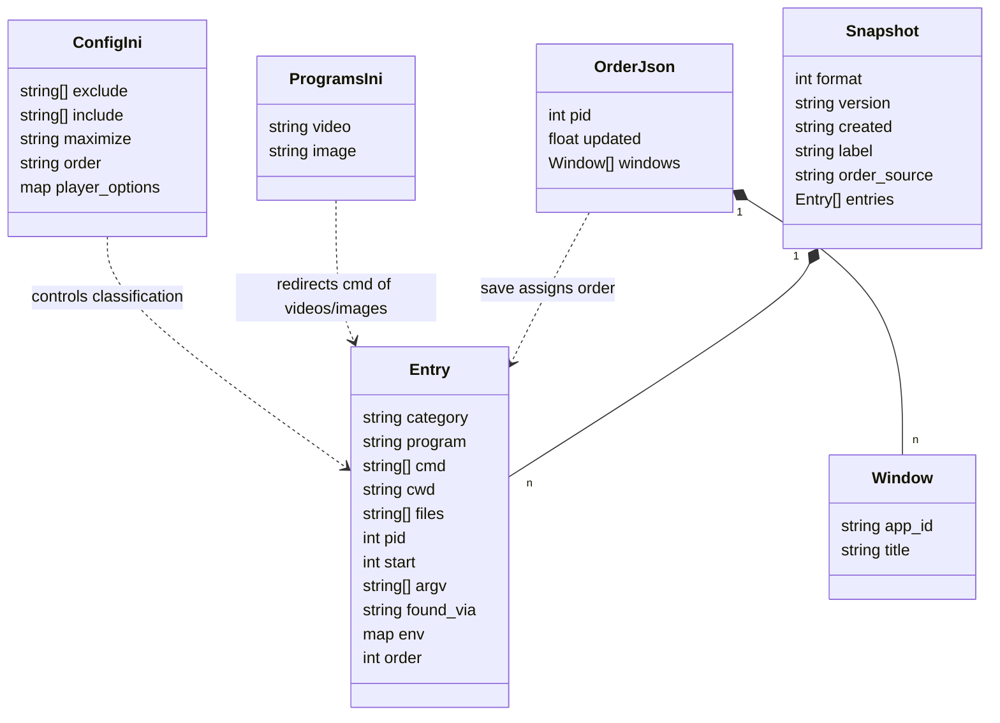

## order.json

Written by the background process after every change, atomically. `windows` is ordered from the oldest to the most recently activated window.

```json
{"pid": 2545, "updated": 1793220960.9,
 "windows": [{"app_id": "eog", "title": "Foto 1.png"},
             {"app_id": "vlc", "title": "Clip 2.mkv - VLC media player"},
             {"app_id": "mpv", "title": "Clip 1.mkv - mpv"},
             {"app_id": "eog", "title": "Foto 2.png"}]}
```

## programs.ini

Written atomically by the tool (temporary file + `os.replace`). Values are a [desktop file ID](glossary.md#gl-desktopid) or a plain command.

```ini
# written by session-snap: programs used to open videos/images on restore
# value = desktop-file ID (e.g. mpv.desktop) or a command (e.g. mpv)
[programs]
video = mpv.desktop
image = org.nomacs.ImageLounge.desktop
```

<a id="sec-algorithms"></a>

# Algorithms

<a id="sec-classification"></a>

## Classification

Every process of the user is examined once. Child processes that run the *same* executable as their parent, for example browser renderers, are collapsed into the parent. Flatpak processes are grouped by sandbox instance.

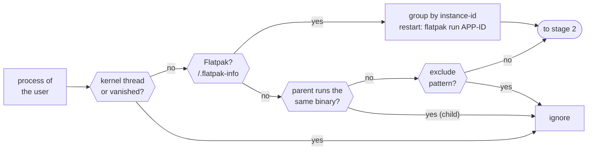

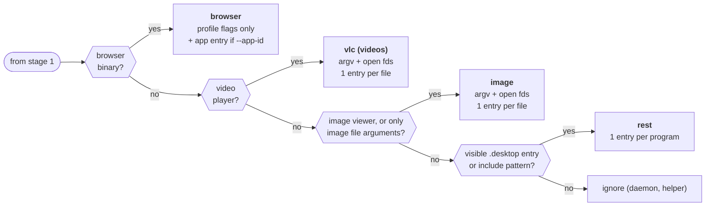

**One entry per file** for videos and images makes every file individually selectable and individually redirectable to another program. **The `.desktop` filter** for the rest category keeps helper processes (audio server, keyring, portals) out of the snapshot.

<a id="sec-identity"></a>

## Signature and process identity

* The [signature](glossary.md#gl-signature) identifies an entry **without** its PID.
  * For videos and images it is *(category, files)*; since 1.2.0 the program is deliberately not part of it, so that a file opened in mpv counts as the same entry as the file recorded in VLC.
  * For browsers and other programs it is *(category, program, arguments)*.
  * `restore` uses the signature to skip running entries; `kill` uses it to find the running process that belongs to a recorded entry.
* The [process identity](glossary.md#gl-identity) is the pair *(PID, start time)*. Before every signal the start time is re-read from `/proc/<pid>/stat`; if it differs, the PID has been reused and **no signal is sent** (test T23).

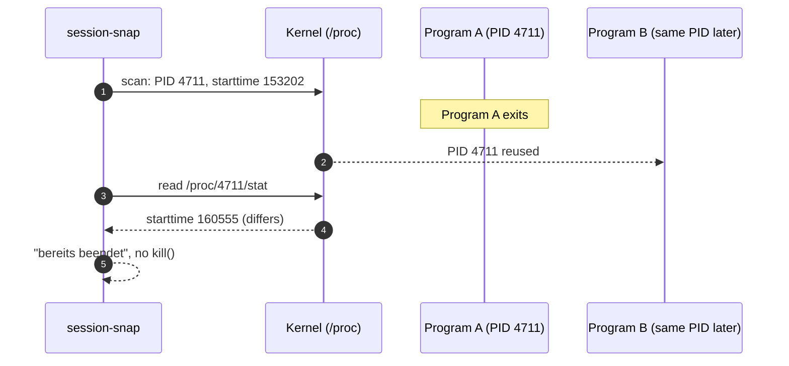

<a id="sec-exactalg"></a>

## Exact restart command

`argv_file_args()` returns the positions and resolved paths of all arguments that name existing files (plain paths, relative paths resolved against the working directory, `file://` URIs). `file_cmd()` builds the restart command for **one** file:

1. Argument 0 is replaced by the recorded executable (the absolute path from `/proc/<pid>/exe`), unless the process is a script whose interpreter differs from argument 0.
2. All file and URL arguments are removed; every option stays, including `--`.
3. The one file of the entry is inserted where the first file argument stood — after a `--` if there was one — or appended if the file was found only as an open file descriptor.

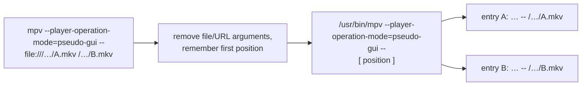

On restore, `apply_player_options()` inserts the configured [player options](glossary.md#gl-playeroptions) right after the program (or after `flatpak run APP-ID`), for videos only, and only options whose name is not already present.

## Origin of a process

`launched_from()` reads `/proc/<pid>/environ` and `/proc/<pid>/cgroup` (both readable for the owner):

* `GIO_LAUNCHED_DESKTOP_FILE` is set by GLib in the environment of a program it launches from a desktop entry (`gdesktopappinfo.c`, line 2941 in GLib 2.80.0); `gio-launch-desktop` adds `GIO_LAUNCHED_DESKTOP_FILE_PID` with the process ID of the launched program (`gio-launch-desktop.c`, line 249) [[glibsrc]](#ref-glibsrc). Because the environment is inherited, the value counts only if this PID equals the process or its parent.
* The systemd convention for application units [[systemdde]](#ref-systemdde) is shown below; the ApplicationID should map to the desktop file. The unit name is matched against all known desktop file IDs.

```text
app[-<launcher>]-<ApplicationID>[@<RANDOM>].service
app[-<launcher>]-<ApplicationID>-<RANDOM>.scope
```

The origin is informational; the restart always uses the recorded command line.

## Browser restart command and app windows

`browser_cmd()` reduces the recorded command line to the binary plus `--user-data-dir=`, `--profile-directory=`, `-P NAME`, `--profile PATH`, `-profile PATH`. Addresses and app flags are dropped, because the browser restores its own session.

`app_flag()` finds `--app-id=…` or `--app=…` in a browser command line. `app_launch()` searches all desktop entries, including hidden ones, for an `Exec` line that contains the same flag. If one is found, its name ("Claude") and its expanded `Exec` line become the app entry; otherwise the recorded command with the profile flags and the app flag is used.

In `kill_targets()`, app entries are indexed by PID **from the current scan**. Every target therefore carries the list of app windows living in its process (`relaunch`), regardless of which entries were selected.

<a id="sec-desktop"></a>

## Desktop applications and Exec expansion

`desktop_apps()` walks the `applications/` directories in XDG order: `$XDG_DATA_HOME`, then `$XDG_DATA_DIRS` [[basedir]](#ref-basedir). The [desktop file ID](glossary.md#gl-desktopid) is the path below `applications/` with `/` replaced by `-`; the first file with a given ID wins [[desktopspec]](#ref-desktopspec). Entries with `Hidden=true` or `NoDisplay=true` are skipped for the program choice [[desktopkeys]](#ref-desktopkeys) but included for the app-window lookup, because Chrome's launcher entries must be found in any case.

`exec_tokens()` expands an `Exec` line according to the [field codes](glossary.md#gl-fieldcode) of the specification [[desktopspec]](#ref-desktopspec):

Table: Field-code handling in exec_tokens().

| Code | Specification | session-snap |
|------|---------------|--------------|
| `%f`, `%u` | a single file / URL | replaced by the file path |
| `%F`, `%U` | a list of files / URLs | replaced by the one file path |
| `%i` | `--icon` + value of `Icon` | dropped (deviation; irrelevant for opening a file) |
| `%c` | translated `Name` | dropped (deviation) |
| `%k` | location of the desktop file | dropped (deviation) |
| `%d %D %n %N %v %m` | deprecated, to be ignored | removed |
| `%%` | literal `%` | `%` |
| none present | — | the file path is appended |

## MIME detection and candidate ranking

`mime_of()` uses `mimetypes.guess_type(path, strict=False)` [[pymimetypes]](#ref-pymimetypes), which reads `/etc/mime.types` [[mediatypes]](#ref-mediatypes). `handlers_for()` counts, for each application, how many of the given MIME types it declares, and sorts by that count (descending) and then by name. If the snapshot contains no file of a category, typical types are used (`video/mp4`, `video/x-matroska`, `video/webm` resp. `image/png`, `image/jpeg`, `image/gif`).

`apply_programs()` replaces the `cmd` of video/image entries by the chosen program's command and marks them with `via`. An unknown desktop file ID produces a warning; the entry then keeps its recorded command.

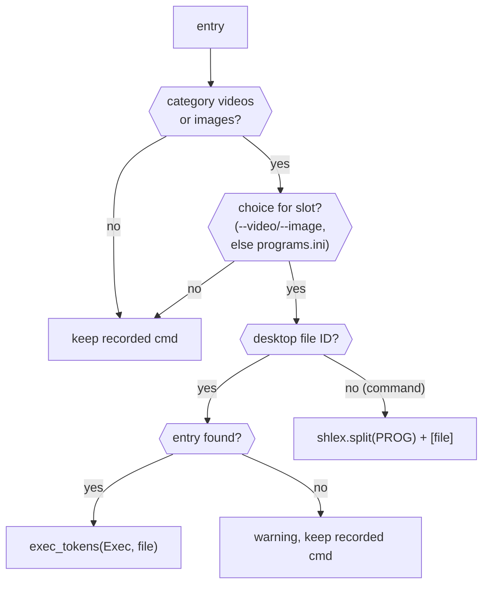

<a id="sec-alg-single"></a>

## Images of single-instance viewers

`build_entries()` ends with `add_window_files(entries, windows)`. Without a window list (no COSMIC) it returns the entries unchanged. Otherwise:

1. The image entries are grouped by process. For every window whose app_id belongs to one of these processes (`app_matches()`), the file-name candidates of its title are computed (`title_candidates()`: the whole title, the parts split at ` - `, ` – `, ` — `, ` | `, without a counter such as `(2/5)` and without a leading `*`).
2. A title that names an already recorded image keeps that entry.
3. Every other title is resolved by `resolve_title()` — inotify-watched folders first, then `recently-used.xbel` (same program first, newest first), then the known folders — and added as a new entry of the **oldest** process of that program (a single-instance program forwards new files to its first process). The new entry copies the recorded command and replaces only the file.
4. A recorded image whose program has windows but none showing it is dropped (window closed with Ctrl+W).
5. Every path is added only once, so two processes of a multi-process viewer never receive each other's files.

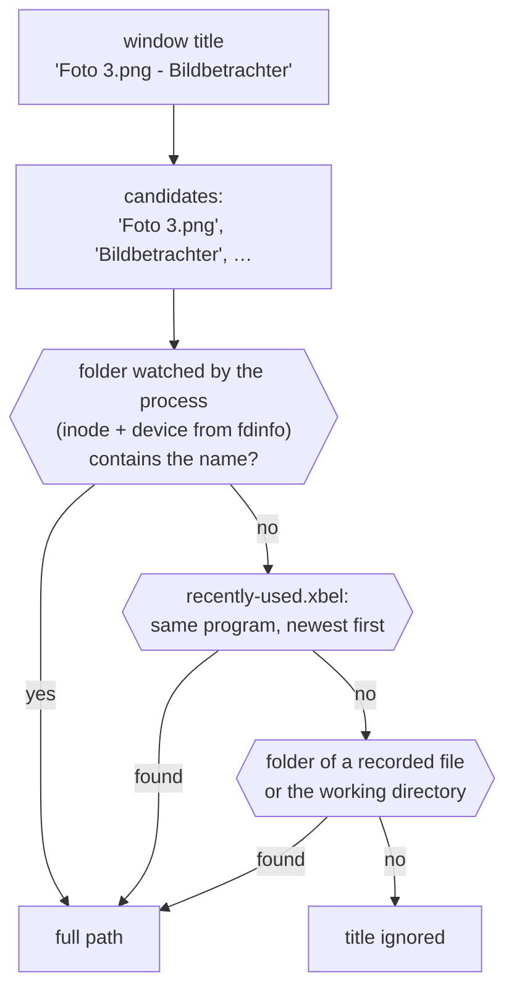

The device number in `fdinfo` is the kernel's internal `dev_t` (major in the upper 12 bits, minor in the lower 20 bits); it is compared with `os.major()`/`os.minor()` of the candidate folder.

<a id="sec-alg-look"></a>

## Appearance variables

`is_look_var()` decides by the [fnmatch](glossary.md#gl-fnmatch) patterns of `ENV_PATTERNS`. `session_look_env()` scans `/proc` once for a process of the same user whose name (`comm` or executable) is one of `SESSION_REFS`, in that priority, and returns its appearance variables. `restore_env()` builds the environment of a restored program: the current environment **without** any appearance variable, plus the variables of the session process — or, without a session process, those recorded in the entry. A variable that the template does not have is therefore removed, not inherited from the terminal. `run_launches()` determines the template once per restore and prints it.

<a id="sec-alg-order"></a>

## Alt-Tab order

**Recording (`watch_once()`).** On connect, the compositor announces all windows in creation order; the active window is moved to the end. From then on the [Wayland client](#sec-wire) calls an `on_done` callback for every `done` event of a window — that is, after every complete state update. If the window's state now contains *activated* (value 2) and did not before, it moves to the end of the list; a new window is appended; a closed window is removed. If the list changed, `order.json` is written atomically. Handling every single `done` event matters: with a periodic comparison, two activations within one period (fast Alt-Tab) would lose the first one — a defect found by test T51.

**Liveness.** The background process holds an exclusive [flock](glossary.md#gl-flock) on `watch.lock` for its whole life [[flock2]](#ref-flock2). `watcher_alive()` tries to take the same lock without waiting: if that fails, the process runs. The kernel releases the lock when the process ends in any way, including `SIGKILL`, so a stale lock file can never pretend a running process.

**Assignment at save (`assign_order()`).** The current windows are read with their *activated* flag. If the background process runs, `current_order()` orders them by `order.json`; windows that never appeared there (never activated) are placed first, as the oldest. Otherwise the creation order is used with the active window last (fallback). `_match_windows()` then assigns windows to entries: first all entries with a file (window title must contain the file name, app_id must match), then the others (app_id only); every window is used once. The index of the window becomes the entry's `order`.

**Rebuild at restore (`reorder_windows()`).** The programs are started sorted by `order`. Then session-snap binds the info protocol, the manager and a `wl_seat`, waits until the windows of all entries with a position exist (at most `maximize_timeout`, or 6 s without a new window), and sends `activate(window, seat)` for each of them, **oldest first**, with a round trip and 0.15 s pause after each. Because the switcher moves every activated window to the end of its list, the final list equals the recorded one; windows not in the snapshot are never activated and therefore stay behind.

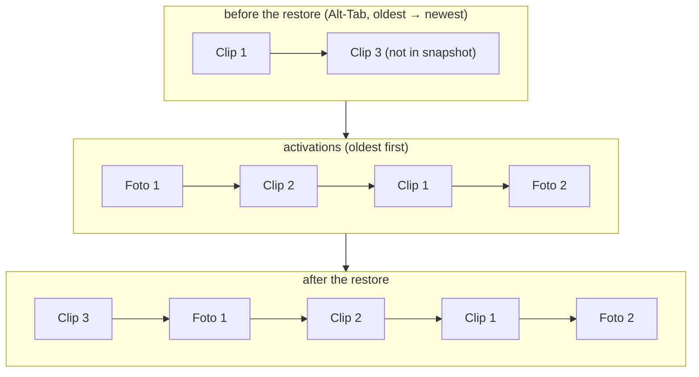

<a id="sec-alg-update"></a>

## Installation, layout move and update

* **Paths.** `init_paths()` derives the configuration, state and data folders from `XDG_CONFIG_HOME`, `XDG_STATE_HOME` and `XDG_DATA_HOME` (absolute values only, else the defaults); `SESSION_SNAP_DIR` puts everything into one folder (tests, and it disables the layout move).
* **Layout move.** `main()` calls `migrate_layout()` before every command. If `~/scripts/session-snap.d` exists, `stop_old_watcher()` first ends a watcher of the old version that still holds `watch.lock` there (only if `/proc/<pid>/cmdline` names `session-snap` and `watch`), then every file is moved with `_move_safe()`, which never overwrites: an identical target removes the source, a different one gets a time stamp.
* **install.sh** installs a tag with `pip install "session-snap @ git+<repo>@<tag>"` into the venv, checks `--version` against the tag, links `~/.local/bin/session-snap`, moves the two old program files out of `~/scripts` and rewrites the autostart entry (only lines naming the old program).
* **update.** `session-snap update` runs `src/session_snap/update/apply-release.sh` of the installed package with the version and venv of the running program (`ReleaseUpdater`); the script is the reference implementation of mediatools 1.14.1 with the names replaced.
* **reload.** `cmd_reload()` writes `watch.restart` and waits for `watch.answer`; `check_reload()` runs in `watch_once()` after every event (the order of that event is already stored), probes the installed release with `WatchRestart.installed_version()` and replaces the process with `os.execv(python, [python, "-m", "session_snap", "watch"])`.

<a id="sec-window"></a>

# Window control on COSMIC

## Why the compositor

Under Wayland, a program cannot move, resize or activate the windows of another program; only the compositor can [[wikiwayland]](#ref-wikiwayland). COSMIC offers two privileged protocols that are meant for panels, docks and the launcher:

Table: COSMIC protocol messages used (from the protocol definitions in cosmic-protocols).

| Interface | Version | Messages used |
|-----------|--------:|---------------|
| `zcosmic_toplevel_info_v1` | 1 | event 0 `toplevel(new_id)` — one handle per window |
| `zcosmic_toplevel_handle_v1` | 1 | events 0 `closed`, 1 `done`, 2 `title(string)`, 3 `app_id(string)`, 8 `state(array)`; state values 0 = maximized, 2 = activated |
| `zcosmic_toplevel_manager_v1` | 1 | event 0 `capabilities(array)` (2 = activate, 3 = maximize); requests 2 `activate(toplevel, seat)`, 3 `set_maximized(toplevel)` |
| `wl_seat` | 1 | bound only to pass it to `activate` |

Version 1 of the info protocol is used deliberately: in this version cosmic-comp sends title, app_id and state directly on the handle (`toplevel_info.rs`: `version() < REQ_GET_COSMIC_TOPLEVEL_SINCE`), so the additional protocol `ext-foreign-toplevel-list-v1` is not needed [[cosmiccomp]](#ref-cosmiccomp), [[cosmicproto]](#ref-cosmicproto), [[wlinfo]](#ref-wlinfo), [[wlmgmt]](#ref-wlmgmt). cosmic-comp's `activate` handler un-minimizes the window, switches to its workspace and gives it the keyboard focus; if the seat object were missing, it would use the last active seat (`toplevel_management.rs`).

## Who may use them

cosmic-comp creates both globals with the filter `client_not_sandboxed`: a client may use them unless it connected with a security context of a sandbox engine other than `com.system76.CosmicPanel` (`src/state.rs`). A program started from a normal terminal or from the autostart has no security context and therefore has access; a Flatpak application would not. This filter and the capability list (close, activate, maximize, minimize, move to workspace) are identical in `epoch-1.0.0`, `epoch-1.5.0` and on the main branch of 14 October 2026 [[cosmiccomp]](#ref-cosmiccomp).

<a id="sec-wire"></a>

## Built-in Wayland client

To avoid any dependency, session-snap contains a minimal implementation of the [Wayland wire protocol](glossary.md#gl-wire) (class `_Wl`, about 130 lines):

* Connection: Unix socket `$XDG_RUNTIME_DIR/$WAYLAND_DISPLAY`. The background process, which may be started without `WAYLAND_DISPLAY`, uses the first `wayland-*` socket it finds.
* Message: object ID (32 bit), then size (upper 16 bit) and opcode (lower 16 bit), then the arguments in native byte order, each padded to 4 bytes; strings with length including the terminating zero.
* Objects: the client allocates IDs from 2 upwards (1 is `wl_display`); IDs of handles created by the server come from the server range.
* Requests used: `wl_display.get_registry`, `wl_display.sync`, `wl_registry.bind`, `zcosmic_toplevel_manager_v1.activate`, `zcosmic_toplevel_manager_v1.set_maximized`.
* Callback: `on_done(handle)` after every `done` event (since 1.7.0, for the background process).

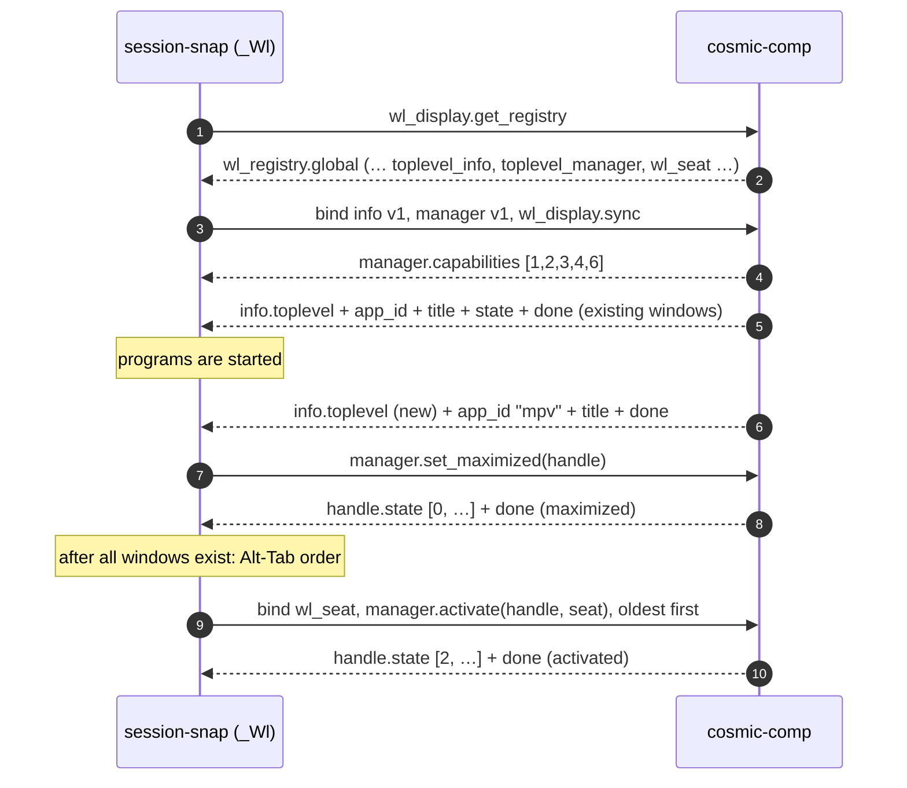

## Matching windows to programs and files

The protocols carry no process ID. A window is assigned by:

1. **New** (maximizing only): it did not exist when session-snap connected, i.e. before the first start.
2. **app_id:** it belongs to the program. Candidate names per entry are the player name, the binary name, the program name and the origin desktop ID (`window_names()`). `app_matches()` compares them with the app_id, also by components of reverse-DNS IDs (`org.gnome.eog` ↔ `eog`; generic parts such as `org`, `gnome`, `kde` are ignored).
3. **Title** (single-instance viewers, Alt-Tab order): the file name of the entry is one of the title's candidates.

Measured app_ids: mpv `mpv` (native Wayland), VLC `vlc` (Qt via XWayland, from the X11 window class), GNOME image viewer `eog`.

**Timing of maximizing.** session-snap waits until as many windows as started programs have been maximized, but at most `maximize_timeout` seconds (default 20), and stops early if no new matching window has appeared for 6 seconds.

**Error handling.** Without Wayland socket, without the globals (not COSMIC, sandbox) or without the capability, a `WaylandError` is raised and only a hint is printed; the programs are started normally.

<a id="sec-process"></a>

# Process control

## Detached start

`spawn_detached()` uses the classic double fork:

1. `fork()` creates an intermediate child.
2. The intermediate child calls `setsid()` ([new session](glossary.md#gl-session)), forks the program and exits at once; the parent reaps it immediately.
3. The grandchild changes to the working directory, connects stdin/stdout/stderr to `/dev/null` and calls `execvp()` — or `execvpe()` with the environment from `restore_env()`.

The program is thus re-parented to the session's subreaper or to init. It has no controlling terminal, survives the end of session-snap and the closing of the terminal, and can never become a zombie of session-snap. Errors of `exec()` are reported through a pipe that is created non-inheritable (`O_CLOEXEC`) and therefore closes automatically on a successful `exec()` (test T27).

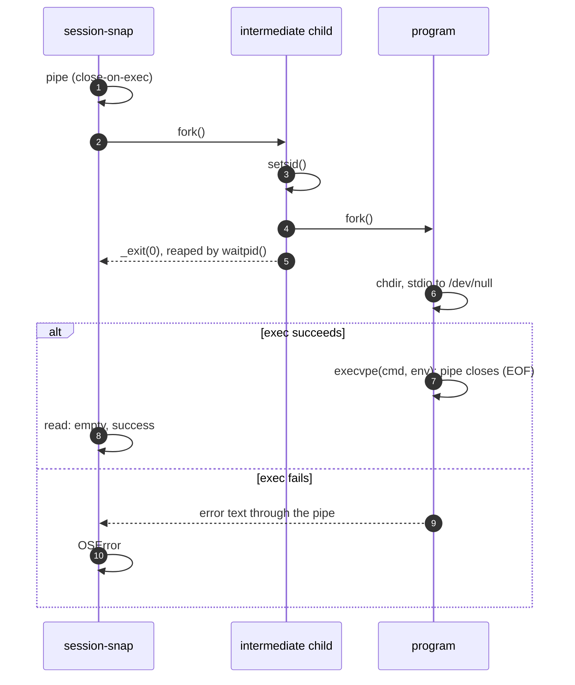

<a id="sec-terminate"></a>

## Termination and relaunch

`terminate()` sends SIGTERM to every target (after the identity check) and polls every 100 ms until the timeout. Survivors that are players or pure image viewers (`force_safe()`: category *Videos*, or *Bilder* without an image editor such as GIMP, Krita, Inkscape or darktable) receive SIGKILL immediately, without a question (since 1.7.5). Other survivors receive SIGKILL only with `--force` or after confirmation. Finally `_relaunch_apps()` is called for all targets that have ended. Several entries of one process — for example five images in one viewer — form **one** target with one signal.

## The background process

`session-snap watch` (`cmd_watch()`) takes the lock, writes its PID into `watch.lock`, and runs `watch_once()` on a new connection in an endless loop: if the compositor is not there, it waits 5 s; if the connection breaks, it waits 2 s and reconnects. `watch --stop` sends SIGTERM to the PID from the lock file, but only if the lock is actually held. `restart_watcher()` stops a running instance and starts the installed program detached with `spawn_detached()`.

<a id="sec-storage"></a>

# Storage and logging

The data live in the XDG folders `~/.config/session-snap/` and `~/.local/state/session-snap/`; `SESSION_SNAP_DIR` puts everything into one folder ([layout](user.md#sec-layout)).

* Snapshot names follow `session-snap_YYYY-MM-DD_HH-MM-SS.json` in `snapshots/`; lexical order equals chronological order. A second capture within the same second receives `_1`, `_2`, … (test T04).
* Snapshots, `programs.ini`, `order.json` and installed programs are written [atomically](glossary.md#gl-atomic) (temporary file + `os.replace()`).
* File names that are not valid UTF-8 are preserved byte-exact via [surrogateescape](glossary.md#gl-surrogateescape) [[pep383]](#ref-pep383) (test T05).
* **Nothing is deleted automatically**; backups in `backup/` are never overwritten.
* The log `logs/session-snap.log` records `snapshot saved`, `restore from`, `launch ok/FAILED`, `kill SIGTERM/SIGKILL`, `relaunch app`, `programs saved`, `look environment from …`, `reordered n of m windows`, `migration: …`, `update: installed …` and the start of the background process, with time stamps.

<a id="sec-verification"></a>

# Verification

## Test strategy

The test suite `test_session_snap` uses only the Python standard library ([unittest](glossary.md#gl-unittest), `unittest.mock` [[pyunittest]](#ref-pyunittest)). It has four parts:

* **Unit tests** check pure functions in isolation.
* **Integration tests** start real processes and check capture, restore, kill and relaunch end to end. The processes under test are *dummies*: copies of the Python interpreter named `vlc`, `eog`, `fakeapp`, `childapp`, `hiddenapp`, `chrome`, `firefox`, `fakeplayer`, `fakeviewer` and `cosmic-panel` in a temporary directory. A dummy behaves like the real program in exactly the aspects that session-snap observes: binary name, command line, open file descriptor, inotify watch, environment, signal handling.
* **Compositor tests** use `FakeCosmic`, a small Wayland server in the test suite that speaks the wire protocol of the COSMIC toplevel protocols: it announces windows, answers `set_maximized` and `activate`, and sends state changes to all connected clients.
* **Interactive and installation tests** run the real program in a [pseudo-terminal](glossary.md#gl-pty) [[pypty]](#ref-pypty) or as a subprocess with a temporary `HOME`.

**Safety on a real desktop.** Every process list in the tests is filtered to binaries inside the temporary directory; installation tests use a temporary `HOME`; the update test never executes a downloaded file. Real programs are never recorded into test snapshots and never signalled.

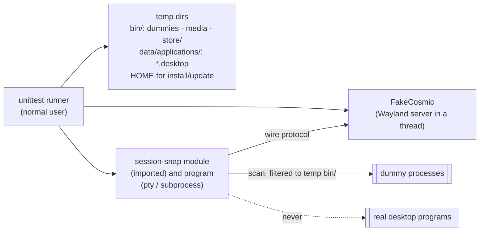

## Running the tests

The tests are pytest modules in `tests/` (the program tests are `unittest.TestCase` classes, which pytest runs as well). Run them as the normal user in the clone; `tools/check.sh` runs them with branch coverage:

```bash
cd ~/Projects/session-snap && .venv/bin/python -m pytest -q
```

Processes started with `python -m session_snap` (restore and kill through a pseudo-terminal, the layout move) are measured too: `[tool.coverage.run] patch = ["subprocess"]` in `pyproject.toml`.

<a id="sec-gates"></a>

## Quality gates

Every push must pass the seven gates of the dev-conventions. `tools/check.sh` runs them locally, the pre-push hook `.githooks/pre-push` runs it before every push, and GitHub Actions runs it for every pull request with Python 3.12 and 3.14 (`.github/workflows/tests.yml`).

Table: Quality gates.

| Gate | Tool | Criterion |
|------|------|-----------|
| privacy | `tools/privacy_scan.py` | no term of the local deny list `~/.config/session-snap/privacy/denylist.txt` and no label of the user's own snapshots in any file of any commit, in any path, commit message or tag annotation of the whole history; without any local term the gate fails (exit 2), only in CI (`CI=true`) it is skipped |
| shell | shellcheck | no finding in `install.sh`, `tools/*.sh`, the hook and `apply-release.sh` |
| format | pycodestyle | no finding, line length 100 |
| lint | pylint with docparams | 10.00/10 incl. Google-style docstrings (Args, Returns, Yields, Raises) |
| types | mypy | no error |
| security | bandit | no finding; skipped checks and every `# nosec` are justified in place |
| tests | pytest + coverage | all pass; branch coverage at least 90 % (2.0.0: 90.2 %) |

Set-up once per clone, as the normal user (only `shellcheck` and `python3-venv` need `sudo`, because apt writes to `/usr`):

```bash
sudo apt install shellcheck python3-venv
cd ~/Projects/session-snap && python3 -m venv .venv && .venv/bin/pip install -e '.[dev]' && git config core.hooksPath .githooks
tools/check.sh
```

`check.sh` activates `.venv` itself; `--fast` skips the tests while editing.

**Should the tests be built into the tool?** No. A separate test program keeps the tool small; the tests can create temporary files, processes and homes without affecting the installed tool; and both are installed and updated together.

## Test catalogue and results

Table: Test catalogue. Result: PASS on Python 3.11, 3.12 and 3.13 (Ubuntu 24.04.5 base), all with `-W error::ResourceWarning`.

| ID | Test | Req. | Result |
|-----|--------------------------------------------------------------------|--------|------|
| T01 | argv parsing: relative, absolute, `file://` URI; options, URLs and missing files skipped | R2 | PASS |
| T02 | `.desktop` parsing: `env` prefix resolved, `NoDisplay` excluded, interpreters ignored | R3 | PASS |
| T03 | signature identical for the same file under a different PID | R7, R9 | PASS |
| T04 | naming rule `session-snap_DATE_TIME.json` in `snapshots/`, same-second suffix, newest first | R4 | PASS |
| T05 | round trip keeps umlauts and non-UTF-8 file names byte-exact | R1, R2 | PASS |
| T06 | `config.ini`: overrides applied, invalid number ignored, broken file gives defaults | — | PASS |
| T07 | key decoding: `ESC[B`, `ESC O B`, `ESC[6~`, lone Esc, unknown sequence | R8 | PASS |
| T08 | CLI aliases `--kill` / `-k` with all options; `--no-relaunch` passed through | R9 | PASS |
| T09 | protected chain contains own process and parent | R9 | PASS |
| T10 | root guard exits when the effective UID is 0 | R14 | PASS |
| T11 | capture: video via open fd, images via args/URI, rest via `.desktop`, hidden excluded | R1–R3 | PASS |
| T12 | child process with the same binary is not recorded separately | R3 | PASS |
| T13 | `save -y -l LABEL`: snapshot with label and all four entries | R4, R10 | PASS |
| T14 | `restore --all`: every entry restarted, identical signatures afterwards | R7 | PASS |
| T15 | `restore --all` twice: second run starts nothing | R7 | PASS |
| T16 | deleted file: reported, exit code 1, the others still start | R7 | PASS |
| T17 | `restore --dry-run`: commands listed, nothing started | R7 | PASS |
| T18 | interactive restore with the tree: `2`, `n`, Down, → (long path completely visible, no word cut), Down (`ESC O B`), Down, →, Down, Space, Enter: exactly one start | R6–R8, R35 | PASS |
| T19 | `kill --all`: every recorded process ends with SIGTERM, exit code 0 | R9 | PASS |
| T20 | `kill --dry-run`: nothing is signalled | R9 | PASS |
| T21 | SIGTERM ignored by a normal program: without `--force` exit 1 and alive; with `--force` SIGKILL ends it. A player ignoring SIGTERM gets SIGKILL without a question | R9, R39 | PASS |
| T22 | process in the caller's own chain is reported, never signalled | R9 | PASS |
| T23 | wrong start time means "already ended", no signal sent | R9 | PASS |
| T24 | `save --kill -y`: snapshot written, then the saved programs terminated | R9 | PASS |
| T25 | full cycle save → kill → restore yields the same signatures | R1–R9 | PASS |
| T26 | `init_paths()`: XDG variables win if absolute, else defaults below HOME | R28 | PASS |
| T27 | launch is detached (own session, not a child); exec errors and missing programs reported | R7 | PASS |
| T28 | browsers: own category, restart keeps only the profile; Claude app window recorded with the launcher's Exec | R15, R16 | PASS |
| T29 | Exec expansion: `%f`/`%U` replaced, other codes dropped, path appended if no code | R17 | PASS |
| T30 | kill: Chrome ends although the app window was not selected; Claude started again; `--no-relaunch` suppresses it | R15, R16 | PASS |
| T31 | `programs`: lists installed handlers per type, saves and resets the choice | R18, R19 | PASS |
| T32 | `restore --video/--image`: files open in the chosen programs; a second restore sees them as running | R17 | PASS |
| T33 | saved choice used; unknown desktop ID falls back to the recorded program with a warning | R17, R19 | PASS |
| T34 | `file_cmd`: original options and `--` kept, file/URL arguments replaced by the one file | R21 | PASS |
| T35 | capture → kill → restore: the restored process has exactly the original program and options | R21 | PASS |
| T36 | player options inserted after the binary or after `flatpak run APP`, not duplicated, only for videos; `--play` suppresses them | R22 | PASS |
| T37 | origin from `GIO_LAUNCHED_DESKTOP_FILE` and from systemd unit names | R21 | PASS |
| T38 | unreadable `XDG_DATA_DIRS` entry skipped; `diagnose` reports recorded processes and reasons | R24 | PASS |
| T39 | `maximize` parsing and app_id matching | R23 | PASS |
| T40 | maximizer leaves existing and foreign windows alone, maximizes new windows, state confirmed | R23 | PASS |
| T41 | without COSMIC globals, maximize capability or Wayland session: clear error, no crash | R23 | PASS |
| T42 | window title parsing; `recently-used.xbel` parsing (newest first, program names, GTK quoting) | R25 | PASS |
| T43 | `add_window_files`: one entry per window; closed window drops its file; multi-process viewer not mixed; no windows → unchanged | R25 | PASS |
| T44 | real process with inotify watch + simulated COSMIC: 1 file in argv, 5 windows → 5 images recorded and restored | R25 | PASS |
| T45 | VLC default options contain `--no-one-instance-when-started-from-file` and `--input-repeat=65535`; template line | R26, R33 | PASS |
| T46 | appearance variables recorded (never the whole environment) and set again on restore without session process | R27 | PASS |
| T27 | `migrate_layout()`: files move into the XDG layout; identical target removes the source, a different one is kept; idempotent | R28 | PASS |
| T28 | a folder that cannot be emptied stays and is reported | R28 | PASS |
| T29 | first start of 2.0.0 moves and reports; the PATH block stays and is mentioned | R12, R28 | PASS |
| T30 | the watcher of 1.8.0 is ended before its lock moves - only a real `session-snap … watch` | R28 | PASS |
| T31–T34 | `--install` explains install.sh; `update` runs the bundled script; reload request and answers; `reload` command | R29 | PASS |
| T50 | restore follows the current desktop session (dark) although the snapshot recorded light | R27 | PASS |
| T51 | background process follows activations (most recent last), writes `order.json`; liveness via lock | R31, R32 | PASS |
| T52 | positions at save (background process and fallback); restore activates oldest first; unrelated windows untouched | R31, R32 | PASS |
| T53 | defaults: images fullscreen, videos maximized, `fullscreen` wins; `set_fullscreen` without announced capability | R34 | PASS |
| T54 | without graphical session `watch --start` reports "NICHT gestartet" with the reason | — (defect #20) | PASS |
| T55 | window title with a counter in the middle yields the file name | R25 (defect #21) | PASS |
| T56 | interactive kill with the tree: root deselects all, category selected and unfolded, legend shown; only that category ends | R35 | PASS |
| T57 | restore menu shows "n von m – x laufen bereits"; kill menu plain counts | R36 | PASS |
| T58 | eog and nomacs get `--fullscreen` for images, the COSMIC image viewer gets no option; no duplicates | R34 | PASS |
| T59 | overlay style `notify`: notification with button *Abbrechen*, updates replace the same notification, closed at the end; button press interrupts like Ctrl+C; without bus nothing | R38 | PASS |
| T59b | overlay styles `fullscreen` / `corner` with a fake helper: one JSON line per step, keyboard off/on, "cancel" interrupts like Ctrl+C; helper unavailable or missing Python → notification; config and environment select the style | R38 | PASS |
| T59c | `desktop-entry`: entry and icon below `XDG_DATA_HOME`, terminal cosmic-term / x-terminal-emulator / `Terminal=true`, unchanged files kept, `--remove` | R46 | PASS |
| T60 | app window of a Chrome started without `--app-id` found through the window list; kill starts it again | R40 | PASS |
| T61 | window matching by desktop ID, without `-bin`, as `google-chrome`, web apps only by app id | R31 | PASS |
| T62 | browser without window does not count as running; with window, or without window list, it does | R42 | PASS |
| T63 | rename, archive, bring back, delete (after confirmation), also through the menu | R37 | PASS |
| T64 | Chrome identity ignores `--profile-directory`; another `--user-data-dir` is another Chrome; kill ends a Chrome started through an app | R40 | PASS |
| T65 | Chrome profiles from `Local State`; restore command without `--profile-directory`, with `--restore-last-session`; app window opened by the session not started twice | R41 | PASS |
| T80–T86 | 2.0.0: kill compares with the live state, shows side effects, keeps browsers unless confirmed; window list retried; capture warning | R14 (defect #28) | PASS |
| T66 | Firefox profile from the open `.parentlock`; `prefs.js` untouched while running; afterwards `resume_session_once` set once, other prefs kept, backup | R41 | PASS |

Static checks: `pyflakes` [[pyflakes]](#ref-pyflakes) reports no findings for the tool or the test suite.

<a id="sec-e2e"></a>

## End-to-end runs with real programs

cosmic-comp was built from source (main branch, commit `742b800b`, 14 October 2026) and run nested (winit backend in Xvfb, with Xwayland) as a normal user. mpv 0.37.0, VLC 3.0.20 and the GNOME image viewer 45.3 were installed from Ubuntu 24.04 — the same versions as on Pop!_OS 24.04. Only video and audio outputs were adapted to the machine without GPU and sound (`--vo=wlshm`, `--ao=null`, `--aout=dummy`). All runs below were repeated with version 1.7.0 for this document; their outputs are the captures shown in Part I.

Table: End-to-end runs.

| ID | Run | Result |
|----|-----|--------|
| E0 | mpv started like `mpv.desktop`; recorded and restored | identical options, `pause` = true (mpv IPC) |
| E1 | save → kill → `restore --all` with mpv, VLC and image viewer | 3 started, 3 windows maximized; original options present |
| E2 | VLC restored with `--start-paused` | paused, playback time stays 0 |
| E3 | windows checked again after 3 s and 8 s | still maximized |
| E4 | eog with 5 images (one process): save, kill, restore | 5 entries (4 via window title), 1 signal, 5 windows again, maximized |
| E5 | 3 VLC videos as started from the file manager (`--started-from-file`) | 3 processes, MPRIS status `Paused` for each |
| E6 | Alt-Tab order *Foto 1, Clip 2, Clip 1, Foto 2* recorded by `watch`; save, kill, restore | same order afterwards (read from `order.json` of the background process) |
| E7 | Clip 1 already open, unrelated Clip 3 opened after it; restore | Clip 3 behind; Clip 1 between Clip 2 and Foto 2; fallback reported without background process |
| E8 | `--install` on a copy of the 1.5.0 installation; update to a newer version at start; `--update` list | migration as shown; backup `session-snap v1.7.0.py`; restart with the new version (test home) |

These end-to-end runs were **not** repeated for 1.7.1–1.7.10; the new functions are covered by the automated tests (with simulated compositor, notification service and browsers) and by the user's reports from the target system named in the text. What these runs do **not** show: the behaviour on the real Pop!_OS desktop with GPU, its COSMIC version, tiling mode, `cosmic-panel` (appearance template), the real switcher, and the autostart at login. The appearance fix was confirmed by the user on the target system (1.6.1, 28 October 2026).

## Defects and design changes

Table: Defects found and fixed, and design changes, over all versions.

| # | Version | Finding | Fix |
|---|---------|----------------------------------------|------------------------------------|
| 1 | 1.1.0 | A relative program path could only be restarted with the stored working directory. | Relative `argv[0]` is made absolute against `cwd`. |
| 2 | 1.1.0 | An arrow key sent as `ESC [ B` in application cursor mode aborted the dialog. | `_getkey()` decodes both encodings. |
| 3 | 1.1.0 | Ubuntu's default `~/.profile` causes a duplicate `~/.local/bin`. | Normalising POSIX block in both rc files. |
| 4 | 1.1.0 | `ResourceWarning`: log handler not closed; started programs owned by a never-waited `Popen`. | Handler closed; double fork + `setsid`. |
| 5 | 1.2.0 | First design protected browser processes with app windows from `kill`. | Replaced, by the user's decision, with terminate-and-relaunch. |
| 6 | 1.2.0 | With the program in the signature, a file opened in mpv instead of VLC would be started twice. | Signature of videos/images without program. |
| 7 | 1.1.0–1.2.0 | Several download cards with the same file name but different contents. | One fixed delivery path; hashes in the [release table](#sec-release). |
| 8 | 1.2.0 | Restart used only the program binary; original options were lost. Found with the real mpv. | Original command line stored; `file_cmd()` replaces only the file arguments. |
| 9 | 1.2.0 | An unreadable directory in `XDG_DATA_DIRS` aborted the program. | Unreadable directories are skipped. |
| 10 | 1.3.0 | First design maximized only mpv (own option); VLC has none. | Uniform maximizing through the compositor. |
| 11 | ≤ 1.4.0 | Only the first image of a single-instance viewer was recorded (reported by the user). | Window titles + path resolution (1.5.0). |
| 12 | ≤ 1.4.0 | VLC from the file manager: restored videos replaced each other in one instance. | `--no-one-instance-when-started-from-file` (1.5.0). |
| 13 | 1.5.0 | `recently-used.xbel` stores `exec="'eog %u'"`; the program name was read as `eog %u`. Found by test T42. | One-token result is split again. |
| 14 | 1.5.0 | Output piped into `head` ended with a `BrokenPipeError` traceback. | Quiet exit. |
| 15 | ≤ 1.5.0 | Restored image viewer light while the desktop was dark (reported by the user). | 1.5.1 replayed the recorded variables — insufficient when the snapshot itself was taken in light mode; 1.6.1 takes them from the desktop session. |
| 16 | ≤ 1.5.0 | The installer installed only the file next to itself; an old installer could install an old version over a newer one. | Installer replaced by `--install`; no downgrade without confirmation. |
| 17 | 1.6.0 | Installation into a missing `~/scripts` failed. Found by test T48. | Target folder created. |
| 18 | 1.6.0 | During `--install` the log was opened before the old log had been moved, which produced a second log file. | Log opened after the migration. |
| 19 | 1.7.0 | The background process compared states periodically and lost an activation when two happened within one period. Found by test T51. | Update on every `done` event. |
| 20 | 1.7.0 | `--install` reports "gestartet" for the background process although it was not started when no graphical session exists ([migration](user.md#sec-migration)). | Fixed in 1.7.1: `restart_watcher()` returns whether it started; the reason is printed; a running instance is left alone. Test T54. |
| 21 | 1.5.0 | `title_candidates()` drops every candidate that contains a `/`; a title with a counter in the middle, e.g. `Foto 2.png (2/5) - Bildbetrachter`, therefore yields only `Bildbetrachter` (found while writing the Code Primer). A counter at the end (`… (2/5)`) works. | Fixed in 1.7.1: the counter is removed wherever it stands. Test T55. |
| 22 | 1.7.0 | Several deliveries carried the same version number 1.7.1 with different contents; the update at start could not tell them apart. | Every delivery gets its own number (1.7.2 ff.). |
| 23 | ≤ 1.7.4 | Claude was not started again after `kill` when it had been opened in an already running Chrome (reported by the user). | App windows also found through the window list (1.7.5). Test T60. |
| 24 | ≤ 1.7.4 | Alt-Tab positions missing for Chrome, Firefox, the terminal and others: program name and window app_id differ (`firefox-bin` / `firefox`, `cosmic-term` / `com.system76.CosmicTerm`). Seen in a snapshot of the user. | Matching by desktop ID, `StartupWMClass`, without `-bin` (1.7.5). Test T61. |
| 25 | ≤ 1.7.5 | A Chrome running in the background without a window counted as "already running" (reported by the user). | Browsers count only with a window (1.7.6). Test T62. |
| 26 | ≤ 1.7.7 | `kill` did not end a Chrome started through an app when the snapshot came from a plain Chrome start (`ps` on the target system). | Chrome identity = family + user data directory (1.7.8). Test T64. |
| 27 | 1.7.1 | The tree selection wrapped paths for the full width although entries are indented; the end of long paths was cut off (found in the captures for this document). | Wrapped to the indented width (1.7.10). Test T18 checks every word of a long path. |
| 28 | ≤ 1.8.0 | Under heavy load (a video encode on all cores) the window list of the compositor did not answer within 2 s; single-instance viewers then looked as if they showed only their first image ("Nur Bilder (2)" with 17 images open), and "Beenden" did not compare the snapshot with what was open (reported by the user, 21 Nov 2026). | Window list retried with 6 s, visible warning and question before saving an incomplete capture; kill compares with the live state, shows side effects and keeps browsers unless confirmed; menu choice logged (2.0.0). Tests T80–T86. |

## Full test output

Output of `python3 -m pytest -v` for 2.0.0 (Python 3.12, normal user); the folder prefix `tests/` and the progress percentages were removed to fit the page width.

```text
test_apply_release.py::test_list_shows_releases_archives_and_leftovers PASSED
test_apply_release.py::test_feature_archive_is_released_without_questions PASSED
test_apply_release.py::test_merge_only_archives_chain_until_the_release PASSED
test_apply_release.py::test_question_declined_keeps_the_archive PASSED
test_apply_release.py::test_wrong_base_stops_before_any_change PASSED
test_apply_release.py::test_patch_that_does_not_apply_leaves_a_clean_clone PASSED
test_apply_release.py::test_newer_release_is_installed_first PASSED
test_apply_release.py::test_help_and_unknown_option PASSED
test_apply_release.py::test_inherited_variables_never_delete_the_script PASSED
test_apply_release.py::test_control_variables_are_not_exported PASSED
test_apply_release.py::test_update_subcommand_forwards_options PASSED
test_release_tools.py::test_feature_not_merged_without_yes PASSED
test_release_tools.py::test_feature_merged_through_pull_request PASSED
test_release_tools.py::test_merge_only_with_yes PASSED
test_release_tools.py::test_feature_then_release_and_install PASSED
test_release_tools.py::test_develop_non_interactive[args0-v1.1.1] PASSED
test_release_tools.py::test_develop_non_interactive[args1-v2.0.0] PASSED
test_release_tools.py::test_develop_non_interactive[args2-v1.2.0] PASSED
test_release_tools.py::test_feature_with_part_from_update PASSED
test_release_tools.py::test_release_declined_keeps_everything_local PASSED
test_release_tools.py::test_hotfix_while_develop_collects PASSED
test_release_tools.py::test_hotfix_conflict_with_develop PASSED
test_release_tools.py::test_red_checks_merge_nothing PASSED
test_release_tools.py::test_failed_tag_check_is_reported PASSED
test_release_tools.py::test_hotfix_refusals PASSED
test_release_tools.py::test_release_refusals PASSED
test_release_tools.py::test_empty_message_refused PASSED
test_release_tools.py::test_gates_run_before_anything_is_pushed PASSED
test_release_tools.py::test_rebase_conflict_changes_nothing PASSED
test_release_tools.py::test_same_code_yes_no PASSED
test_selfrestart.py::test_command_drops_markers_and_old_log PASSED
test_selfrestart.py::test_installed_version_answers PASSED
test_selfrestart.py::test_installed_version_rejects[broken-0] PASSED
test_selfrestart.py::test_installed_version_rejects[demo 1.3.0-1] PASSED
test_selfrestart.py::test_missing_release_and_failing_exec PASSED
test_selfrestart.py::test_default_interpreter_is_running_one PASSED
test_session_snap.py::T1_Unit::test_01_argv_files PASSED
test_session_snap.py::T1_Unit::test_02_desktop_names PASSED
test_session_snap.py::T1_Unit::test_03_signature_pid_independent PASSED
test_session_snap.py::T1_Unit::test_04_naming_rule_and_order PASSED
test_session_snap.py::T1_Unit::test_05_roundtrip_umlaut_and_non_utf8 PASSED
test_session_snap.py::T1_Unit::test_06_config PASSED
test_session_snap.py::T1_Unit::test_07_key_decoding PASSED
test_session_snap.py::T1_Unit::test_08_cli_aliases PASSED
test_session_snap.py::T1_Unit::test_09_protected_chain PASSED
test_session_snap.py::T1_Unit::test_10_root_guard PASSED
test_session_snap.py::T1_Unit::test_57_restore_menu_counts PASSED
test_session_snap.py::T1_Unit::test_58_eog_fullscreen_option PASSED
test_session_snap.py::T1_Unit::test_59_overlay_notification_and_cancel PASSED
test_session_snap.py::T1_Unit::test_59b_overlay_gtk_helper PASSED
test_session_snap.py::T1_Unit::test_59c_desktop_entry PASSED
test_session_snap.py::T1_Unit::test_63_manage_snapshots PASSED
```

```text
test_session_snap.py::T2_Capture::test_11_classification PASSED
test_session_snap.py::T2_Capture::test_12_child_processes_collapsed PASSED
test_session_snap.py::T2_Capture::test_13_save_cli PASSED
test_session_snap.py::T3_Restore::test_14_restore_all PASSED
test_session_snap.py::T3_Restore::test_15_restore_skips_running PASSED
test_session_snap.py::T3_Restore::test_16_restore_missing_file PASSED
test_session_snap.py::T3_Restore::test_17_restore_dry_run PASSED
test_session_snap.py::T3_Restore::test_18_checklist_via_pty PASSED
test_session_snap.py::T3_Restore::test_27_detached_launch PASSED
test_session_snap.py::T4_Kill::test_19_kill_all PASSED
test_session_snap.py::T4_Kill::test_20_kill_dry_run PASSED
test_session_snap.py::T4_Kill::test_21_kill_unresponsive PASSED
test_session_snap.py::T4_Kill::test_22_kill_protects_own_chain PASSED
test_session_snap.py::T4_Kill::test_23_pid_reuse_guard PASSED
test_session_snap.py::T4_Kill::test_24_save_then_kill PASSED
test_session_snap.py::T4_Kill::test_25_kill_then_restore_cycle PASSED
test_session_snap.py::T4_Kill::test_56_kill_checklist_folded_categories PASSED
test_session_snap.py::T6_Browser_Programs::test_28_browser_capture PASSED
test_session_snap.py::T6_Browser_Programs::test_29_exec_tokens PASSED
test_session_snap.py::T6_Browser_Programs::test_30_kill_relaunches_app PASSED
test_session_snap.py::T6_Browser_Programs::test_31_programs_cli PASSED
test_session_snap.py::T6_Browser_Programs::test_32_restore_with_other_program PASSED
test_session_snap.py::T6_Browser_Programs::test_33_saved_program_and_unknown_program PASSED
test_session_snap.py::T6_Browser_Programs::test_60_app_window_found_through_window_list PASSED
test_session_snap.py::T6_Browser_Programs::test_61_window_names_for_order PASSED
test_session_snap.py::T6_Browser_Programs::test_62_background_browser_not_running PASSED
test_session_snap.py::T6_Browser_Programs::test_64_chrome_identity_ignores_profile_flag PASSED
test_session_snap.py::T6_Browser_Programs::test_65_chrome_session_restore PASSED
test_session_snap.py::T6_Browser_Programs::test_66_firefox_session_restore PASSED
test_session_snap.py::T7_Exact_Program::test_34_file_cmd PASSED
test_session_snap.py::T7_Exact_Program::test_35_original_options_survive_cycle PASSED
test_session_snap.py::T7_Exact_Program::test_36_player_options PASSED
test_session_snap.py::T7_Exact_Program::test_37_launched_from PASSED
test_session_snap.py::T7_Exact_Program::test_38_unreadable_xdg_dir_and_diagnose PASSED
test_session_snap.py::T8_Maximize::test_39_parse_and_match PASSED
test_session_snap.py::T8_Maximize::test_40_maximize_only_new_matching_windows PASSED
test_session_snap.py::T8_Maximize::test_41_no_cosmic PASSED
test_session_snap.py::T8_Maximize::test_51_watch_records_alt_tab_order PASSED
test_session_snap.py::T8_Maximize::test_52_save_order_and_restore_reorder PASSED
test_session_snap.py::T8_Maximize::test_53_fullscreen_images_maximize_videos PASSED
test_session_snap.py::T9_Single_Instance::test_42_titles_and_recent PASSED
test_session_snap.py::T9_Single_Instance::test_43_merge_window_files PASSED
test_session_snap.py::T9_Single_Instance::test_44_eog_end_to_end PASSED
test_session_snap.py::T9_Single_Instance::test_45_vlc_default_options PASSED
test_session_snap.py::T9_Single_Instance::test_46_look_environment PASSED
test_session_snap.py::T9_Single_Instance::test_50_system_theme_wins PASSED
test_session_snap.py::T9_Single_Instance::test_55_title_counter_in_the_middle PASSED
test_session_snap.py::T10_Layout_Update::test_26_xdg_paths PASSED
test_session_snap.py::T10_Layout_Update::test_27_migrate_layout PASSED
test_session_snap.py::T10_Layout_Update::test_28_migrate_keeps_foreign_files_visible PASSED
```

```text
test_session_snap.py::T10_Layout_Update::test_29_first_start_moves_and_reports PASSED
test_session_snap.py::T10_Layout_Update::test_30_stop_old_watcher PASSED
test_session_snap.py::T10_Layout_Update::test_31_install_option_explains PASSED
test_session_snap.py::T10_Layout_Update::test_32_update_runs_bundled_script PASSED
test_session_snap.py::T10_Layout_Update::test_33_reload_request_and_answers PASSED
test_session_snap.py::T10_Layout_Update::test_34_cmd_reload PASSED
test_session_snap.py::T10_Layout_Update::test_54_watch_not_started_without_session PASSED
test_session_snap.py::T11_Kill_Live::test_80_collateral_and_browser PASSED
test_session_snap.py::T11_Kill_Live::test_81_live_choice PASSED
test_session_snap.py::T11_Kill_Live::test_82_kill_more_open_than_snapshot PASSED
test_session_snap.py::T11_Kill_Live::test_83_side_effects_and_browser_need_confirmation PASSED
test_session_snap.py::T11_Kill_Live::test_84_no_targets_and_warning PASSED
test_session_snap.py::T11_Kill_Live::test_85_window_list_retry PASSED
test_session_snap.py::T11_Kill_Live::test_86_capture_warning_and_save PASSED
test_session_snap.py::T12_Interface::test_90_menu_keys PASSED
test_session_snap.py::T12_Interface::test_91_checklist_keys PASSED
test_session_snap.py::T12_Interface::test_92_checklist_folding_keys PASSED
test_session_snap.py::T12_Interface::test_93_choose_scope_and_programs PASSED
test_session_snap.py::T13_Paths_And_Commands::test_100_flatpak_entries PASSED
test_session_snap.py::T13_Paths_And_Commands::test_101_interactive_menu PASSED
test_session_snap.py::T13_Paths_And_Commands::test_102_pick_snapshot PASSED
test_session_snap.py::T13_Paths_And_Commands::test_103_order_choice PASSED
test_session_snap.py::T13_Paths_And_Commands::test_104_manage PASSED
test_session_snap.py::T13_Paths_And_Commands::test_105_watch_cli PASSED
test_session_snap.py::T13_Paths_And_Commands::test_106_config_and_load PASSED
test_session_snap.py::T14_More_Paths::test_110_save_branches PASSED
test_session_snap.py::T14_More_Paths::test_111_background_browser PASSED
test_session_snap.py::T14_More_Paths::test_112_main_dispatch PASSED
test_session_snap.py::T14_More_Paths::test_113_run_launches_without_session PASSED
test_session_snap.py::T14_More_Paths::test_114_backup_and_recent PASSED
test_session_snap.py::T15_Restore_Paths::test_120_restore_branches PASSED
test_session_snap.py::T15_Restore_Paths::test_121_window_states PASSED
test_session_snap.py::T15_Restore_Paths::test_122_app_window_and_order PASSED
======================= 133 passed, 2 warnings in 54.41s =======================
```

<a id="sec-release"></a>

# Release procedure

Releases follow the dev-conventions (git-flow without release branches on the developer's side; GitHub with branch protection). `main` holds releases only, every release is an annotated tag `vX.Y.Z`; `develop` integrates finished features; changes are made on `feature/<name>` or `hotfix/<name>`. `main` and `develop` change only through `tools/release.sh` (GitHub variant): it rebases a feature onto `develop`, runs all gates before anything is merged, pushes the branch, opens the pull request, waits for the required checks, merges on the server, tags, merges back into `develop`, checks bit-identity with `tools/same-code.sh`, offers `./install.sh vX.Y.Z` and runs `tools/after-install.sh` (reload of the watcher).

```bash
cd ~/Projects/session-snap && git switch develop && git pull --ff-only && git switch -c feature/<short-name>
tools/check.sh && git add -A && git commit -m "<what and why>" && tools/release.sh
```

The version is never edited by hand: `release.sh` computes it from the newest tag on `main` and the part (patch, minor, major) and writes `src/session_snap/__init__.py` and the heading of `CHANGELOG.md`, whose `## [Unreleased]` section must describe the change.

**Release assets.** The PDFs of this document and of the Code Primer are attached to the GitHub release (`gh release upload vX.Y.Z …`), not committed.

**Documentation build.** The Markdown sources are expanded by `build.py`: source listings, function excerpts (taken from the delivered file with Python's `ast` module, so that quotes cannot drift from the code), screen captures and test output are inserted, and every `mermaid` block is rendered to a vector PDF with mermaid-cli [[mermaid]](#ref-mermaid). The result is converted by Pandoc [[pandoc]](#ref-pandoc) with a Lua filter and built with XeLaTeX and `latexmk`, which also runs `makeindex`. The filter turns code blocks into grey, unbreakable boxes whose font size makes the longest line fit, turns citations into numbered links, adds an index entry for every glossary link, and maps the two parts to `\part`.

<a id="sec-extending"></a>

# Extending session-snap

Table: Typical extensions and where to make them.

| Extension | Change |
|-----------|--------|
| Recognise another video player or image viewer | `video_players` / `image_viewers` in `config.ini` (no code change) or the constants `VIDEO_PLAYERS` / `IMAGE_VIEWERS` |
| Pause option for another player | `[player-options]` in `config.ini`, or `DEFAULT_PLAYER_OPTIONS` |
| Another desktop's session process as appearance template | `SESSION_REFS` |
| Another download folder | `_browser_download_dirs()` / `download_dirs()` |
| Recognise another browser | `BROWSER_NAMES` (host) and `BROWSER_FLATPAKS` (Flatpak); profile flags in `browser_cmd()` |
| Never terminate certain processes | `protect` in `config.ini` |
| New subcommand | `cmd_…()` function, parser entry in `build_parser()`, dispatch in `main()`, optional dash alias |

Every extension needs a test in `test_session_snap` following the existing pattern: dummy binary, desktop entry in the temporary data directory, `FakeCosmic` for window functions, assertion on `entries()` or on the CLI output via `run_main()`.

<a id="sec-history"></a>

# Version history

Table: Versions.

| Version | Date | Content |
|---------|------|---------|
| 1.0.0 | 14 Oct 2026 | capture (VLC, images, rest), snapshots, restore with checklist |
| 1.1.0 | 14 Oct 2026 | `kill`, storage rule, installer with idempotent `PATH` block, double-fork launch, 27 tests, documentation |
| 1.2.0 | 15 Oct 2026 | browser category with app-window relaunch, program choice for videos/images, program-independent signature, 33 tests |
| 1.3.0 | 20 Oct 2026 | restart with original options, paused start, origin of a process, `diagnose`, 38 tests (intermediate delivery) |
| 1.4.0 | 20 Oct 2026 | uniform maximizing through COSMIC, built-in Wayland client, simulated compositor, 41 tests |
| 1.5.0 | 26 Oct 2026 | all images of single-instance viewers from window titles; VLC one window per video; windows and appearance variables in `diagnose`; 45 tests |
| 1.5.1 | 28 Oct 2026 | appearance variables recorded and replayed; 46 tests |
| 1.6.0 | 28 Oct 2026 | everything in `~/scripts` (`session-snap`, `test_session_snap`, `session-snap.d/`); `--install` with migration; update at start and `--update`; 49 tests |
| 1.6.1 | 28 Oct 2026 | appearance taken from the desktop session (follows light/dark); 50 tests |
| 1.7.0 | 28 Oct 2026 | Alt-Tab order: background process `session-snap watch` with autostart, positions in snapshots, rebuild on restore with choice and fallback; 52 tests |
| 1.7.1 | 1 Nov 2026 | VLC endless loop; images fullscreen; defects #20, #21; tree selection for terminate; 56 tests |
| 1.7.2 | 1 Nov 2026 | unique version number (same content as the last 1.7.1 delivery) |
| 1.7.3 | 1 Nov 2026 | restore menu "n von m – x laufen bereits"; 57 tests |
| 1.7.4 | 1 Nov 2026 | eog `--fullscreen`; 58 tests |
| 1.7.5 | 1 Nov 2026 | app windows via window list; better window matching; SIGKILL without question for players/viewers; busy overlay; 61 tests |
| 1.7.6 | 1 Nov 2026 | tree selection for restore; nomacs `--fullscreen`; background browser not "running"; 62 tests |
| 1.7.7 | 1 Nov 2026 | snapshot management (`manage`); 63 tests |
| 1.7.8 | 1 Nov 2026 | Chrome identity without `--profile-directory`; 64 tests |
| 1.7.9 | 1 Nov 2026 | browser session restore (Chrome, Firefox); 66 tests |
| 1.7.10 | 1 Nov 2026 | complete paths in the tree selection; documentation and primer updated |
| 1.7.11 | 2 Nov 2026 | documentation of the same version installed with the program (or reported missing); 67 tests |
| 2.0.0 | Nov 2026 | dev-conventions v6: package in `src/`, `install.sh` from release tags into a venv, XDG layout with one-time move, `update` (two steps) and `reload` (live update of `watch`), `release.sh` (GitHub), seven quality gates incl. shellcheck, pytest with 90 % branch coverage, CI 3.12/3.14; kill compares with the live state (defect #28); 133 tests |
| 1.8.0 | 13 Nov 2026 | public repository; quality gates (privacy, format, pylint, mypy, bandit, tests with coverage), CI on GitHub Actions, pre-push hook; English docstrings; examples with Lorem-ipsum media; no change in behaviour; 67 tests |


## References

Checked between 14 October and 1 November 2026; **[V]** content verified, **[I]** found in the search index, **[X]** not retrievable (kept for documentation).

- <a id="ref-lwn"></a>**[lwn]** LWN.net: *Pop!_OS 24.04 LTS released* (Dec 2025). <https://lwn.net/Articles/1050129> — **[V]**
- <a id="ref-register"></a>**[register]** The Register: *Pop OS 24.04 LTS with COSMIC Epoch 1 emerges* (22 Dec 2025). <https://www.theregister.com/2025/12/22/popos_2404_cosmic_epoch_1/> — **[I]**
- <a id="ref-alternativeto"></a>**[alternativeto]** AlternativeTo: *Pop!_OS 24.04 LTS beta launches COSMIC desktop* (Sep 2025): COSMIC is Wayland-native, X11 apps via Xwayland. <https://www.alternativeto.net/news/2025/9/pop-_os-24-04-lts-beta-launches-cosmic-desktop-and-new-native-apps/> — **[X]** direct retrieval failed (client error); statement confirmed from the search-index excerpt.
- <a id="ref-wikiwayland"></a>**[wikiwayland]** Wikipedia: *Wayland (protocol)*. <https://en.wikipedia.org/wiki/Wayland_(protocol)> — **[I]**
- <a id="ref-procfd"></a>**[procfd]** Linux man-pages: *proc_pid_fd(5)* — links to open files, `PTRACE_MODE_READ_FSCREDS`. <https://man7.org/linux/man-pages/man5/proc_pid_fd.5.html> — **[V]**
- <a id="ref-procfdinfo"></a>**[procfdinfo]** Linux man-pages: *proc_pid_fdinfo(5)* — inotify lines `wd`, `ino` (inode, hexadecimal), `sdev` (device, hexadecimal). <https://man7.org/linux/man-pages/man5/proc_pid_fdinfo.5.html> — **[V]**
- <a id="ref-procstat"></a>**[procstat]** Linux man-pages: *proc_pid_stat(5)* — field 4 `ppid`, field 22 `starttime`, state `Z`. <https://man7.org/linux/man-pages/man5/proc_pid_stat.5.html> — **[V]**
- <a id="ref-flatpakmeta"></a>**[flatpakmeta]** Debian manpages: *flatpak-metadata(5)* — `/.flatpak-info`, `[Instance]`, `instance-id`. <https://manpages.debian.org/buster/flatpak/flatpak-metadata.5.en.html> — **[V]**
- <a id="ref-cosmicproto"></a>**[cosmicproto]** System76: *cosmic-protocols* (`unstable/cosmic-toplevel-info-unstable-v1.xml`, `unstable/cosmic-toplevel-management-unstable-v1.xml`). <https://github.com/pop-os/cosmic-protocols> — **[V]** (repository cloned on 20 Oct 2026)
- <a id="ref-xbel"></a>**[xbel]** freedesktop.org: *Desktop Bookmark Specification* (XBEL; replaces the Recent Files Storage Specification; `recently-used.xbel`; `application` element with `name` and `exec`). <https://wiki.freedesktop.org/www/Specifications/desktop-bookmark-spec/> — **[V]**
- <a id="ref-inotify7"></a>**[inotify7]** Linux man-pages: *inotify(7)* — watches can be viewed via `/proc/<pid>/fdinfo`. <https://man7.org/linux/man-pages/man7/inotify.7.html> — **[V]**
- <a id="ref-poplauncher"></a>**[poplauncher]** System76: *pop-launcher* source code, plugin `plugins/src/cosmic_toplevel/mod.rs` (activated window moved to the end of the list). <https://github.com/pop-os/launcher> — **[V]** (repository cloned on 28 Oct 2026, commit `86c2639b`)
- <a id="ref-cosmiccomp"></a>**[cosmiccomp]** System76: *cosmic-comp* source code. <https://github.com/pop-os/cosmic-comp> — **[V]** (repository cloned on 20 Oct 2026; `src/state.rs`, `src/wayland/protocols/toplevel_info.rs`; tags `epoch-1.0.0`, `epoch-1.5.0` and main branch commit `742b800b` compared; built and run)
- <a id="ref-cosmicsession"></a>**[cosmicsession]** System76: *cosmic-session* source code, `data/cosmic-session.target` (`Wants=xdg-desktop-autostart.target`), `src/main.rs` (own autostart scan only without systemd). <https://github.com/pop-os/cosmic-session> — **[V]** (repository cloned on 28 Oct 2026, commit `4b0a0a24`)
- <a id="ref-xdgautostartgen"></a>**[xdgautostartgen]** systemd: *systemd-xdg-autostart-generator(8)* — services generated from autostart entries, started through `xdg-desktop-autostart.target`. <https://man7.org/linux/man-pages/man8/systemd-xdg-autostart-generator.8.html> — **[V]**
- <a id="ref-skel"></a>**[skel]** Local observation: `/etc/skel/.profile` of Ubuntu 24.04.5 LTS (same base as Pop!_OS 24.04), inspected on 14 Oct 2026. — **[V]** (local)
- <a id="ref-pscheck"></a>**[pscheck]** Local observation on the target system (Pop!_OS 24.04, the developer's user account): `ps` output with one Chrome main process carrying `--app-id`, 15 Oct 2026. — **[V]** (local)
- <a id="ref-mpvdesktop"></a>**[mpvdesktop]** Local observation: `/usr/share/applications/mpv.desktop` of package `mpv` 0.37.0-1ubuntu4: `Exec=mpv --player-operation-mode=pseudo-gui -- %U`. 20 Oct 2026. — **[V]** (local)
- <a id="ref-glibsrc"></a>**[glibsrc]** GLib 2.80.0 source code, Ubuntu source package `glib2.0_2.80.0-6ubuntu3.9`: `gio/gdesktopappinfo.c` line 2941, `gio/gio-launch-desktop.c` line 249. Inspected on 20 Oct 2026. — **[V]** (local)
- <a id="ref-systemdde"></a>**[systemdde]** systemd: *Desktop Environments* (naming of application units), mirror of `docs/DESKTOP_ENVIRONMENTS.md`. <https://git.alternativebit.fr/picnoir/Systemd/raw/commit/77169ed09bb088d9b931a42788c3cbfda9078a92/docs/DESKTOP_ENVIRONMENTS.md> — **[V]**
- <a id="ref-basedir"></a>**[basedir]** freedesktop.org: *XDG Base Directory Specification*. <https://specifications.freedesktop.org/basedir/latest/> — **[V]**
- <a id="ref-desktopspec"></a>**[desktopspec]** freedesktop.org: *Desktop Entry Specification* (single page) — desktop file ID rule, Exec field codes. <https://specifications.freedesktop.org/desktop-entry/latest-single/> — **[V]**
- <a id="ref-desktopkeys"></a>**[desktopkeys]** freedesktop.org: *Desktop Entry Specification 1.5 — Recognized keys* (`NoDisplay`, `Hidden`, `TryExec`, `Exec`). <https://specifications.freedesktop.org/desktop-entry/1.5/recognized-keys.html> — **[V]**
- <a id="ref-pymimetypes"></a>**[pymimetypes]** Python documentation: *mimetypes* — `knownfiles` incl. `/etc/mime.types`, `guess_type(strict=False)`. <https://docs.python.org/library/mimetypes.html> — **[V]**
- <a id="ref-mediatypes"></a>**[mediatypes]** Local observation: `/etc/mime.types` belongs to package `media-types` on Ubuntu 24.04.5 (`dpkg -S`); `.mkv` → `video/x-matroska`. Inspected on 15 Oct 2026. — **[V]** (local)
- <a id="ref-flock2"></a>**[flock2]** Linux man-pages: *flock(2)* — locks belong to the open file description; `LOCK_NB`; released when all descriptors are closed. <https://man7.org/linux/man-pages/man2/flock.2.html> — **[V]**
- <a id="ref-wlinfo"></a>**[wlinfo]** wayland.app: *COSMIC toplevel info* (`cosmic-toplevel-info-unstable-v1`). <https://wayland.app/protocols/cosmic-toplevel-info-unstable-v1> — **[V]**
- <a id="ref-wlmgmt"></a>**[wlmgmt]** wayland.app: *COSMIC toplevel management* (`cosmic-toplevel-management-unstable-v1`), incl. compositor support table. <https://wayland.app/protocols/cosmic-toplevel-management-unstable-v1> — **[V]**
- <a id="ref-pep383"></a>**[pep383]** PEP 383: *Non-decodable Bytes in System Character Interfaces*. <https://peps.python.org/pep-0383> — **[I]**
- <a id="ref-pyunittest"></a>**[pyunittest]** Python documentation: *unittest*. <https://docs.python.org/3/library/unittest.html> — **[I]**
- <a id="ref-pypty"></a>**[pypty]** Python documentation: *pty*. <https://docs.python.org/3/library/pty.html> — **[I]**
- <a id="ref-pyflakes"></a>**[pyflakes]** PyPI: *pyflakes*. <https://pypi.org/project/pyflakes/> — **[V]** (HTTP 200)
- <a id="ref-mermaid"></a>**[mermaid]** Mermaid: *Sequence diagrams*. <https://mermaid.js.org/syntax/sequenceDiagram> — **[I]**
- <a id="ref-pandoc"></a>**[pandoc]** Pandoc User's Guide. <https://pandoc.org/chunkedhtml-demo> — **[I]**
