# session-snap — User Guide

> Version 2.0.0. The terminal captures were recorded with 1.8.0 and still show its paths below `~/scripts/session-snap.d`; since 2.0.0 the files are in the XDG folders (see Installation). Generated from the documentation source; the PDF edition (with rendered figures, index and the complete source listing) and its Markdown source are attached to every [GitHub release](https://github.com/peddanet/session-snap/releases). Terms are explained in the [glossary](glossary.md).

<a id="sec-intro"></a>

# Introduction

## Purpose

Hibernation preserves a desktop session completely. It is, however, slow, it needs swap space at least as large as the RAM, and it is not always reliable on laptops. In daily use, the context that matters is much smaller: *which videos were open, which images, which browsers and which other programs — with which files, and in which order*. session-snap records exactly this information as a [snapshot](glossary.md#gl-snapshot) and restores it after a normal boot.

## What is new in versions 1.5 to 2.0.0

Table: Changes from version 1.7.0 to 2.0.0.

| Version | Area | Change |
|---------|------|--------|
| 1.7.1 | Videos | VLC loops endlessly and keeps playing: default options `--start-paused --input-repeat=65535 --no-one-instance-when-started-from-file` ([paused start](#sec-paused)). |
| 1.7.1 | Images | Images open **fullscreen**, videos maximized: new key `fullscreen` (default `images`), `maximize` default `videos`; COSMIC request `set_fullscreen` ([fullscreen](#sec-fullscreen)). |
| 1.7.1 | Background process | `--install` and `watch --start` no longer claim "gestartet" without a graphical session; a running background process is left alone (defect #20). |
| 1.7.1 | Single-instance viewers | A counter `(2/5)` in the middle of a window title is removed before the file name is searched (defect #21). |
| 1.7.1 | Terminate | The checklist for terminating is a **tree**: "Alle Programme" → categories → programs, folded at the start, with a two-line key legend ([interface](#sec-ui)). |
| 1.7.2 | Versioning | Unique version number after several deliveries with the same number. |
| 1.7.3 | Restore menu | Counts as "n von m – x laufen bereits" ([interface](#sec-ui)). |
| 1.7.4 | Images | eog starts with its own `--fullscreen` (borderless, like a double-click). |
| 1.7.5 | Browsers | Chrome app windows (Claude, WhatsApp) are found through the COSMIC window list as well; they were missed when the app was opened in an already running Chrome ([browsers](#sec-browser)). |
| 1.7.5 | Alt-Tab order | Windows are matched also by desktop ID, `StartupWMClass`, names without `-bin`, `google-chrome`, and web apps by their app id. |
| 1.7.5 | Terminate | Players and pure image viewers that ignore SIGTERM get SIGKILL **without a question**; editors, browsers and other programs are still asked about ([termination](developer.md#sec-terminate)). |
| 1.7.5 | Overlay | A desktop notification above all windows shows each step ("bitte nicht eingreifen") and has a button **Abbrechen** ([busy overlay](#sec-overlay)). |
| 1.7.6 | Restore | The selection for restoring uses the same tree as terminating. |
| 1.7.6 | Images | nomacs starts with `--fullscreen`; the COSMIC image viewer has no start option and gets the compositor request only. |
| 1.7.6 | Browsers | A browser without any window (Chrome running in the background) no longer counts as "already running". |
| 1.7.7 | Snapshots | New menu item and command `manage`: rename, archive, bring back, delete ([managing snapshots](#sec-manage)). |
| 1.7.8 | Browsers | Chrome is identified by browser family and user data directory only; `--profile-directory` (present when Chrome was started through an app) no longer hides it from `kill`. |
| 1.7.9 | Browsers | **Session restore**: Chrome with `--restore-last-session` (all last profiles, windows and tabs), Firefox with `resume_session_once` per profile ([browser sessions](#sec-browsersession)). |
| 1.7.10 | Tree selection | Long paths are wrapped to the indented width and are again completely visible (found while preparing this document). |
| 1.7.10 | Tests | 66 tests (14 new). |
| 1.7.11 | Installation | `--install` and the update also install documentation and primer (`.md`, `.pdf`) **of the same version** into `session-snap.d/docs/`; a missing file is reported ([installing](#sec-install)). 67 tests. |
| 1.8.0 | Repository | Public repository `peddanet/session-snap` with the history of all available versions as tagged commits, branches `main` and `develop`, user and developer guide in `docs/`, `CHANGELOG.md`, `CONTRIBUTING.md`, demo snapshot with generated Lorem-ipsum media in `examples/` ([release procedure](developer.md#sec-release)). |
| 1.8.0 | Quality | Six [quality gates](developer.md#sec-gates): privacy, format (≤ 100 characters), pylint 10.00/10, mypy, bandit, tests with branch coverage; English docstrings for every function and class; internal renames without behaviour change (`interactive()` → `interactive_menu()`, `_Wl._send()` → `_Wl.send()`). 67 tests. |
| 2.0.0 | Conventions | Built and released by the dev-conventions v6: package `session_snap`, `install.sh` from release tags into `~/.local/share/session-snap/venv`, command `~/.local/bin/session-snap`, XDG layout with a one-time move of `~/scripts/session-snap.d` ([moving](#sec-migration)), `session-snap update` and `reload` ([update](#sec-update)), `tools/release.sh`, seven [quality gates](developer.md#sec-gates). `--install` and `--update` from the download folder are gone, hence a major version. |
| next | Overlay | Progress card above all windows with spinner, progress bar "n / m" and time left; blocks keyboard (and in style `fullscreen` the mouse) except Esc / Ctrl+C / *Abbrechen*; styles `fullscreen`, `corner`, `notify`, `off` ([busy overlay](#sec-overlay)). |
| next | Menu entry | `session-snap desktop-entry` (run by `install.sh`): entry with icon in the application menu, opens the menu in a terminal ([menu entry](#sec-menuentry)). |
| 2.0.0 | Terminate | Kill compares the selection with what is open now, offers to save a new snapshot first, lists windows that close as a side effect and keeps browsers unless confirmed; the window list is retried under load and an incomplete capture is announced ([UC6](#uc6)). |


Table: Changes from version 1.4.0 to 1.7.0.

| Version | Area | Change |
|---------|------|--------|
| 1.5.0 | Single-instance image viewers | A viewer such as the GNOME image viewer shows several images in **one** process, but only the first image is in its command line. All shown images are now recovered from the **window titles** and resolved to full paths ([single-instance viewers](#sec-single)). |
| 1.5.0 | VLC | VLC hands every further file to its first instance and *replaces* the current video, so only the last video survived a restore. VLC now gets `--no-one-instance-when-started-from-file` by default: one paused window per video. |
| 1.5.0 | Diagnosis | `diagnose` lists the windows reported by COSMIC and the environment variables that decide how a program looks. |
| 1.5.1 / 1.6.1 | Appearance | Restored programs follow the **current system theme** — light or dark — exactly like programs started from the dock or the file manager ([appearance](#sec-look)). |
| 1.6.0 | One folder | Everything lives in `~/scripts`: the program `session-snap`, the test program `test_session_snap`, and the data directory `session-snap.d/` with `snapshots/`, `logs/` and `backup/` ([storage](developer.md#sec-storage)). The separate installer script is gone. |
| 1.6.0 | Install, migrate, update | `session-snap --install` installs from any folder and converts an older installation. At every start session-snap offers a newer version found in the download folder; `--update` lists all versions and also allows going back ([installation](#sec-installation)). |
| 1.7.0 | Alt-Tab order | The background process `session-snap watch` records the Alt-Tab order; snapshots store each window's position; a restore rebuilds the order — on request, with a fallback when the background process is not running ([Alt-Tab order](#sec-order)). |
| 1.7.0 | Tests | 52 tests (11 new), simulated compositor extended by activation; end-to-end runs for all new functions against a real cosmic-comp. |

Table: Changes from version 1.2.0 to 1.4.0 (1.3.0 was an intermediate delivery).

| Area | Change |
|------|--------|
| Exact program | Every video and image is restarted with the **recorded program and all its original options**; only the file arguments are replaced by the one file of the entry ([exact restart](#sec-exact)). |
| Paused start | Videos start paused: mpv `--pause`, VLC `--start-paused` ([player options](glossary.md#gl-playeroptions)); `--play` switches this off. |
| Maximized windows | The new windows of videos and images are maximized through the COSMIC compositor, uniformly for every program, including VLC ([window control](developer.md#sec-window)). |
| Origin of a window | The launcher entry a program was started from is recorded where the system reveals it and shown by `show` and `diagnose`. |
| Diagnosis | New command `diagnose`. |

Table: Changes from version 1.1.0 to 1.2.0.

| Area | Change |
|------------|----------------------------------------------------------------|
| Browsers | New category *Browser* for Firefox, Chrome, Chromium and Brave; restart with the profile only, the browser restores its own windows ([session restore](glossary.md#gl-sessionrestore)). |
| App windows (Claude) | A browser [app window](glossary.md#gl-appwindow) is recorded as an entry of its own; `kill` restarts it after its browser has been terminated ([relaunch](glossary.md#gl-relaunch)). |
| Program choice | Videos and images can be opened with another program than the recorded one, chosen per [MIME type](glossary.md#gl-mime) and stored in [programs.ini](glossary.md#gl-programsini). |
| Identity of files | A video or image counts as open no matter which program shows it ([signature](glossary.md#gl-signature)). |

## Requirements

Table: Requirements and their verification. Test IDs refer to the [test catalogue](developer.md#sec-verification), E-IDs to the [end-to-end runs](developer.md#sec-e2e).

| ID  | Requirement | Verified by |
|-----|--------------------------------------------------------------|--------------|
| R1  | Record all open video players with the **complete path** of the played file. | T11, T13 |
| R2  | Record open images (PNG, GIF, JPEG, …) with complete paths. | T01, T11 |
| R3  | Record all other desktop programs as a separate category, including their command line. | T02, T11, T12 |
| R4  | Storage rule: every record is a file `session-snap_<date>_<time>.json`; the log file is kept as well. | T04 |
| R5  | Records are never deleted automatically. | by design, [storage](developer.md#sec-storage) |
| R6  | If several snapshots exist, the user chooses one. | T18, [interactive interface](#sec-ui) |
| R7  | Restore all programs, one category, or a manual selection. | T14–T18, T27 |
| R8  | Selection in a terminal checklist: arrow keys, `[x]` boxes toggled with the space bar, full paths visible. | T07, T18 |
| R9  | `kill` terminates the recorded programs — never the script itself or the terminal it runs in. | T19–T25 |
| R10 | Every action is logged. | T13, [storage](developer.md#sec-storage) |
| R11 | Installation from a release tag into a venv of its own (`install.sh`), command linked to `~/.local/bin` (since 2.0.0; up to 1.8.0: `--install` into `~/scripts`). | T26, T27 |
| R12 | The `PATH` block of the versions up to 1.8.0 is kept and only mentioned (`~/scripts` stays in use for other scripts). | T29 |
| R13 | Automated unit tests before every delivery. | [verification](developer.md#sec-verification) |
| R14 | Runs as the normal desktop user; refuses to run as root. | T10 |
| R15 | `kill` also terminates all Firefox and Chrome instances recorded in the snapshot. | T28, T30 |
| R16 | If a terminated Chrome process contained the Claude app window, Claude is started again separately. | T30 |
| R17 | Videos and images can be opened with another program than the recorded one. | T32, T33 |
| R18 | All installed programs that can open a file type are offered automatically, separated by file type. | T31 |
| R19 | The chosen program is kept as default and can be changed in a menu. | T31, T33 |
| R20 | Every delivery is unambiguous: one file name, one current version. | [release procedure](developer.md#sec-release) |
| R21 | Every file is reopened with exactly the program type that showed it, including its options. | T11, T34, T35, E0 |
| R22 | Videos are opened paused, not playing. | T36, E1, E2, E5 |
| R23 | Videos and images are opened maximized, uniformly for all programs. | T39–T41, E1–E3 |
| R24 | It must be possible to see why a program is or is not recorded. | T38 |
| R25 | All images of a single-instance viewer are recorded and restored, not only the first. | T42–T44, E4 |
| R26 | Every restored VLC video gets its own (paused) window. | T45, E5 |
| R27 | Restored programs follow the current system theme (light or dark). | T46, T50 |
| R28 | XDG layout: configuration, state and data folders of the tool; the layout up to 1.8.0 is moved once, never overwriting. | T26–T30 |
| R29 | `session-snap update`: newer release first, then delivered patch archives (one question); `reload` switches the running watcher (since 2.0.0). | T32–T34, apply-release tests |
| R30 | Program and tests are released together from one tagged commit (since 2.0.0). | release tool tests |
| R31 | The Alt-Tab order of the windows is restored, including windows that are already open, which are put back between their former neighbours. | T51, T52, E6, E7 |
| R32 | The order is recorded by a background process; if it does not run, a fallback order is used; the user can choose the order on restore. | T51, T52, E7, [order menu](#sec-order) |
| R33 | Videos loop endlessly and keep playing after the first pass. | T45 |
| R34 | Images open fullscreen — in the viewer's own fullscreen mode where the viewer offers one. | T53, T58 |
| R35 | Restore and terminate offer a tree selection: everything, per category, per program, with arrow keys and space bar and a key legend. | T18, T56 |
| R36 | The restore menu shows how many entries of each category are already running. | T57 |
| R37 | Snapshots can be renamed, archived and deleted. | T63 |
| R38 | While session-snap works, a display above all windows shows the step and its progress, blocks other input and offers to cancel (button, Esc, Ctrl+C). | T59, T59b |
| R39 | Players and image viewers are terminated without a question; programs with possibly unsaved data are asked about. | T21 |
| R40 | Chrome app windows (Claude) are terminated with their browser and started again, however Chrome was started. | T30, T60, T64 |
| R41 | Browsers restore their last session: Chrome with all last profiles, Firefox per profile, with windows and tabs. | T65, T66 |
| R42 | A browser running in the background without a window does not count as running. | T62 |
| R43 | Installation and update copy the documentation that belongs to the installed version, or say that it is missing. | T67 |
| R44 | The public repository contains no personal data: example data are invented placeholders (Lorem ipsum). | privacy gate, [quality gates](developer.md#sec-gates) |
| R45 | Every push passes the quality gates locally (pre-push hook) and on GitHub Actions with Python 3.12. | [quality gates](developer.md#sec-gates) |
| R46 | session-snap can be started from the application menu (entry with icon). | T59c |

## Deliverables

Table: Contents of the repository and of release 1.8.0.

| File | Purpose |
|------|---------|
| `session-snap` | The tool (Python 3, standard library only; tested with 3.11, 3.12 and 3.13). No file extension: it is a command. |
| `test_session_snap` | 67 unit and integration tests ([unittest](glossary.md#gl-unittest), standard library only); installed next to the tool. |
| `session-snap-documentation.md` / `.pdf` | This document: the Markdown source and the PDF generated from it (attached to the GitHub release, not in the repository). |
| `session-snap-primer.md` / `.pdf` | The *Code Primer*: mechanisms and classes explained with code excerpts (release attachment). |
| `README.md`, `docs/user.md`, `docs/developer.md` | Overview, user guide and developer guide in the repository. |
| `CHANGELOG.md`, `CONTRIBUTING.md` | Version history; branches, commits and checks for contributors. |
| `pyproject.toml`, `tools/` | Configuration of the check tools, `check.sh`, the pre-push hook and the pinned tool versions. |
| `examples/` | `demo-snapshot.json` and `make_demo_media.py`, which generates the Lorem-ipsum images, test videos and a localised copy of the snapshot. |

<a id="sec-quickstart"></a>

# Quick start

All commands in this document run as the **normal desktop user**. The reason is explained in [prerequisites and privilege levels](#sec-installation).

First installation from the repository ([installing](#sec-install)):

```bash
git clone https://github.com/peddanet/session-snap.git ~/Projects/session-snap
cd ~/Projects/session-snap && ./install.sh && ~/.local/bin/session-snap --version
```

Check the background process:

```bash
session-snap watch --status
```

The daily cycle — before switching off:

```bash
session-snap save -y --kill -l "Feierabend"
```

After booting and logging in:

```bash
session-snap restore -s latest --all
```

Videos open paused, windows are maximized ([videos](#sec-videos)), all programs follow the current light or dark theme ([appearance](#sec-look)), and the windows come back in their Alt-Tab order ([Alt-Tab order](#sec-order)).

Everything else is also reachable through the interactive main menu:

```bash
session-snap
```

A later version is installed by downloading it and starting `session-snap` once: it asks before it installs ([update](#sec-update)).

<a id="sec-installation"></a>

# Installation

## Prerequisites and privilege levels

Pop!_OS 24.04 is based on Ubuntu 24.04 and ships Python 3.12. Since 2.0.0 session-snap is an ordinary Python package that is installed from a release tag into a virtual environment of its own ([dev-conventions](glossary.md#gl-devconventions), chapter "Installation pattern"). The installer needs `git` and the Python module `venv` (Ubuntu package `python3-venv`); the program itself uses the standard library only. mpv and nomacs are optional alternative programs.

All steps of session-snap run as the **normal desktop user**. `sudo` is neither needed nor allowed for the tool itself:

* the installation writes only below the home directory (the XDG folders listed in the next section, `~/.local/bin`, `~/.config/autostart`);
* the tool must see the processes of *your* session and start programs inside *your* Wayland session; as root it would see foreign processes, and the programs it starts would have no access to your Wayland socket;
* the tool refuses to run as root (test T10).

Only package installations with `apt` write below `/usr` and therefore need `sudo`.

Table: Privilege level of every command in this document.

| Command | Runs as | Justification |
|---------|---------|---------------|
| `./install.sh`, `./install.sh v2.0.0` | normal user | writes only `~/.local/share/session-snap/venv`, `~/.local/bin/session-snap`, `~/.local/state/session-snap/backup`, `~/.config/autostart`, the menu entry and icon below `~/.local/share` |
| `sudo apt install python3-gi gir1.2-gtk-3.0 gir1.2-gtklayershell-0.1 python3-gi-cairo` | `sudo` | apt writes below `/usr`; needed once for the progress overlay ([overlay](#sec-overlay)) |
| `session-snap …` (all subcommands, also `watch`, `update`, `reload`) | normal user | reads only own processes; starts and terminates only own programs; writes only its XDG folders |
| `tools/check.sh`, `python3 -m pytest` | normal user | the tests start and terminate only their own dummy processes in temporary folders |
| `apt-cache policy …`, `grep`, `ps`, `sha256sum`, `hash -r` | normal user | read-only queries, or affect only the current shell |
| `sudo apt install git python3-venv mpv nomacs` | `sudo` from user context | package installation writes to `/usr` and the dpkg database |

Check and install the prerequisites (only what is missing needs installing):

```bash
apt-cache policy git python3-venv mpv nomacs
sudo apt install git python3-venv
```

<a id="sec-layout"></a>

## Folder layout

session-snap follows the XDG Base Directory layout of the dev-conventions: the category comes first, then the tool [[xdgbasedir]](#ref-xdgbasedir). The environment variables `XDG_CONFIG_HOME`, `XDG_STATE_HOME` and `XDG_DATA_HOME` are honoured if they hold absolute paths.

```text
~/Projects/session-snap/               source (git clone) - only for developers
~/.local/share/session-snap/
├── venv/                              the installed release (install.sh)
└── releases/                          patch archives applied by "session-snap update"
~/.local/bin/session-snap              the command: link into the venv
~/.config/session-snap/
├── config.ini                         optional configuration
├── programs.ini                       program choice for videos/images (written by the tool)
└── privacy/denylist.txt, allowlist.txt   local terms of the privacy gate (developers)
~/.local/state/session-snap/
├── snapshots/                         session-snap_<date>_<time>.json (archiv/ inside)
├── logs/                              session-snap.log
├── backup/                            Firefox prefs.js before a change; old program files
├── order.json                         current Alt-Tab order (written by "session-snap watch")
├── watch.lock                         lock + PID of the running background process
└── watch.restart, watch.answer        reload request and answer (session-snap reload)
~/.config/autostart/session-snap-watch.desktop   starts "session-snap watch" at login
```

**Backup or new machine:** copy `~/Projects/`, `~/.config/session-snap/`, `~/.local/state/session-snap/` and `~/.local/share/session-snap/` without `venv/`; then run `./install.sh` once, because a venv is bound to the Python of the machine.

<a id="sec-install"></a>

## Installing

The code is always installed from a **release tag** `vX.Y.Z` of the repository, never from a working tree. Run as the normal user:

```bash
git clone https://github.com/peddanet/session-snap.git ~/Projects/session-snap
cd ~/Projects/session-snap && ./install.sh && ~/.local/bin/session-snap --version
```

* `git clone` puts the repository into `~/Projects/session-snap`.
* `./install.sh` reads the release tags with `git ls-remote`, creates `~/.local/share/session-snap/venv` and installs the newest release there with pip (`./install.sh v2.0.0` installs a given one, `./install.sh --list` lists them). It checks that the program reports the version of the tag, links `~/.local/bin/session-snap`, runs `session-snap watch --status`, which performs the one-time move of older data and restarts the background process, and finally `session-snap desktop-entry` for the entry in the application menu ([menu entry](#sec-menuentry)).
* `~/.local/bin/session-snap --version` with the full path shows the installed release even if an active development venv would shadow the command.

Ubuntu puts `~/.local/bin` into `PATH` at login if the folder exists then; after its first creation, log out and in once. Until then the full path works.

<a id="sec-migration"></a>

## Moving from the layout up to 1.8.0

Up to 1.8.0 session-snap was a single file in `~/scripts` with its data in `~/scripts/session-snap.d`. The move happens once and never overwrites anything:

1. **install.sh** moves `~/scripts/session-snap` and `~/scripts/test_session_snap` into `~/.local/state/session-snap/backup/` (as `session-snap v1.8.0` and so on) — only files it recognises as session-snap programs by their docstring and `VERSION` line — and rewrites the autostart entry of the watcher from the old program to `~/.local/bin/session-snap`.
2. **The first start of 2.0.0** stops a watcher of the old version (only a process whose command line is `session-snap … watch`), then moves `config.ini` and `programs.ini` to `~/.config/session-snap/`, `snapshots/`, `logs/`, `backup/` and `order.json` to `~/.local/state/session-snap/`, `docs/` to `~/.local/share/session-snap/`. An identical target removes the source, a different one gets a time stamp; every move is reported; empty folders are removed. A folder that cannot be emptied stays and is reported.
3. **The PATH block** `# >>> session-snap: ~/scripts in PATH >>>` in `~/.profile` and `~/.bashrc` stays: `~/scripts` remains the place for small unversioned scripts, which may rely on it. The first start only mentions it.

**After the move** an open terminal may still remember the old location of the command. Bash keeps such a cache per shell; a new terminal or `hash -r` clears it.

<a id="sec-update"></a>

## Update

**`session-snap update`** works in two steps and asks at most one question ([dev-conventions](glossary.md#gl-devconventions), chapter "Update command"):

1. **Newer release** (everyone): it compares the installed version with the newest tag of the repository (`git ls-remote`, no clone needed). A newer release is installed — with `./install.sh` of the clone if there is one, else with pip into the running venv — and a running watcher is asked to switch to it (`session-snap reload`).
2. **Patch archives** (developers, needs the clone): archives `session-snap-feature-<name>.tar.gz` or `session-snap-hotfix-<name>.tar.gz` in `~/Downloads` are shown with branch, version part and message; after one confirmation they are applied with `git am` and released with `tools/release.sh`.

```bash
session-snap update --list
session-snap update
```

`--list` only shows what would happen. Up to 1.8.0, `--install` and `--update` installed files from the download folder; since 2.0.0 `--install` explains the new way and `--update` is an alias of `update`.

**Live update of the watcher.** The background process `session-snap watch` runs for the whole session. `session-snap reload` writes a request file; the watcher checks it after every window event, probes the installed release (`python -m session_snap --version`), answers `accepted` or `rejected: <reason>` and replaces its process image with `os.execv` — same PID, no restart of the session ([dev-conventions](glossary.md#gl-devconventions), chapter "Live update of a running process"). `install.sh` and `tools/release.sh` (via `tools/after-install.sh`) call it after an installation.

## Checking the installation

Run as the normal user in a **new** terminal:

```bash
~/.local/bin/session-snap --version
command -v session-snap
session-snap watch --status
```

Expected output: the installed version; `/home/USER/.local/bin/session-snap`; `Mitschreiber: laeuft (PID …); Autostart: ja`.

Developers run the quality gates in the clone (about two minutes; [quality gates](developer.md#sec-gates)):

```bash
cd ~/Projects/session-snap && tools/check.sh
```

## Uninstalling

Stop the background process and delete its autostart entry, the link and the venv; delete the configuration and state folders only if the snapshots are no longer needed:

```bash
session-snap watch --stop
rm -- ~/.config/autostart/session-snap-watch.desktop ~/.local/bin/session-snap
rm -rf -- ~/.local/share/session-snap/venv
```

<a id="sec-operation"></a>

# Operation

## Command reference

Table: Subcommands. Dash aliases are accepted as the first argument: `--save`, `--restore`, `--kill` (also `-k`), `--list`, `--show`, `--config`, `--programs`, `--diagnose`.

| Command | Function |
|---------|----------|
| `session-snap` | interactive main menu (all functions) |
| `session-snap save [-l LABEL] [-y] [--kill [--force] [--no-relaunch]]` | record the current state, including the Alt-Tab order |
| `session-snap restore [-s SNAP] [--all] [--dry-run] [--video PROG] [--image PROG] [--play] [--no-maximize] [--order saved\|keep]` | restart programs from a snapshot |
| `session-snap kill [-s SNAP] [--all] [--force] [--timeout S] [--dry-run] [--no-relaunch]` | terminate the running programs of a snapshot |
| `session-snap programs [--video PROG] [--image PROG] [--reset]` | show or set the programs for videos and images |
| `session-snap watch [--start \| --stop \| --status]` | background process that records the Alt-Tab order ([Alt-Tab order](#sec-order)) |
| `session-snap diagnose` | show, per relevant process, what is recorded and why (for error reports) |
| `session-snap list` | list all snapshots, newest first |
| `session-snap manage` | rename, archive, bring back and delete snapshots ([managing snapshots](#sec-manage)) |
| `session-snap show [SNAP]` | print a snapshot with full paths and commands |
| `session-snap config` | create a commented `config.ini` template |
| `session-snap update [--list] [-y]` | install a newer release, then apply delivered patch archives ([update](#sec-update)) |
| `session-snap reload` | switch a running `watch` to the installed release (live update, [update](#sec-update)) |
| `session-snap desktop-entry [--remove]` | write (or remove) the entry with icon in the application menu ([menu entry](#sec-menuentry)) |
| `session-snap --version` | print the version |

Table: Options.

| Option | Applies to | Meaning |
|--------|-----------|---------|
| `-l`, `--label TEXT` | save | free-text label stored *inside* the snapshot ([label](#sec-label)) |
| `-y`, `--yes` | save | no checklist, no question: save everything (for keyboard shortcuts and scripts) |
| `--kill` | save | after saving, terminate the saved programs |
| `-s`, `--snapshot SNAP` | restore, kill | `latest`, a file name (with or without `.json`) or a path; without `-s` a chooser appears if several snapshots exist |
| `--all` | restore, kill | act on all entries without a menu |
| `--force` | save `--kill`, kill | send [SIGKILL](glossary.md#gl-sigkill) to programs that ignore [SIGTERM](glossary.md#gl-sigterm) after the timeout |
| `--timeout S` | kill | grace period after SIGTERM in seconds (default 5, configurable) |
| `--no-relaunch` | save `--kill`, kill | do **not** start app windows such as Claude again after their browser has been terminated |
| `--dry-run` | restore, kill | only print what would be done |
| `--video PROG` | restore | open videos *this time* with PROG ([desktop file ID](glossary.md#gl-desktopid) such as `mpv.desktop`, or a command such as `mpv`) |
| `--image PROG` | restore | open images *this time* with PROG |
| `--play` | restore | start videos playing (no [player options](glossary.md#gl-playeroptions) such as `--pause`) |
| `--no-maximize` | restore | neither maximize nor fullscreen the windows after the start (also no viewer fullscreen options) |
| `--order saved` / `keep` | restore | Alt-Tab order as recorded / unchanged; without the option the restore asks (with `--all`: `order` from `config.ini`) |
| `--video PROG`, `--image PROG` | programs | set the **default** for videos / images; `original` removes the choice |
| `--reset` | programs | remove all program choices |
| `--start` | watch | create the autostart entry and start the background process now |
| `--stop`, `--status` | watch | end the background process / show whether it runs |

Table: Exit codes (for use in scripts).

| Code | Meaning |
|------|---------|
| 0 | success (also: nothing to do) |
| 1 | at least one start failed, programs still running after kill, snapshot not found, or aborted by the user |
| 2 | invalid command line (argparse) |
| 130 | aborted with Ctrl+C |

<a id="sec-ui"></a>

## Interactive user interface

The interface uses [curses](glossary.md#gl-curses) [[pycurses]](#ref-pycurses) and runs in any terminal. The screens of the main menu, the restore menu, both tree selections and the snapshot management below are **real captures** of version 1.7.10; the remaining screens are captures of version 1.7.0 whose layout did not change. The script ran in a [pseudo-terminal](glossary.md#gl-pty) of 80 × 30 characters in a test environment with stand-ins for VLC, the GNOME image viewer, a text editor and Chrome with the Claude app window; the screen content was reconstructed with a terminal emulator. Runs of empty terminal rows are shortened to one row.

**Main menu** (`session-snap` without arguments):

```text
 session-snap 1.7.10 ─ Hauptmenue

  Ablage: /home/snaptest/scripts/session-snap.d

  ▶  1. Aktuellen Zustand aufnehmen (Snapshot speichern)
     2. Snapshot wiederherstellen (1 vorhanden)
     3. Protokollierte Programme beenden (kill)
     4. Snapshot-Inhalt anzeigen
     5. Programme fuer Videos/Bilder waehlen
     6. Snapshots verwalten (umbenennen, archivieren, loeschen)
     7. Beenden

 ↑↓/j k bewegen   Enter waehlen   1-9 direkt   q/Esc zurueck
```

**Scope menu for restore.** Programs that are already running are counted separately and are not started again; every option shows "n von m – x laufen bereits" (n to start, m in the snapshot, x running). A browser counts as running only if it has an open window. The line *Programme* shows which programs will open videos and images, the line below which windows go fullscreen and which are maximized:

```text
 session-snap 1.7.10 ─ Wiederherstellen

  Snapshot: session-snap_2026-11-01_22-03-54.json   «Feierabend»
  Inhalt: Videos  1 | Bilder  2 | Browser  2 | Sonstige  1
  Bereits laufend (werden standardmaessig nicht erneut gestartet): 4
  Programme: Videos -> wie aufgezeichnet, Bilder -> wie aufgezeichnet
  Videos starten pausiert (--play: sofort abspielen); Vollbild: Bilder;
  maximiert: Videos

  ▶  1. Alle starten (2 von 6 – 4 laufen bereits)
     2. Auswahl treffen … (Checkliste)
     3. Nur Videos (0 von 1 – 1 laufen bereits)
     4. Nur Bilder (2 von 2)
     5. Nur Browser (0 von 2 – 2 laufen bereits)
     6. Nur Sonstige (0 von 1 – 1 laufen bereits)
     7. Programme fuer Videos/Bilder waehlen …
     8. Abbrechen

 ↑↓/j k bewegen   Enter waehlen   1-9 direkt   q/Esc zurueck
```

**Tree selection** (option 2). The root "Alle Programme" contains the categories, the categories contain the programs. Categories start folded and show their programs in short form; → unfolds, ← folds, the space bar on the root or on a category switches the whole group, `[-]` marks a partly selected group. Long paths are wrapped and therefore always completely visible. Entries that are already running are deselected and marked `[laeuft bereits]`. In the capture, the cursor stood on *Bilder*, which was unfolded with →:

```text
 session-snap 1.7.10 ─ Starten – session-snap_2026-11-01_22-03-54.json

 ▸ [-] Alle Programme (2/6 gewaehlt)
   ▸ [ ] Videos (0/1 gewaehlt)  – vlc
   ▾ [x] Bilder (2/2 gewaehlt)
     [x] eog  (PID 1030)
           Datei:  /home/snaptest/Bilder/animation.gif
     [x] eog  (PID 1030)
           Datei:  /home/snaptest/Bilder/Screenshots/Bildschirmfoto vom
                   2026-10-14 20-41-07.png
   ▸ [ ] Browser (0/2 gewaehlt)  – chrome, Claude
   ▸ [ ] Sonstige Programme (0/1 gewaehlt)  – cosmic-edit

 2/6 gewaehlt │ ↑↓ bewegen  → auf  ← zu  Leertaste an/aus  Enter OK  q Abbruch
                a alle an  n alle ab  i umkehren  z alle auf/zu
```

**Alt-Tab order** (appears after the scope menu if the snapshot contains window positions; [Alt-Tab order](#sec-order)):

```text
 session-snap 1.7.0 ─ Alt-Tab-Reihenfolge

  In welcher Reihenfolge sollen die Fenster im Fensterwechsler (Alt-Tab)
  stehen?
  Fenster, die nicht im Snapshot stehen, bleiben dahinter.

  ▶  1. Wie beim Speichern (vom Mitschreiber)
     2. Nicht aendern (neu gestartete Fenster vorne)

 ↑↓/j k bewegen   Enter waehlen   1-9 direkt   q/Esc zurueck
```

The same tree is used for terminating; there it starts with all running programs selected:

```text
 session-snap 1.7.10 ─ Beenden – session-snap_2026-11-01_22-03-54.json

 ▸ [x] Alle Programme (3/3 gewaehlt)
   ▸ [x] Videos (1/1 gewaehlt)  – vlc
   ▸ [x] Browser (1/1 gewaehlt)  – chrome
   ▸ [x] Sonstige Programme (1/1 gewaehlt)  – cosmic-edit

 3/3 gewaehlt │ ↑↓ bewegen  → auf  ← zu  Leertaste an/aus  Enter OK  q Abbruch
                a alle an  n alle ab  i umkehren  z alle auf/zu
```

Table: Keys in menus, in the tree selection (restore, terminate) and in the flat checklist (save).

| Key | Menu | Tree selection | Flat checklist |
|-----|------|----------------|----------------|
| ↑ / ↓ | move | move | move (also `k` / `j`) |
| → / ← | — | unfold / fold the category (on the root: all categories) | — |
| PgUp / PgDn | — | move by one third of a page | move by one third of a page |
| Home / End | first / last option | first / last row | first / last entry |
| `1` … `9` | select option directly | — | — |
| Space | — | toggle the entry; on a category or the root the whole group | toggle `[x]` of the current entry, move to the next one |
| `a` / `n` / `i` | — | all on / all off / invert | select all / none / invert |
| `z` | — | unfold or fold all categories | — |
| `c` | — | — | toggle the whole category of the current entry |
| Enter | confirm | confirm the selection | confirm the selection |
| `q` or Esc | back / abort | abort (nothing is started or terminated) | abort |

The tree selection shows its keys in a two-line legend; the footers adapt to the terminal width and show a short form in narrow terminals.

Arrow keys are decoded robustly. Terminals in application cursor mode ([DECCKM](glossary.md#gl-decckm)) send `ESC O B` [[ctlseqs]](#ref-ctlseqs), other terminals send `ESC [ B`, and both are recognised as "down" (test T07). A lone Esc aborts after 25 ms ([ESCDELAY](glossary.md#gl-escdelay) [[escdelay]](#ref-escdelay)). An unknown escape sequence is ignored and never aborts by accident.

**Do not paste several commands at once** when one of them opens a menu: the menu reads the remaining pasted lines as key presses, and digits select menu items directly. Run interactive commands one by one.

<a id="sec-label"></a>

## Label and deselection

**`-l` / `--label`** gives a snapshot a *descriptive name*, for example `session-snap save -l "Abend"`. The label is stored **inside** the JSON file (field `label`) and displayed by the chooser, `list` and `show` as `«Abend»`. It does **not** change the file name; the storage rule `session-snap_<date>_<time>.json` always applies. Without `-l`, interactive saving asks for an optional label; Enter means none.

**Deselection.** When you save interactively, a checklist of everything detected appears *before* the file is written. All entries are preselected. You remove with the space bar what you do **not** want in the snapshot, for example a terminal. Enter saves only the selected entries; `-y` skips this step.

**Main menu → save.** The title reads "abwaehlen, was NICHT gespeichert werden soll" (deselect what should NOT be saved):

```text
 session-snap 1.7.10 ─ Aufnahme – abwaehlen, was NICHT gespeichert werden soll

 ── Videos (1/1) ──────────────────────────────────────────────────────────────
 [x] vlc  (PID 1029)
       Datei:  /home/snaptest/Videos/Urlaub 2026/Tag 3 - Bootstour zur Insel
               mit sehr langem Dateinamen 1080p.mkv
 ── Bilder (2/2) ──────────────────────────────────────────────────────────────
 [x] eog  (PID 1030)
       Datei:  /home/snaptest/Bilder/animation.gif
 [x] eog  (PID 1030)
       Datei:  /home/snaptest/Bilder/Screenshots/Bildschirmfoto vom 2026-10-14
               20-41-07.png
 ── Browser (2/2) ─────────────────────────────────────────────────────────────
 [x] chrome  (PID 1031)
       Befehl: /home/snaptest/bin/chrome --profile-directory=Default
 [x] Claude  (PID 1031)
       Befehl: /home/snaptest/bin/chrome -c 'import time;time.sleep(600)'
               --profile-directory=Default
               --app-id=fmpnliohjhemenmnlpbfagaolkdacoja
 ── Sonstige Programme (1/1) ──────────────────────────────────────────────────
 [x] cosmic-edit  (PID 1032)
       Datei:  /home/snaptest/Dokumente/notizen.txt
       Befehl: /home/snaptest/bin/cosmic-edit -c 'import sys,time; fs=[open(a)
               for a in sys.argv[1:] if a.startswith('"'"'/'"'"')];
               time.sleep(600)' /home/snaptest/Dokumente/notizen.txt

 6/6 gewaehlt │ Leer=an/aus a=alle n=keine i=inv c=Kat. Enter=OK q=Abbr.
```

<a id="sec-manage"></a>

## Managing snapshots

Snapshots are never deleted automatically. `session-snap manage` (main menu item 6) lists them, newest first, and offers per snapshot:

* **Umbenennen** — sets the label shown in all lists; the file name with date and time stays.
* **Archivieren** — moves the file to `snapshots/archiv/`. Archived snapshots no longer appear when restoring or terminating; **Aus dem Archiv zurueckholen** brings one back. Nothing is overwritten: if a file of the same name exists in the target folder, the move is refused.
* **Loeschen** — deletes the file after a yes/no question.

```text
 session-snap 1.7.10 ─ Snapshots verwalten – Snapshots

  2 in /home/snaptest/scripts/session-snap.d/snapshots
  Snapshot waehlen, dann: umbenennen, archivieren, loeschen

  ▶  1. 2026-11-01 22:04:18  [Videos  1 | Bilder  0 | Browser  2 | Sonstige  1]
     2. 2026-11-01 22:03:54  [Videos  1 | Bilder  2 | Browser  2 | Sonstige  1]
     3. → Archiv anzeigen (0)
     4. Fertig

 ↑↓/j k bewegen   Enter waehlen   1-9 direkt   q/Esc zurueck
```

After choosing a snapshot:

```text
 session-snap 1.7.10 ─ session-snap_2026-11-01_22-04-18.json

  2026-11-01 22:04:18  [Videos  1 | Bilder  0 | Browser  2 | Sonstige  1]
  «Montag frueh»

  ▶  1. Umbenennen
     2. Archivieren
     3. Loeschen
     4. Zurueck

 ↑↓/j k bewegen   Enter waehlen   1-9 direkt   q/Esc zurueck
```

Every change is written to the log. The label is changed atomically inside the JSON file.

<a id="sec-overlay"></a>

## Busy overlay

While session-snap starts programs, maximizes or fullscreens windows, rebuilds the Alt-Tab order or terminates programs, the windows it opens take the focus. A notice in the terminal would be hidden. session-snap therefore shows a progress display **above all windows** for the duration of the work: title "session-snap arbeitet: Wiederherstellen" (or "Beenden"), a turning spinner, the current step, a progress bar "n / m" with the estimated time left ("noch ca. M:SS min"), the hint "Bitte nicht eingreifen. Esc oder Strg+C: Abbrechen", and a button **Abbrechen**. The display is updated at every step and removed at the end.

Pressing **Abbrechen**, **Esc** or **Ctrl+C** interrupts session-snap exactly like Ctrl+C in the terminal: the current step stops, nothing further is started or terminated, the program ends with code 130.

Table: Styles of the overlay (key `overlay` in `config.ini`).

| Value | Display | Input |
|-------|---------|-------|
| `fullscreen` (default; also `yes`) | dims all screens, card in the middle | takes keyboard and mouse: every key except Esc / Ctrl+C is swallowed, clicks reach only the card |
| `corner` | box in the upper right corner | takes the keyboard (Esc / Ctrl+C only); the mouse still reaches the windows |
| `notify` | desktop notification as up to 2.0 (step text and "n / m"; no spinner, no bar) | none; button *Abbrechen* in the notification |
| `off` (also `no`) | nothing; only the terminal prints the steps | — |

**How it works.** `fullscreen` and `corner` are a [Wayland layer-shell](glossary.md#gl-layershell) surface on the *overlay* layer, drawn above all windows including fullscreen ones [[layershell]](#ref-layershell). A small helper (`overlay_gtk.py`, GTK 3 with gtk-layer-shell [[gtklayershell]](#ref-gtklayershell)) runs with the **system Python** `/usr/bin/python3`, because the installed session-snap lives in a venv without PyGObject; it receives one JSON line per step and answers `cancel` when the user aborts. The keyboard is taken with keyboard interactivity *exclusive*; COSMIC then gives the keyboard focus to no other surface [[cosmicfocus]](#ref-cosmicfocus). While the Alt-Tab order is rebuilt, the overlay releases the keyboard for that step, because an activated window could otherwise not receive the focus and the order would not change; the button stays usable. Needed packages (Ubuntu 24.04 / Pop!_OS 24.04), installed with `sudo` because apt writes to `/usr`:

```bash
sudo apt install python3-gi gir1.2-gtk-3.0 gir1.2-gtklayershell-0.1 python3-gi-cairo
```

`python3-gi-cairo` is optional: without it the spinner is a turning character instead of a drawn ring. If the helper cannot run (package missing, no Wayland session, compositor without layer shell), session-snap falls back to the notification by itself and writes the reason to the log ("overlay helper unavailable: …"). `SESSION_SNAP_OVERLAY=corner` (or another style, `0` = off) overrides the configuration for one run; `SESSION_SNAP_OVERLAY_PYTHON` names another Python for the helper.

**Notification style.** The notification is sent with `gdbus` to the notification service of the session ([D-Bus](glossary.md#gl-dbus), interface `org.freedesktop.Notifications` [[notifyspec]](#ref-notifyspec)). It uses urgency *critical* and `expire_timeout` 0. The COSMIC notification service supports buttons (capability `actions`) and keeps notifications with timeout 0 until they are closed [[cosmicnotif]](#ref-cosmicnotif). The button press arrives as signal `ActionInvoked`, which session-snap reads with `gdbus monitor`. Without `gdbus` or without a session bus, for example over SSH, nothing is shown and only the terminal prints the steps.

**Timing in the log.** For each restore the log gets one line `reorder timing: waited X s for n of m windows, activated k in Y s`. It shows where the time of the Alt-Tab step goes (waiting for windows that are still opening, or the activations themselves) and is the basis for any later speed-up.

Not verified on the target system: the overlay was tested on a headless sway compositor (both styles, Esc, Ctrl+C, other keys swallowed); the behaviour on COSMIC, in particular the released keyboard during the Alt-Tab step, is checked at the first real restore.

<a id="sec-menuentry"></a>

## Entry in the application menu

`session-snap desktop-entry` writes `~/.local/share/applications/session-snap.desktop` and the icon `~/.local/share/icons/hicolor/scalable/apps/session-snap.svg`; `install.sh` runs it after every installation. The entry opens the interactive menu of session-snap in a terminal: in COSMIC Terminal (`cosmic-term -e …` [[cosmicterm]](#ref-cosmicterm)) if installed, else in the Debian default terminal `x-terminal-emulator -e …`, else with `Terminal=true` [[desktopentry]](#ref-desktopentry). Unchanged files are left alone; `session-snap desktop-entry --remove` removes both. Normal user, writes only below `~/.local/share`.

<a id="sec-browser"></a>

# Browsers and app windows

## What is recorded

Firefox, Chrome, Chromium and Brave form the category *Browser*. Only the browser's main process is recorded, not its renderer or helper processes. The restart command keeps the profile selection only: `--user-data-dir=`, `--profile-directory=`, and Firefox's `-P`/`--profile`. Addresses and app flags are dropped. Since 1.7.9 session-snap also records which **browser profiles** are open and makes the browser restore its last session on restore ([browser sessions](#sec-browsersession)).

**App windows.** An installed web app such as Claude or WhatsApp Web is recorded as an entry of its own. Up to 1.7.4 it was found only through `--app-id=…` in the command line of the Chrome process. That works only when Chrome was *started* through the app. When Chrome already ran as a browser and the app was opened later, the launcher hands the request to the running process and ends; the app then was missed. Since 1.7.5 app windows are also found through the COSMIC window list: Chrome names the Wayland window of a web app `<browser>-<app id>-<profile>`, for example `chrome-fmpnliohjhemenmnlpbfagaolkdacoja-Default` [[kdepwa]](#ref-kdepwa), and the app id is the value of `--app-id` in the launcher entry.

**Identity of a Chrome process.** One Chrome process serves all profiles; `--profile-directory` only names the profile of the first window. Up to 1.7.7 the recorded command line, including `--profile-directory`, was part of the identity ([signature](glossary.md#gl-signature)). A snapshot taken while Chrome ran as plain `chrome` then did not match a Chrome started through Claude (`chrome --profile-directory=Default --app-id=…`), and `kill` left Chrome — with Claude and WhatsApp inside — running. Since 1.7.8 a Chrome-based browser is identified by browser family and user data directory only. Firefox keeps its profile arguments in the identity, because every Firefox profile runs in a process of its own.

## Why Chrome and Claude cannot be separated by a signal

Chrome runs all windows of a profile — normal windows and installed web apps such as Claude — in **one** [browser process](glossary.md#gl-browserproc). Two running Chrome instances cannot share the same user data directory [[chromiumudd]](#ref-chromiumudd); a second launch with the same profile is therefore served by the running process. A signal always reaches the whole process, so there is no way to terminate "Chrome without Claude" by signal.

On the target system this was verified with `ps` [[pscheck]](#ref-pscheck). There was exactly **one** Chrome main process, and its command line contained `--app-id=fmpnliohjhemenmnlpbfagaolkdacoja`, because Chrome had been started through the Claude launcher:

```text
PID    PPID  COMMAND
84720     1  /opt/google/chrome/chrome --profile-directory=Default --app-id=fmpnliohjhemenmnlpbfagaolkdacoja
84731     1  /opt/google/chrome/chrome_crashpad_handler --monitor-self ...
84733     1  /opt/google/chrome/chrome_crashpad_handler --no-periodic-tasks ...
```

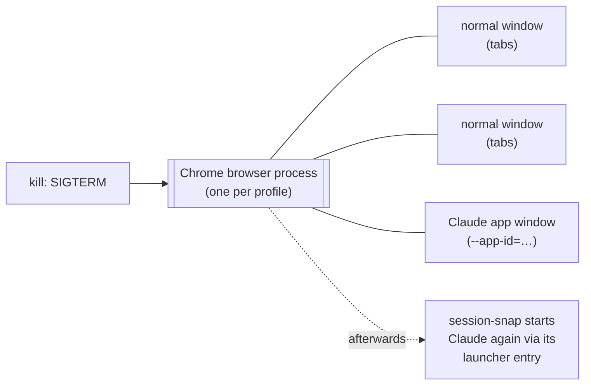

## Behaviour of session-snap

Since version 1.2.0, session-snap therefore follows the rule agreed with the user:

1. `kill` terminates **all** recorded browser processes, including one that contains the Claude app window.
2. If a terminated browser process contained an [app window](glossary.md#gl-appwindow), session-snap starts that app window **again immediately**, as a separate start ([relaunch](glossary.md#gl-relaunch)). It looks for the launcher entry with the same `--app-id`, i.e. the entry that the Super key launcher uses ("Claude"). If no launcher entry exists, the recorded command line is used.
3. The relaunch happens whether or not the app window itself was selected in the snapshot or in the checklist; what counts is whether the *terminated process* contained it. `--no-relaunch` switches this off.
4. `save` records the app window as a separate *Browser* entry (program name taken from the launcher, e.g. "Claude"), so that `restore` can start it explicitly.

The kill menu announces the relaunch before anything happens:

```text
 session-snap 1.7.10 ─ Beenden

  Snapshot: session-snap_2026-11-01_22-03-54.json   «Feierabend»
  Laufende Programme aus diesem Snapshot: 3
  Beenden erfolgt mit SIGTERM (Programme duerfen sauber schliessen).
  App-Fenster, die danach neu gestartet werden: Claude

  ▶  1. Alle beenden (3)
     2. Auswahl treffen … (Checkliste)
     3. Nur Videos (1)
     4. Nur Bilder (0)
     5. Nur Browser (1)
     6. Nur Sonstige (1)
     7. Abbrechen

 ↑↓/j k bewegen   Enter waehlen   1-9 direkt   q/Esc zurueck
```

A dry run shows the exact commands, including the relaunch:

```text
[  1/3] Videos             DRY-RUN  SIGTERM -> vlc (PID 212)
[  2/3] Browser            DRY-RUN  SIGTERM -> chrome (PID 215)
            DRY-RUN  danach neu starten: Claude: ~/bin/chrome -c 'import time;time.sleep(600)' --profile-directory=Default --app-id=fmpnliohjhemenmnlpbfagaolkdacoja
[  3/3] Sonstige Programme DRY-RUN  SIGTERM -> cosmic-edit (PID 214)
```

**Observed on the target system** (1 November 2026): with a snapshot from a plain Chrome start, `kill` in 1.7.7 did not end the Chrome process started through Claude (`ps` before and after showed the same PID). Fixed in 1.7.8, see above.

<a id="sec-browsersession"></a>

## Browser sessions

Since 1.7.9 a restore brings back the browsers **with their last session**: all profiles that were open, each with its windows and tabs. `browser_session = no` in `config.ini` switches it off.

**Chrome, Chromium, Brave, Edge, Vivaldi.** Chrome keeps the profiles that are open in the file `Local State` of its user data directory (key `profile.last_active_profiles`) [[chromeprefs]](#ref-chromeprefs); the display names (e.g. *Lorem*, *Ipsum*) are in `profile.info_cache`. session-snap stores this list with the snapshot; `show` prints it. On restore, Chrome is started **without** `--profile-directory` and **with** `--restore-last-session`. With this switch every profile Chrome opens at startup restores its last session, and without a profile directory Chrome opens all profiles that were open at the end [[chromestartup]](#ref-chromestartup). The switch works only when Chrome **starts**; a running Chrome ignores it [[chromerestore]](#ref-chromerestore). Therefore:

1. Chrome is started before the app windows. An app window started first would start the Chrome process itself.
2. If Chrome is still running **without any window** (setting "Continue running background apps when Google Chrome is closed"), session-snap ends it with SIGTERM first. If Chrome still has any window — also only an app window such as Claude — it is **not** ended; the session is then not restored, and session-snap says so. Without a COSMIC window list nothing is ended.
3. An app window that Chrome's session already reopened is not started a second time; session-snap waits up to 8 s for it.

Chrome writes its session when it ends normally. `kill` sends SIGTERM, which lets Chrome do that.

**Firefox.** The profile of a running Firefox is the folder of its open lock file `.parentlock` [[fflock]](#ref-fflock). session-snap stores it with the snapshot. Before the restore it sets `browser.sessionstore.resume_session_once = true` in `prefs.js` of that profile; Firefox restores the last session at the next start [[ffstartup]](#ref-ffstartup) and resets the value itself [[ffsessionstore]](#ref-ffsessionstore). The value is written only while Firefox does **not** run with that profile; `prefs.js` is copied to `session-snap.d/backup/` first. `user.js` is deliberately not used: Firefox reads it at every start, so the session would be restored every time, not once.

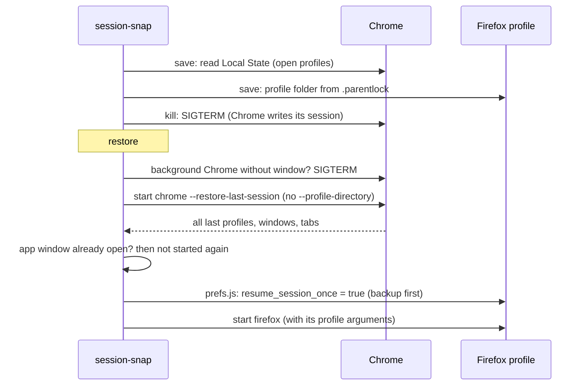

**Recommendation.** Switch off "Continue running background apps when Google Chrome is closed" in Chrome (Settings → System). Then no Chrome runs without a window, and the session is always restored.

## Optional: protect a process permanently

A process whose full command line matches a `protect` pattern in `config.ini` is never terminated; `kill` reports it as protected. One use: a Chrome instance with its own user data directory for Claude would run as a separate process and could then be kept open permanently. The command and the pattern below are an example only and were not tested on the target system.

```bash
/opt/google/chrome/chrome --user-data-dir="$HOME/.config/chrome-claude" --app=https://claude.ai
```

```ini
[session-snap]
protect = *--user-data-dir=*chrome-claude*
```

<a id="sec-programs"></a>

# Choosing programs for videos and images

## Concept

Every installed application declares in its [desktop entry](glossary.md#gl-desktop) which file types it can open (key `MimeType`). session-snap determines the [MIME type](glossary.md#gl-mime) of each recorded file from its extension [[pymimetypes]](#ref-pymimetypes) and offers every application that declares this type. Thus mpv appears automatically for `.mkv` files once it is installed, and nomacs for `.png` files. Nothing has to be configured by hand.

The choice applies **per file type**: one program for videos, one for images. It is stored as the default in [programs.ini](glossary.md#gl-programsini) and used by every restore. It can be changed in three ways:

* in the restore menu (option 7) or in the main menu (option 5);
* on the command line with `session-snap programs --video … --image …`;
* for a single restore with `restore --video … --image …`, which leaves the default unchanged.

## In the menu

**Program menu.** Current choice per file type:

```text
 session-snap 1.7.0 ─ Programme waehlen

  Gilt fuer das Oeffnen beim Wiederherstellen. Gespeichert in:
  /home/snaptest/scripts/session-snap.d/programs.ini

  ▶  1. Videos: wie aufgezeichnet
     2. Bilder: wie aufgezeichnet
     3. Zurueck

 ↑↓/j k bewegen   Enter waehlen   1-9 direkt   q/Esc zurueck
```

**Candidates for videos.** The list shows each program with its desktop file ID and how many of the snapshot's files it can open:

```text
 session-snap 1.7.0 ─ Programm fuer Videos

  Videos: 1 Datei(en) im Snapshot, 2 passende Programme installiert

  ▶  1. Wie aufgezeichnet (Originalprogramm)
     2. mpv Media Player  (mpv.desktop, oeffnet 1/1)
     3. VLC media player  (vlc.desktop, oeffnet 1/1)

 ↑↓/j k bewegen   Enter waehlen   1-9 direkt   q/Esc zurueck
```

**Candidates for images.** Programs that open all files come first. mpv and VLC also appear because they declare `image/gif`:

```text
 session-snap 1.7.0 ─ Programm fuer Bilder

  Bilder: 2 Datei(en) im Snapshot, 4 passende Programme installiert

  ▶  1. Wie aufgezeichnet (Originalprogramm)
     2. Image Viewer  (eog.desktop, oeffnet 2/2)
     3. nomacs - Image Lounge  (org.nomacs.ImageLounge.desktop, oeffnet 2/2)
     4. mpv Media Player  (mpv.desktop, oeffnet 1/2)
     5. VLC media player  (vlc.desktop, oeffnet 1/2)

 ↑↓/j k bewegen   Enter waehlen   1-9 direkt   q/Esc zurueck
```

**After choosing.** mpv for videos, nomacs for images; both choices are saved immediately:

```text
 session-snap 1.7.0 ─ Programme waehlen

  Gilt fuer das Oeffnen beim Wiederherstellen. Gespeichert in:
  /home/snaptest/scripts/session-snap.d/programs.ini

  ▶  1. Videos: mpv Media Player (mpv.desktop)
     2. Bilder: nomacs - Image Lounge (org.nomacs.ImageLounge.desktop)
     3. Zurueck

 ↑↓/j k bewegen   Enter waehlen   1-9 direkt   q/Esc zurueck
```

## On the command line

List the current choice and all installed candidates:

```bash
session-snap programs
```

```text
Einstellungen (~/scripts/session-snap.d/programs.ini):
  Videos  mpv Media Player (mpv.desktop)
  Bilder  nomacs - Image Lounge (org.nomacs.ImageLounge.desktop)

Installierte Programme fuer Videos (video/mp4, video/x-matroska, video/webm):
  mpv.desktop                                  mpv Media Player  (oeffnet 2/3)
  vlc.desktop                                  VLC media player  (oeffnet 2/3)

Installierte Programme fuer Bilder (image/png, image/jpeg, image/gif):
  eog.desktop                                  Image Viewer  (oeffnet 3/3)
  org.nomacs.ImageLounge.desktop               nomacs - Image Lounge  (oeffnet 3/3)
  mpv.desktop                                  mpv Media Player  (oeffnet 1/3)
  vlc.desktop                                  VLC media player  (oeffnet 1/3)
```

Set the defaults. Take the exact desktop file IDs from the output of the previous command:

```bash
session-snap programs --video mpv.desktop --image org.nomacs.ImageLounge.desktop
```

Open videos with VLC for this restore only:

```bash
session-snap restore -s latest --all --video vlc.desktop
```

Return to the recorded programs:

```bash
session-snap programs --reset
```

A plain command instead of a desktop file ID also works (`--video mpv`). The file is then appended as the last argument.

## Behaviour details

* Only entries of the categories *Videos* and *Bilder* are affected; browsers and other programs always start as recorded.
* The restore output marks redirected entries, e.g. `OK  …/Tag 3.mkv  [mit mpv.desktop]`.
* If a chosen program has been uninstalled, a warning is printed and the recorded program is used.
* A file that is already open counts as running regardless of the program showing it. If a video was recorded in VLC and is now open in mpv, it is not started a second time.

<a id="sec-videos"></a>

# Videos and windows

<a id="sec-exact"></a>

## Exact program and options

Every video and image is reopened with **the program that showed it** when the snapshot was taken, with **all options** of that program. Only the file arguments are replaced by the one file of the entry.

The defect fixed by this in 1.3.0 was found with the real mpv 0.37.0 (the version of Pop!_OS 24.04). A video opened from the file manager via `mpv.desktop` (`Exec=mpv --player-operation-mode=pseudo-gui -- %U`) is recorded and restarted as follows:

Table: Restart command of an mpv video before and after the fix.

| | Command |
|------|---------|
| Recorded process | `mpv --player-operation-mode=pseudo-gui -- file:///…/Test%20Video.mkv` |
| Restart in 1.2.0 | `/usr/bin/mpv '/…/Test Video.mkv'` — options lost |
| Restart since 1.3.0 | `/usr/bin/mpv --pause --player-operation-mode=pseudo-gui -- '/…/Test Video.mkv'` |

Real run with the real mpv 0.37.0, started with exactly the command line of `mpv.desktop`, on cosmic-comp. `show` prints both the restart command and the original command line:

```text
== Videos (1) ==
  mpv (PID 1086)
      Datei:  /home/USER/Videos/Tag 3.mkv
      Befehl: /usr/bin/mpv --player-operation-mode=pseudo-gui -- '/home/USER/Videos/Tag 3.mkv'
      Original: mpv --player-operation-mode=pseudo-gui -- file:///home/USER/Videos/Tag%203.mkv
      Umgebung: wie beim Speichern
```

After `kill` and `restore` the same file opens paused and maximized:

```text
Darstellung: keine Desktop-Sitzung gefunden - wie beim Speichern
[  1/1] Videos             OK    /home/USER/Videos/Tag 3.mkv  [--pause]
Maximiere 1 Fenster (bis 20 s) ...
            MAX      mpv: Tag 3.mkv - mpv - maximiert

Ergebnis: 1 gestartet, 0 fehlgeschlagen. Log: /home/USER/m/s15b/logs/session-snap.log
Alt-Tab-Reihenfolge wie beim Speichern: 1 von 1 Fenstern geordnet
```

**Origin.** Where the system reveals it, session-snap also records the launcher entry (`.desktop` file) the program was started from ([origin](glossary.md#gl-origin)). The recorded program is the program that actually had the file open, read from the process itself. The file association list (`mimeapps.list`) only says which program *would* open a file type by default, so it is not used for this.

<a id="sec-paused"></a>

## Paused start and endless loop

Videos are started paused, so that a restore of many videos does not start them all playing at full volume. The [player options](glossary.md#gl-playeroptions) were checked in the installed program versions and verified through the programs' own remote-control interfaces:

Table: Default player options and their verification.

| Player | Options | Purpose | Verified state after restore |
|--------|---------|---------|------------------------------|
| mpv 0.37.0 | `--pause` | "Start the player in paused state." (`DOCS/man/options.rst`) [[mpvsrc]](#ref-mpvsrc) | IPC property `pause` = `true` |
| VLC 3.0.20 | `--start-paused` | "Start paused" (`vlc --longhelp --advanced`) | rc interface: `pause state: 4`, playback time stays 0; MPRIS `PlaybackStatus` = `Paused` |
| VLC 3.0.20 | `--input-repeat=65535` | play the video again and again (since 1.7.1, see below) | measured with VLC 3.0.20 in the previous development session |
| VLC 3.0.20 | `--no-one-instance-when-started-from-file` | one window per video (since 1.5.0, see below) | three processes, three windows |

**Endless loop (1.7.1).** VLC's playlist options `--loop` and `--repeat` start the item anew on every pass, and `--start-paused` then pauses it again each time. `--input-repeat` instead jumps back to the start *inside* the same input (`MainLoopTryRepeat()` in `src/input/input.c` [[vlcinput]](#ref-vlcinput)), so the video keeps playing after it was started once.

Other players (Celluloid, Totem, SMPlayer, …) start **playing** unless their pause option is added in the section `[player-options]` of `config.ini` ([configuration](#sec-config)). `--play` starts the videos playing.

**VLC and "one instance".** VLC's setting *Use only one instance when started from file manager* is enabled by default, and the launcher entry `vlc.desktop` starts VLC with `--started-from-file`. Every further VLC started this way hands its file to the first instance, which **replaces** the current video. Restoring three videos therefore left one VLC with only the last video. Measured on cosmic-comp with VLC 3.0.20: without the option, one process with *Clip 3*; with `--no-one-instance-when-started-from-file`, three processes, each paused. Real run of 1.7.0 with three videos recorded from the file manager:

```text
Darstellung: keine Desktop-Sitzung gefunden - wie beim Speichern
[  1/3] Videos             OK    /home/USER/Videos/Clip 1.mkv  [--start-paused --no-one-instance-when-started-from-file]
[  2/3] Videos             OK    /home/USER/Videos/Clip 2.mkv  [--start-paused --no-one-instance-when-started-from-file]
[  3/3] Videos             OK    /home/USER/Videos/Clip 3.mkv  [--start-paused --no-one-instance-when-started-from-file]
Maximiere 3 Fenster (bis 20 s) ...
            MAX      vlc: Clip 1.mkv - VLC media player - maximiert
            MAX      vlc: Clip 2.mkv - VLC media player - maximiert
            MAX      vlc: Clip 3.mkv - VLC media player - maximiert

Ergebnis: 3 gestartet, 0 fehlgeschlagen. Log: /home/USER/m/s15d/logs/session-snap.log
Alt-Tab-Reihenfolge wie beim Speichern: 3 von 3 Fenstern geordnet
```

```text
$ pgrep -c -x vlc
3
MPRIS PlaybackStatus per instance:
  'Paused'  file:///home/USER/Videos/Clip%203.mkv
  'Paused'  file:///home/USER/Videos/Clip%202.mkv
  'Paused'  file:///home/USER/Videos/Clip%201.mkv
```

## Maximized windows

VLC 3.0.20 has no option to start maximized: the complete option list contains none, and the VideoLAN feature request #2110 "Maximize video on startup" is open [[vlc2110]](#ref-vlc2110). session-snap therefore maximizes the windows itself, right after the start, **for every program the same way**, through the compositor:

1. Before the first program is started, session-snap connects to the COSMIC compositor and notes the windows that already exist.
2. The programs are started.
3. Every **new** window whose [app_id](glossary.md#gl-appid) belongs to a started program is maximized with the COSMIC request `set_maximized`.
4. The compositor confirms the state; the result is printed per window.

Real run against cosmic-comp (built from source) with the real mpv, VLC and GNOME image viewer:

```text
Darstellung: keine Desktop-Sitzung gefunden - wie beim Speichern
[  1/3] Bilder             OK    /home/USER/m/bild.png
[  2/3] Videos             OK    /home/USER/m/Videos mit Leerzeichen/Test Video.mkv  [--pause]
[  3/3] Videos             OK    /home/USER/m/Videos mit Leerzeichen/Test Video.mkv  [--start-paused --no-one-instance-when-started-from-file]
Maximiere 3 Fenster (bis 20 s) ...
            MAX      eog: bild.png - maximiert
            MAX      mpv: Test Video.mkv - mpv - maximiert
            MAX      vlc: Test Video.mkv - VLC media player - maximiert

Ergebnis: 3 gestartet, 0 fehlgeschlagen. Log: /home/USER/m/s15a/logs/session-snap.log
Alt-Tab-Reihenfolge wie beim Speichern: 2 von 2 Fenstern geordnet
```

Independent check afterwards, read from the compositor:

```text
  eog   MAXIMIZED  bild.png
  mpv   MAXIMIZED  Test Video.mkv - mpv
  vlc   MAXIMIZED  Test Video.mkv - VLC media player
```

Which categories are maximized is set with `maximize` in `config.ini` (default since 1.7.1: videos; `all` includes browsers and other programs). `--no-maximize` switches it off for one restore. Without COSMIC — for example in an SSH session, or under another desktop — the programs are started normally and a hint is printed:

```text
Hinweis: Fenster werden nicht maximiert - Verbindung zu /run/user/1000/wayland-nicht-da fehlgeschlagen: [Errno 2] No such file or directory
Darstellung: keine Desktop-Sitzung gefunden - wie beim Speichern
[  1/1] Videos             OK    /home/USER/Videos/Tag 3.mkv  [--pause]

Ergebnis: 1 gestartet, 0 fehlgeschlagen. Log: /home/USER/m/s15b/logs/session-snap.log
Hinweis: Reihenfolge nicht hergestellt - Verbindung zu /run/user/1000/wayland-nicht-da fehlgeschlagen: [Errno 2] No such file or directory
```

The technical background is described in [window control on COSMIC](developer.md#sec-window).

<a id="sec-fullscreen"></a>

## Fullscreen images

Since 1.7.1 images open **fullscreen** (`fullscreen = images`); a category in both `fullscreen` and `maximize` goes fullscreen. Two levels are used.

**First level: the viewer's own fullscreen mode** (1.7.4, 1.7.6). Fullscreen set by the compositor only enlarges the window; the viewer's header bar and frame stay. The borderless view one gets with a double-click is the viewer's own mode, and only the viewer can switch it on. session-snap therefore starts the viewer with its own option, entered in `[player-options]`:

Table: Viewer fullscreen options (used only while images are in `fullscreen`).

| Viewer | Option | Source |
|--------|--------|--------|
| GNOME image viewer (eog) 45.3 | `--fullscreen` ("Open in fullscreen mode"); the flag is passed on to an already running eog instance, so every new window opens fullscreen | `src/main.c`, `src/eog-application.c`, `src/eog-window.c` [[eogsrc]](#ref-eogsrc) |
| nomacs 3.16 and later | `-f` / `--fullscreen` ("Start in fullscreen") | `ImageLounge/src/main.cpp` [[nomacssrc]](#ref-nomacssrc) |
| COSMIC image viewer | **none**: the first argument is always the image path (`args().nth(1)`); an option would be opened as a file. Fullscreen only with the key `f` inside the program | `cosmic-viewer/src/main.rs` [[cosmicviewer]](#ref-cosmicviewer) |

**Second level: the compositor request** `set_fullscreen` (request 7 of `zcosmic_toplevel_manager_v1`, output *null* = the compositor chooses) [[cosmicproto]](#ref-cosmicproto). cosmic-comp executes it (`toplevel_management.rs`) and allows several fullscreen windows per workspace (`fullscreen_surfaces` is a list in `workspace.rs`) [[cosmiccomp]](#ref-cosmiccomp). It is sent for every new image window that is not fullscreen yet, and is the only means for viewers without an option.

On the target system the user reported on 1 November 2026 that with 1.7.4 the eog windows now open enlarged as intended ("werden jetzt tatsächlich alle maximiert"); that this is eog's borderless mode was not confirmed explicitly.

<a id="sec-single"></a>

# Single-instance image viewers

## The problem

The GNOME image viewer (`eog`) is a [single-instance application](glossary.md#gl-singleinstance): a second `eog Foto 2.png` does not start a second program, it passes the file to the running process, which opens a new window. Measured with five images opened one after another (test environment, cosmic-comp):

```text
$ pgrep -a -x eog
1232 eog /home/USER/Bilder/Urlaub 2026/Foto 1.png
```

One process, five windows — but only *Foto 1* is in its command line, and image viewers close their files after loading, so `/proc/<pid>/fd` shows none of them. Up to 1.4.0 session-snap therefore recorded only the first image. Ctrl+Q closes all five windows at once (the whole process), Ctrl+W only one window.

## The solution (1.5.0)

The windows themselves name their files. COSMIC reports every window with its [app_id](glossary.md#gl-appid) and its title ("Foto 3.png"). session-snap matches the windows of the viewer to its process and resolves each title to a full path:

1. **Directories the viewer watches.** eog watches the folders of its images with [inotify](glossary.md#gl-inotify); the watched objects are listed with inode and device in `/proc/<pid>/fdinfo` [[procfdinfo]](#ref-procfdinfo), [[inotify7]](#ref-inotify7). A candidate folder whose inode and device match is a confirmed location.
2. **Recently used files.** GTK programs record opened files in `~/.local/share/recently-used.xbel` ([desktop bookmark specification](glossary.md#gl-xbel) [[xbel]](#ref-xbel)), including the program (`exec="'eog %u'"`). Entries of the same program are preferred, newer ones first.
3. **Known folders.** The folders of the files already recorded and the working directory of the process.

Each found image becomes an entry of its own, marked with its source; a recorded image whose window has been closed (Ctrl+W) is dropped. Multi-process viewers (one process per image, e.g. nomacs) are not affected: every process keeps exactly its own file.

```text
== Bilder (5) ==
  eog (PID 1232)
      Datei:  /home/USER/Bilder/Urlaub 2026/Foto 1.png
      Befehl: /usr/bin/eog '/home/USER/Bilder/Urlaub 2026/Foto 1.png'
      Original: eog '/home/USER/Bilder/Urlaub 2026/Foto 1.png'
      Umgebung: wie beim Speichern
  eog (PID 1232)
      Datei:  /home/USER/Bilder/Urlaub 2026/Foto 2.png
      Befehl: /usr/bin/eog '/home/USER/Bilder/Urlaub 2026/Foto 2.png'
      Original: eog '/home/USER/Bilder/Urlaub 2026/Foto 1.png'
      Gefunden ueber: Fenstertitel 'Foto 2.png'
      Umgebung: wie beim Speichern
  eog (PID 1232)
      Datei:  /home/USER/Bilder/Urlaub 2026/Foto 3.png
      Befehl: /usr/bin/eog '/home/USER/Bilder/Urlaub 2026/Foto 3.png'
      Original: eog '/home/USER/Bilder/Urlaub 2026/Foto 1.png'
      Gefunden ueber: Fenstertitel 'Foto 3.png'
      Umgebung: wie beim Speichern
  eog (PID 1232)
      Datei:  /home/USER/Bilder/Urlaub 2026/Foto 4.png
      Befehl: /usr/bin/eog '/home/USER/Bilder/Urlaub 2026/Foto 4.png'
      Original: eog '/home/USER/Bilder/Urlaub 2026/Foto 1.png'
      Gefunden ueber: Fenstertitel 'Foto 4.png'
      Umgebung: wie beim Speichern
  eog (PID 1232)
      Datei:  /home/USER/Bilder/Urlaub 2026/Foto 5.png
      Befehl: /usr/bin/eog '/home/USER/Bilder/Urlaub 2026/Foto 5.png'
      Original: eog '/home/USER/Bilder/Urlaub 2026/Foto 1.png'
      Gefunden ueber: Fenstertitel 'Foto 5.png'
      Umgebung: wie beim Speichern
```

`diagnose` shows the window list and the source:

```text
session-snap 1.7.0 diagnose - Sitzung ?/?
Darstellung (session-snap selbst): XDG_DATA_DIRS=/usr/local/share:/usr/share:/root/.nix-profile/share:/nix/var/nix/profiles/default/share DISPLAY=:0 WAYLAND_DISPLAY=wayland-1
Desktop-Sitzung (Vorlage fuer Darstellung): nicht gefunden
gsettings org.gnome.desktop.interface color-scheme: 'default'
gsettings org.gnome.desktop.interface gtk-theme: 'Adwaita'
Mitschreiber (Alt-Tab-Reihenfolge): laeuft NICHT; Autostart: nein
Fensterliste (COSMIC): 5 Fenster
    eog: Foto 1.png
    eog: Foto 2.png
    eog: Foto 3.png
    eog: Foto 4.png
    eog: Foto 5.png

[1] PID 1232  exe=/usr/bin/eog  flatpak=-
    argv:    eog '/home/USER/Bilder/Urlaub 2026/Foto 1.png'
    cwd:     /home/USER/m
    offen:   -
    Starter: -  (nicht ermittelbar)
    Darstellung: XDG_DATA_DIRS=/usr/local/share:/usr/share:/root/.nix-profile/share:/nix/var/nix/profiles/default/share DISPLAY=:0 WAYLAND_DISPLAY=wayland-1
    ERFASST als Bilder: /usr/bin/eog '/home/USER/Bilder/Urlaub 2026/Foto 1.png'
    ERFASST als Bilder: /usr/bin/eog '/home/USER/Bilder/Urlaub 2026/Foto 2.png'
        gefunden ueber Fenstertitel 'Foto 2.png'
    ERFASST als Bilder: /usr/bin/eog '/home/USER/Bilder/Urlaub 2026/Foto 3.png'
        gefunden ueber Fenstertitel 'Foto 3.png'
    ERFASST als Bilder: /usr/bin/eog '/home/USER/Bilder/Urlaub 2026/Foto 4.png'
        gefunden ueber Fenstertitel 'Foto 4.png'
    ERFASST als Bilder: /usr/bin/eog '/home/USER/Bilder/Urlaub 2026/Foto 5.png'
        gefunden ueber Fenstertitel 'Foto 5.png'
```

After `kill` (one signal for the one process) and `restore`, all five images are open again, maximized:

```text
Darstellung: keine Desktop-Sitzung gefunden - wie beim Speichern
[  1/5] Bilder             OK    /home/USER/Bilder/Urlaub 2026/Foto 1.png
[  2/5] Bilder             OK    /home/USER/Bilder/Urlaub 2026/Foto 2.png
[  3/5] Bilder             OK    /home/USER/Bilder/Urlaub 2026/Foto 3.png
[  4/5] Bilder             OK    /home/USER/Bilder/Urlaub 2026/Foto 4.png
[  5/5] Bilder             OK    /home/USER/Bilder/Urlaub 2026/Foto 5.png
Maximiere 5 Fenster (bis 20 s) ...
            MAX      eog: Foto 1.png - maximiert
            MAX      eog: Foto 2.png - maximiert
            MAX      eog: Foto 3.png - maximiert
            MAX      eog: Foto 4.png - maximiert
            MAX      eog: Foto 5.png - maximiert

Ergebnis: 5 gestartet, 0 fehlgeschlagen. Log: /home/USER/m/s15c/logs/session-snap.log
Alt-Tab-Reihenfolge wie beim Speichern: 5 von 5 Fenstern geordnet
```

**Limits.** The method needs COSMIC (window list) and a viewer that shows the file name in its window title; eog, Loupe and nomacs do. Without the window list, session-snap behaves as before and records the image of the command line.

<a id="sec-look"></a>

# Appearance: light and dark theme

A program takes its look — theme, light or dark variant, toolkit backend — partly from **environment variables** such as `GTK_THEME` [[gtktheme]](#ref-gtktheme), `QT_QPA_PLATFORMTHEME` or `XDG_DATA_DIRS`. A program started from the dock or the file manager inherits the environment of the desktop session; a program started by session-snap inherits the environment of the terminal. On the target system the image viewer opened from the file manager was dark and the restored one light.

**Since 1.6.1 restored programs take these variables from the desktop session** — from a running session process, in this order: `cosmic-panel`, `cosmic-app-list`, `cosmic-files`, `cosmic-launcher`, `cosmic-session` (and the shells of GNOME, KDE, Xfce). Thus a restored program looks exactly like one started from the dock: dark when the system is dark, light when it is light — also when the snapshot was taken in the other mode. The restore prints which session process served as the template (format of the line; the PID varies):

```text
Darstellung (Theme, hell/dunkel) wie die Desktop-Sitzung: cosmic-panel (PID 2481)
```

Only these variables are copied; the rest of the environment stays as it is: `GTK_*`, `GDK_*`, `QT_*`, `ADW_*`, `GSETTINGS_*`, `XCURSOR_*`, `XDG_CURRENT_DESKTOP`, `XDG_SESSION_DESKTOP`, `XDG_SESSION_TYPE`, `XDG_DATA_DIRS`, `XDG_CONFIG_DIRS`, `XDG_DATA_HOME`, `XDG_CONFIG_HOME`, `DESKTOP_SESSION`, `LANG`, `LANGUAGE`, `LC_*`, `NO_AT_BRIDGE`. Snapshots store the same variables of each recorded program (field `env`, since 1.5.1); they are used only when no desktop session is found, e.g. over SSH. The rest of the environment is never stored, because it may contain tokens or passwords.

`diagnose` prints the template process and every variable that differs between it and the terminal (format of the lines; values abbreviated):

```text
Desktop-Sitzung (Vorlage fuer Darstellung): cosmic-panel PID 2481
    GTK_THEME: Sitzung=… Terminal=(nicht gesetzt)
```

Which variable causes the difference on the target system was not determined; the method covers the whole group. If a restored program still looks different and `diagnose` reports "keine Abweichung zum Terminal", the cause is not in the environment.

<a id="sec-order"></a>

# Alt-Tab order

## How COSMIC orders windows

The window switcher (Alt-Tab) of COSMIC is provided by the launcher plugin `cosmic_toplevel` of pop-launcher [[poplauncher]](#ref-poplauncher). It keeps its **own list**: a new window is appended; a window that becomes **active** is moved to the end, i.e. to "most recently used" ([MRU](glossary.md#gl-mru)). The compositor publishes windows only in creation order and which one is active; it does not publish the switcher's list [[cosmiccomp]](#ref-cosmiccomp). Therefore the order must be recorded while you work.

## The background process `session-snap watch`

`session-snap watch` runs from the login onward. It connects to the compositor like a panel, follows **every activation** — by Alt-Tab, mouse click, dock or launcher — with the same rule as the switcher, and writes the current order to `~/scripts/session-snap.d/order.json` after every change. Each single state message counts, so quick Alt-Tab switching is not lost. It runs only once (lock file `watch.lock`), reconnects when the compositor restarts, and needs about no CPU while nothing happens.

It is started at every login through the autostart entry `~/.config/autostart/session-snap-watch.desktop`. On Pop!_OS, `cosmic-session` pulls in `xdg-desktop-autostart.target`, whose services the systemd generator creates from these entries [[cosmicsession]](#ref-cosmicsession), [[xdgautostartgen]](#ref-xdgautostartgen), [[autostart]](#ref-autostart).

```bash
session-snap watch --start      # create the autostart entry and start it now (done by install.sh)
session-snap watch --status     # running? autostart entry present?
session-snap watch --stop       # end it (it starts again at the next login)
```

```text
Mitschreiber: laeuft NICHT; Autostart: nein
```

Only an activation changes the order. Browsing the switcher and cancelling it with Esc, or minimizing a window, changes nothing — as in the switcher itself.

## Saving

`save` reads the windows from the compositor, takes the order from `order.json` **if the background process runs**, and stores in every entry its position (`order`, 0 = oldest). Windows are assigned to entries by the file name in the window title (videos, images) or by the app_id (other programs). If the background process does **not** run, the **fallback** applies: the order in which the windows were opened, with the active window in front. `save` reports which source was used, and the snapshot keeps it (`order_source`):

```text
Alt-Tab-Reihenfolge: 4 Fenster - vom Mitschreiber (session-snap watch)
Alt-Tab-Reihenfolge: 5 Fenster - Mitschreiber laeuft nicht: Reihenfolge des Oeffnens, aktives Fenster vorne
```

## Restoring

After choosing what to start, the restore asks for the order ([order menu](#sec-ui)):

1. **Wie beim Speichern** — the programs are started in the recorded order, and afterwards all windows of the snapshot are **activated one after another, oldest first**. Windows that were already open and belong to the snapshot are activated too, so they return between their former neighbours. Windows that are not in the snapshot are not touched and end up behind.
2. **Nicht aendern** — new windows simply appear in front.

With `--all` there is no question; `order` in `config.ini` decides (default `saved`), and `--order keep` switches it off for one call. If nothing has to be started, the windows can still be ordered.

Real run against cosmic-comp with the real mpv, VLC and image viewer: the user switched in the order *Foto 1, Clip 2, Clip 1, Foto 2*; everything was saved, terminated and restored:

```text
Mitschreiber: laeuft (PID 2545); Autostart: nein
Reihenfolge zuletzt geschrieben vor 1 s: /home/USER/o17/data/order.json
user switching: [('eog', 'Foto 1.png'), ('vlc', 'Clip 2.mkv - VLC media player'), ('mpv', 'Clip 1.mkv - mpv'), ('eog', 'Foto 2.png')]
### order.json (watcher):
['Foto 1.png', 'Clip 2.mkv - VLC media player', 'Clip 1.mkv - mpv', 'Foto 2.png']
Alt-Tab-Reihenfolge: 4 Fenster - vom Mitschreiber (session-snap watch)
Gespeichert: /home/USER/o17/data/snapshots/session-snap_2026-10-28_22-17-34.json  (4 Eintraege)
Ergebnis: 3 beendet, 0 laufen weiter. Log: /home/USER/o17/data/logs/session-snap.log
### restore:
Darstellung: keine Desktop-Sitzung gefunden - wie beim Speichern
[  1/4] Bilder             OK    /home/USER/Bilder/Urlaub 2026/Foto 1.png
[  2/4] Videos             OK    /home/USER/Videos/Clip 2.mkv  [--start-paused --no-one-instance-when-started-from-file]
[  3/4] Videos             OK    /home/USER/Videos/Clip 1.mkv  [--pause]
[  4/4] Bilder             OK    /home/USER/Bilder/Urlaub 2026/Foto 2.png
Maximiere 4 Fenster (bis 20 s) ...

Ergebnis: 4 gestartet, 0 fehlgeschlagen. Log: /home/USER/o17/data/logs/session-snap.log
Alt-Tab-Reihenfolge wie beim Speichern: 4 von 4 Fenstern geordnet
### order.json after restore:
['Foto 1.png', 'Clip 2.mkv - VLC media player', 'Clip 1.mkv - mpv', 'Foto 2.png']
Mitschreiber: laeuft (PID 2545); Autostart: nein
Reihenfolge zuletzt geschrieben vor 1 s: /home/USER/o17/data/order.json
Mitschreiber beendet.
```

Second run: *Clip 1* was already open again, and an unrelated video *Clip 3* was opened after it. After the restore, *Clip 3* stands behind, and *Clip 1* is back between *Clip 2* and *Foto 2*. The last line shows the fallback when the background process does not run:

```text
### before:
['Clip 1.mkv - mpv', 'Clip 3.mkv - mpv']
[  1/3] Bilder             OK    /home/USER/Bilder/Urlaub 2026/Foto 1.png
[  2/3] Videos             OK    /home/USER/Videos/Clip 2.mkv  [--start-paused --no-one-instance-when-started-from-file]
[  3/3] Bilder             OK    /home/USER/Bilder/Urlaub 2026/Foto 2.png
Alt-Tab-Reihenfolge wie beim Speichern: 4 von 4 Fenstern geordnet
### after:
['Clip 3.mkv - mpv', 'Foto 1.png', 'Clip 2.mkv - VLC media player', 'Clip 1.mkv - mpv', 'Foto 2.png']
### fallback without watcher (save):
Alt-Tab-Reihenfolge: 5 Fenster - Mitschreiber laeuft nicht: Reihenfolge des Oeffnens, aktives Fenster vorne
```

**Limits.** Every activation raises the window briefly (about 0.15 s per window). A window on another workspace switches COSMIC to that workspace. A window whose title does not (yet) contain its file name at the moment of saving gets no position and stays behind — observed once in the runs with a window that had just opened. The switcher keeps its own list; if the launcher itself is restarted, it starts again in creation order.

<a id="sec-config"></a>

# Configuration

The configuration file `~/.config/session-snap/config.ini` is optional. Create the template as the normal user:

```bash
session-snap config
```

Table: Keys of the section `[session-snap]` in config.ini.

| Key | Default | Meaning |
|-----|---------|---------|
| `exclude` | built-in list | additional programs / Flatpak IDs that are never recorded ([fnmatch](glossary.md#gl-fnmatch) patterns) |
| `include` | — | programs always recorded as *Sonstige*, even without a desktop entry |
| `protect` | — | patterns matched against the **full command line**; matching processes are never terminated |
| `image_viewers` | built-in list | additional binary names treated as image viewers |
| `video_players` | built-in list | additional binary names treated as video players |
| `delay` | 0.4 | pause between two program starts in seconds |
| `kill_timeout` | 5 | grace period after SIGTERM in seconds |
| `maximize` | `videos` | categories whose windows are maximized after a restore: `videos`, `images`, `browser`, `rest`, `all`, `none` |
| `fullscreen` | `images` | categories whose windows go fullscreen (same values; wins over `maximize`); also switches the viewers' own fullscreen options on |
| `maximize_timeout` | 20 | longest wait for the windows to appear, in seconds (also used for ordering) |
| `order` | `saved` | Alt-Tab order after a restore **without questions** (`--all`): `saved` = as recorded, `keep` = unchanged |
| `overlay` | `fullscreen` | progress display above all windows: `fullscreen`, `corner`, `notify`, `off`; `yes` = `fullscreen`, `no` = `off` ([overlay](#sec-overlay)) |
| `browser_session` | `yes` | browsers restore their last session ([browser sessions](#sec-browsersession)) |

Table: Section `[player-options]` in config.ini — start options per program binary name, inserted for videos and — while images are in `fullscreen` — for image viewers.

| Key | Default | Meaning |
|-----|---------|---------|
| `mpv` | `--pause` | mpv starts paused |
| `vlc` | `--start-paused --input-repeat=65535 --no-one-instance-when-started-from-file` | VLC starts paused, loops endlessly, one window per video |
| `eog` | `--fullscreen` | GNOME image viewer in its own fullscreen mode |
| `nomacs` | `--fullscreen` | nomacs in its own fullscreen mode |
| any binary name | — | e.g. `celluloid = …`; an empty value switches the options off for that player |

Example:

```ini
[session-snap]
exclude = org.telegram.desktop
include = my-tool
protect = *--user-data-dir=*chrome-claude*
image_viewers = qview
video_players = haruna
delay = 0.4
kill_timeout = 5
maximize = videos
fullscreen = images
maximize_timeout = 20
order = saved
overlay = fullscreen
browser_session = yes

[player-options]
mpv = --pause
vlc = --start-paused --input-repeat=65535 --no-one-instance-when-started-from-file
eog = --fullscreen
nomacs = --fullscreen
```

Lists are separated by commas or newlines. The built-in exclusions (`DEFAULT_EXCLUDE` in the source) cover COSMIC panel and applet processes, portals and helper daemons. The exact process names of COSMIC components were **not** verified on a live COSMIC desktop. If a COSMIC helper appears under *Sonstige*, add its name to `exclude`.

`programs.ini` is written by the tool itself and normally not edited by hand; its format is described in the [data model](developer.md#sec-datamodel).

<a id="sec-usecases"></a>

# Use cases

Each use case states the goal, the command, a diagram, the expected result and the tests that verify it. All commands run as the **normal user**.

## UC1 — Save interactively with label and deselection

**Goal:** record the current state before shutting down, without unwanted entries.

```bash
session-snap save -l "Abend"
```

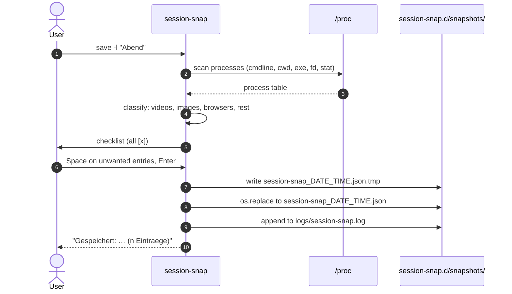

**Expected result:** a new file `session-snap_<date>_<time>.json` with only the selected entries and the label `Abend`; a log line `snapshot saved`. *Verified by:* T04, T13, T18.

## UC2 — Save without questions

**Goal:** one-step capture, e.g. from a keyboard shortcut or another script.

```bash
session-snap save -y -l "Schnellsicherung"
```

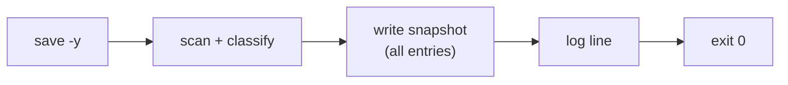

**Expected result:** a snapshot with *all* detected entries and exit code 0, without any terminal interaction. If stdin is not a terminal, `save` behaves like `save -y` automatically. *Verified by:* T13.

## UC3 — Restore everything after booting

```bash
session-snap restore -s latest --all
```

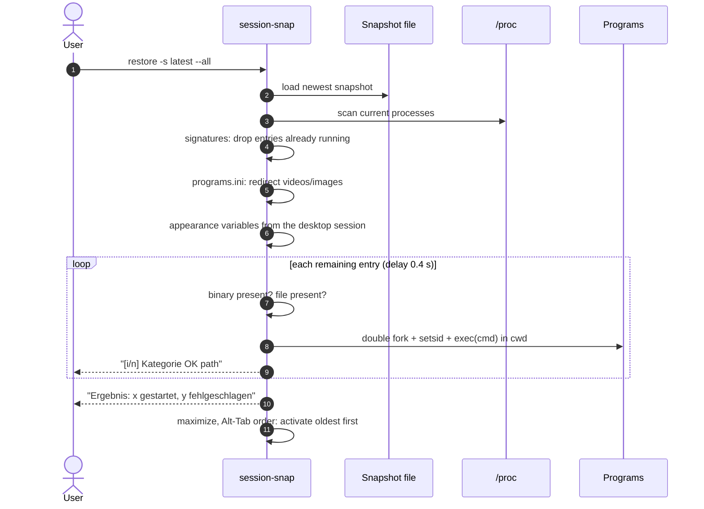

**Expected result:** every entry that is not running is started with its file, using the chosen programs, in the light/dark theme of the desktop and in the recorded Alt-Tab order. Running entries are skipped. Exit code 0 if all starts succeed. *Verified by:* T14, T15, T25, T27.

## UC4 — Restore a selection

```bash
session-snap restore
```

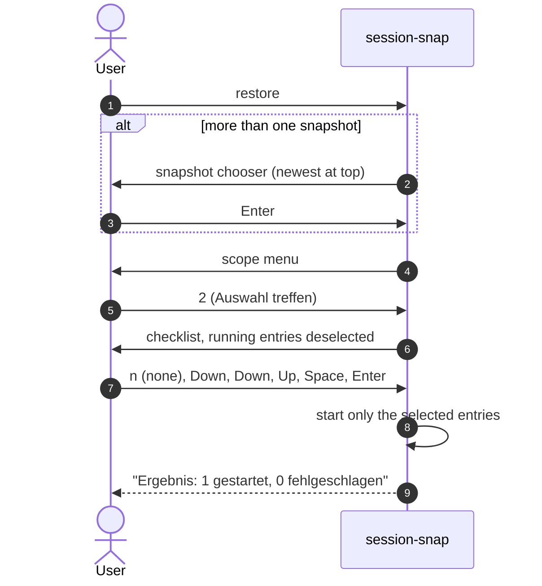

**Expected result:** exactly the selected entries are started. *Verified by:* T18, which sends this key sequence through a pseudo-terminal.

## UC5 — Restore one category

```bash
session-snap restore -s latest
```

Then choose 3 (*Nur Videos*), 4 (*Nur Bilder*), 5 (*Nur Browser*) or 6 (*Nur Sonstige*).

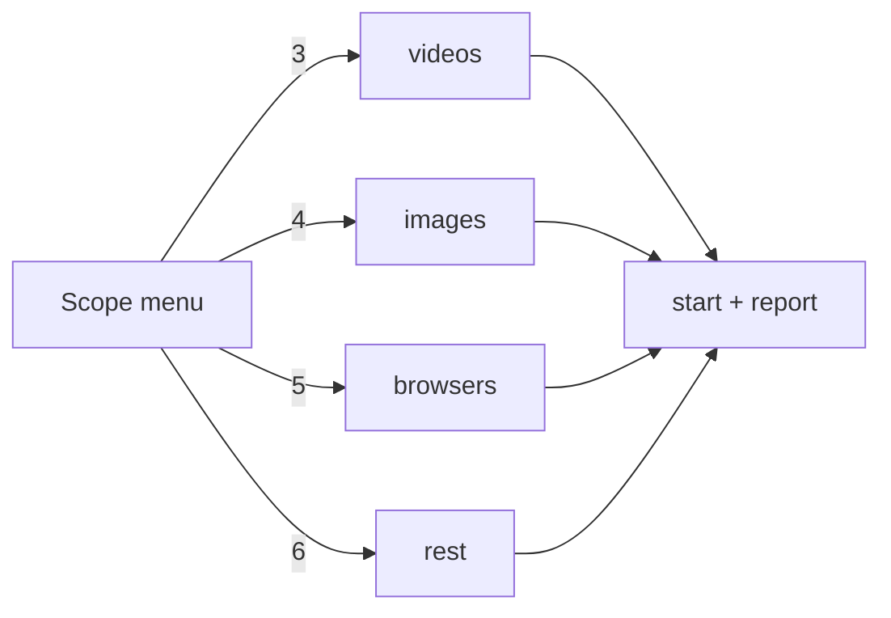

**Expected result:** only the entries of the chosen category that are not running are started. *Verified by:* the selection path of T14/T18; the category filter is a list filter on the same code path.

<a id="uc6"></a>

## UC6 — Terminate the recorded programs

```bash
session-snap kill -s latest
session-snap kill -s latest --all --timeout 5 --force
```

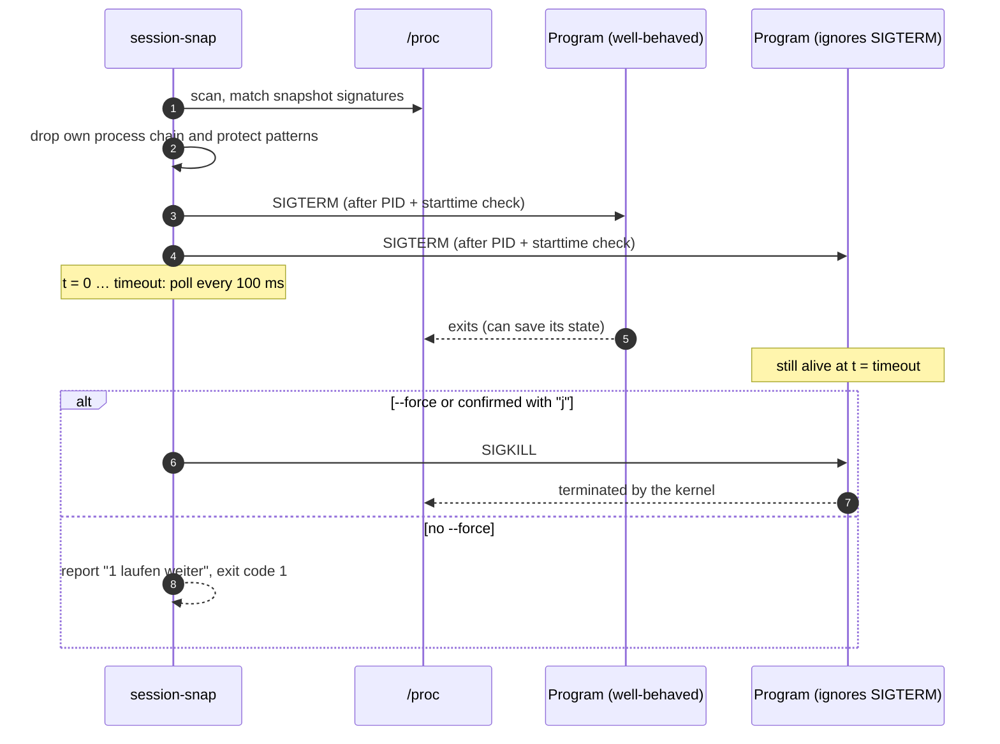

[SIGTERM](glossary.md#gl-sigterm) asks a program to exit; it can save its state or ask "save changes?". [SIGKILL](glossary.md#gl-sigkill) cannot be caught, blocked or ignored [[signal7]](#ref-signal7), so it is used only with `--force` or after an explicit confirmation. Several entries of the same process, such as two images in one viewer, are merged into one target that receives exactly one signal.

**Comparison with what is open now (since 2.0.0).** The snapshot decides which programs are offered, but session-snap compares the selection with the current state before it signals anything:

* If more entries of the chosen categories are open than the snapshot holds (for example 17 images open, 2 in the snapshot), it asks: **[1]** save a new snapshot first ("vor dem Beenden"), then terminate all open entries of these categories; **[2]** terminate only the snapshot's entries; **[3]** cancel.
* A process always ends as a whole. If it shows more than was chosen — an image viewer with one process for all its windows, a browser that shows an image — the extra windows are listed ("eog (PID …) schliesst auch 15 weitere(s): …") and confirmed first.
* A browser among the targets of a selection without the category *Browser* is terminated only after the explicit question "Browser wirklich beenden?"; without a terminal it stays open.
* If the window list of the compositor is not available (heavy load), every capture says so ("ACHTUNG: Fensterliste nicht verfuegbar … Zahl der Bilder unvollstaendig"); saving asks before writing such an incomplete snapshot. The window list is requested twice, with 2 s and 6 s.
* The log records the menu choice with all counts and every fallback.

**Expected result:** all matched programs exit. Programs that do not react are reported and receive SIGKILL only with `--force`. The script and its terminal are never terminated. *Verified by:* T19–T23, T80–T86.

## UC7 — Replacement for hibernation

Before switching off:

```bash
session-snap save -y --kill -l "Feierabend"
```

After booting and logging in:

```bash
session-snap restore -s latest --all
```

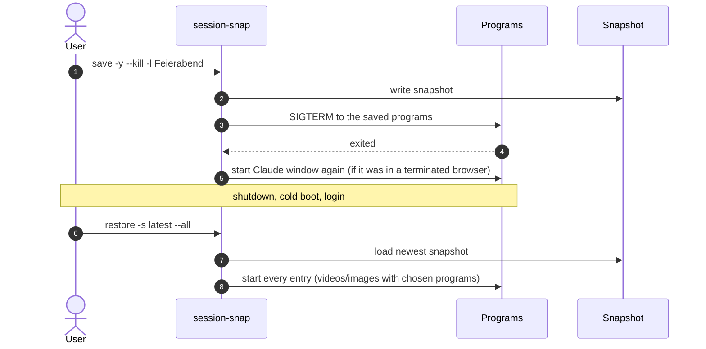

**Expected result:** after the restore, the same set of programs with the same files is running again. *Verified by:* T24, T25.

## UC8 — Inspect: list, show, dry run

```bash
session-snap list
session-snap show latest
session-snap restore -s latest --all --dry-run
session-snap kill -s latest --all --dry-run
```

Output of `show` for the test snapshot:

```text
# ~/scripts/session-snap.d/snapshots/session-snap_2026-10-28_22-13-59.json
# erstellt 2026-10-28T22:13:59  Sitzung /

== Videos (1) ==
  vlc (PID 212)
      Datei:  ~/Videos/Urlaub 2026/Tag 3 - Bootstour zur Insel mit sehr langem Dateinamen 1080p.mkv
      Befehl: ~/bin/vlc '~/Videos/Urlaub 2026/Tag 3 - Bootstour zur Insel mit sehr langem Dateinamen 1080p.mkv'
      Umgebung: wie beim Speichern

== Bilder (2) ==
  eog (PID 213)
      Datei:  ~/Bilder/animation.gif
      Befehl: ~/bin/eog ~/Bilder/animation.gif
      Original: ~/bin/eog '~/Bilder/Screenshots/Bildschirmfoto vom 2026-10-14 20-41-07.png' ~/Bilder/animation.gif
      Umgebung: wie beim Speichern
  eog (PID 213)
      Datei:  ~/Bilder/Screenshots/Bildschirmfoto vom 2026-10-14 20-41-07.png
      Befehl: ~/bin/eog '~/Bilder/Screenshots/Bildschirmfoto vom 2026-10-14 20-41-07.png'
      Original: ~/bin/eog '~/Bilder/Screenshots/Bildschirmfoto vom 2026-10-14 20-41-07.png' ~/Bilder/animation.gif
      Umgebung: wie beim Speichern

== Browser (2) ==
  chrome (PID 215)
      Befehl: ~/bin/chrome --profile-directory=Default
      Umgebung: wie beim Speichern
  Claude (PID 215)
      Befehl: ~/bin/chrome -c 'import time;time.sleep(600)' --profile-directory=Default --app-id=fmpnliohjhemenmnlpbfagaolkdacoja
      Umgebung: wie beim Speichern

== Sonstige Programme (1) ==
  cosmic-edit (PID 214)
      Datei:  ~/Dokumente/notizen.txt
      Befehl: ~/bin/cosmic-edit ~/Dokumente/notizen.txt
      Umgebung: wie beim Speichern
```

**Expected result:** output only; no program is started or signalled. *Verified by:* T17, T20.

## UC9 — Error cases

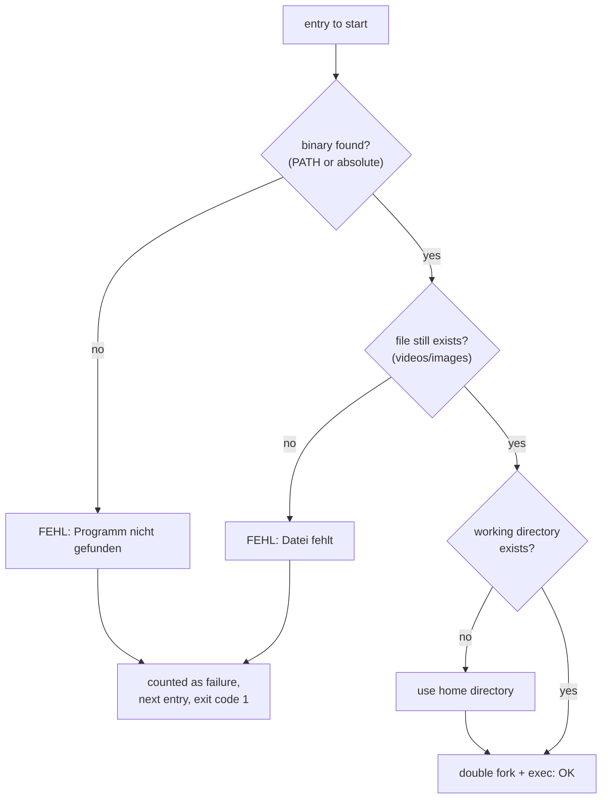

Table: Error cases and behaviour.

| Situation | Behaviour | Test |
|--------------------------|--------------------------------|--------------|
| File deleted or renamed since the snapshot | `Datei fehlt`; the other entries still start; exit code 1 | T16 |
| Program uninstalled | `Programm nicht gefunden`; exit code 1 | T27 |
| Chosen program (programs.ini) uninstalled | warning, recorded program used | T33 |
| No graphical session (`WAYLAND_DISPLAY`/`DISPLAY` unset, e.g. SSH) | warning and question before starting | `run_launches()` |
| Started as root or with sudo | abort with a message | T10 |
| Corrupt snapshot file | `Snapshot unlesbar`, exit code 1 | `_load_or_report()` |
| Broken `config.ini` | warning, defaults used | T06 |

## UC10 — Close all browsers, keep Claude available

**Goal:** close Chrome and Firefox completely; Claude must be available again immediately.

```bash
session-snap save -y -l "Browser"
session-snap kill -s latest
```

Choose 5 (*Nur Browser*) in the scope menu.

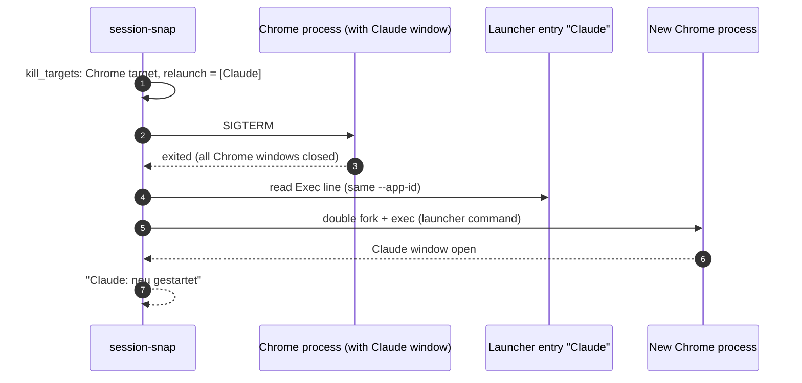

**Expected result:** all browser processes have ended; a new Chrome process shows only the Claude window, unless Chrome's own startup setting reopens other windows. With `--no-relaunch`, nothing is started. *Verified by:* T28, T30.

## UC11 — Open the recorded videos with mpv

**Goal:** 13 videos were recorded in VLC; this time they should open in mpv.

```bash
session-snap restore -s latest --all --video mpv.desktop
```

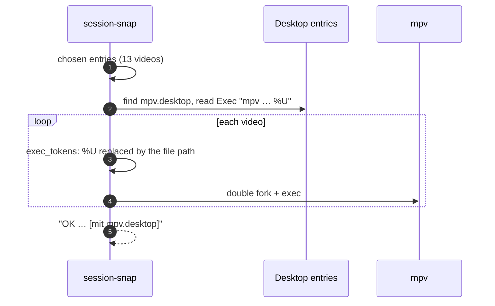

**Expected result:** 13 mpv windows with the recorded files. A later restore recognises them as running. *Verified by:* T32.

## UC12 — Set the default programs once

```bash
session-snap programs
session-snap programs --video mpv.desktop --image org.nomacs.ImageLounge.desktop
```

Alternatively interactively: main menu → 5, or restore menu → 7.

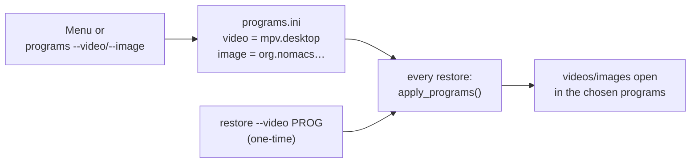

**Expected result:** `programs.ini` contains the choice, and every subsequent restore uses it until `--reset` is run. *Verified by:* T31, T33.

## UC13 — Restore videos paused and maximized

**Goal:** many videos were open; after the restore they should all be visible in maximized windows, but none should play.

```bash
session-snap restore -s latest --all
```

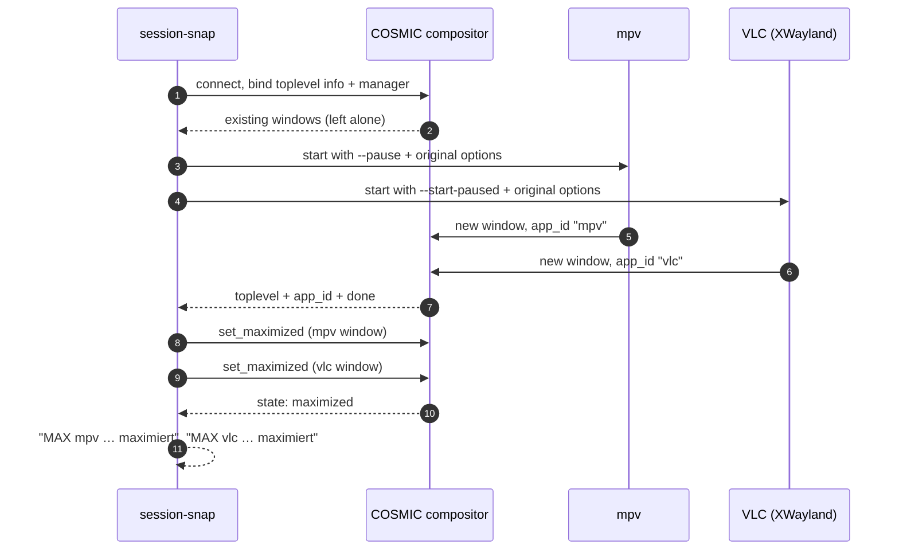

**Expected result:** every video window maximized and paused; existing windows and windows of other programs unchanged. *Verified by:* T36, T39–T41 and the end-to-end runs E1–E3 ([verification](developer.md#sec-verification)).

## UC14 — Find out why something is not restored

```bash
session-snap diagnose
```

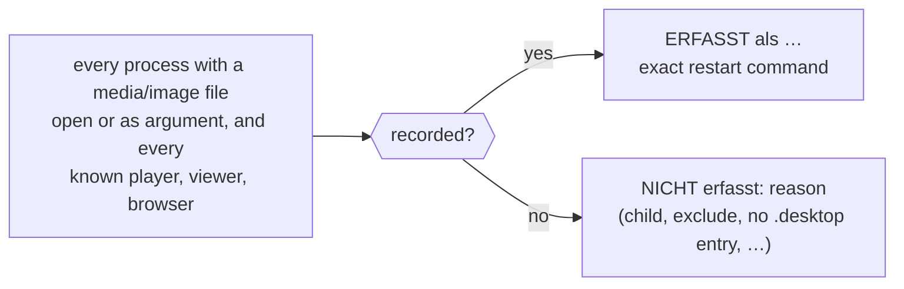

Example output:

```text
session-snap 1.7.0 diagnose - Sitzung ?/?
Darstellung (session-snap selbst): XDG_DATA_DIRS=/nonexistent WAYLAND_DISPLAY=wayland-0
Desktop-Sitzung (Vorlage fuer Darstellung): nicht gefunden
gsettings org.gnome.desktop.interface color-scheme: No schemas installed
gsettings org.gnome.desktop.interface gtk-theme: No schemas installed
Mitschreiber (Alt-Tab-Reihenfolge): laeuft NICHT; Autostart: nein
Fensterliste (COSMIC): nicht verfuegbar

[1] PID 250  exe=/home/snaptest/bin/mpv  flatpak=-
    argv:    /home/snaptest/bin/mpv -c 'import time;time.sleep(600)' --player-operation-mode=pseudo-gui -- file:///home/snaptest/Videos/Urlaub%202026/Tag%203%20-%20Bootstour%20zur%20Insel%20mit%20sehr%20langem%20Dateinamen%201080p.mkv
    cwd:     /home/snaptest
    offen:   -
    Starter: -  (nicht ermittelbar)
    Darstellung: XDG_DATA_DIRS=/nonexistent WAYLAND_DISPLAY=wayland-0
    ERFASST als Videos: /home/snaptest/bin/mpv -c 'import time;time.sleep(600)' --player-operation-mode=pseudo-gui -- '/home/snaptest/Videos/Urlaub 2026/Tag 3 - Bootstour zur Insel mit sehr langem Dateinamen 1080p.mkv'
```

**Expected result:** a list that can be copied into an error report; nothing is started, saved or terminated. *Verified by:* T38.

## UC15 — Restore all images of a single-instance viewer

**Goal:** five images were open in the GNOME image viewer (one process, five windows); after the restore all five must be open again.

```bash
session-snap save -y -l "Bilder"
session-snap kill -s latest
session-snap restore -s latest
```

Choose 4 (*Nur Bilder*) in both menus.

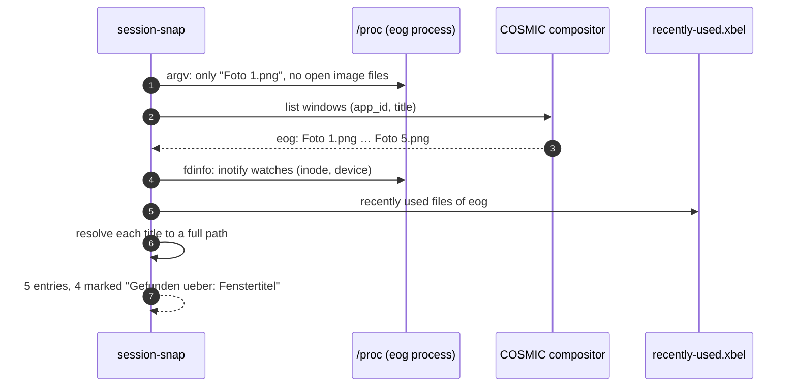

**Expected result:** `show` lists five images; after `kill` (one signal) and `restore`, five windows with the five images. *Verified by:* T42–T44, E4.

## UC16 — Install a new version

**Goal:** a new release was published; it should replace the installed one, and the running watcher should switch to it.

```bash
session-snap update --list
session-snap update
```

**Expected result:** `--list` shows the installed and the newest release; `update` installs it, checks `--version` and reports the answer of the watcher (`accepted: … -> …`). *Verified by:* apply-release tests, T32–T34.

## UC17 — Restore the Alt-Tab order

**Goal:** after the restore, Alt-Tab should show the windows in the order in which they were last used — also between windows that are already open.

```bash
session-snap watch --status
session-snap save -y -l "Reihenfolge"
session-snap restore -s latest
```

Choose the scope, then 1 (*Wie beim Speichern*).

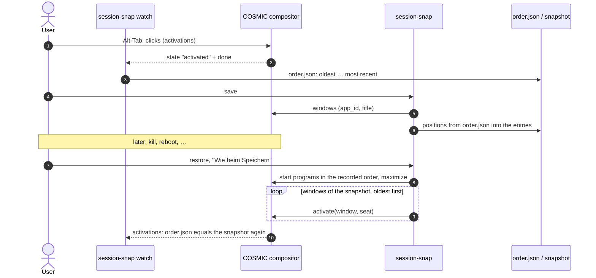

**Expected result:** Alt-Tab shows the snapshot's windows in the recorded order, unrelated windows behind them. *Verified by:* T51, T52, E6, E7.

## UC18 — Clean up old snapshots

**Goal:** the list of snapshots has become long; old ones should be archived, one renamed, a wrong one deleted.

```bash
session-snap manage
```

Choose a snapshot with ↑ ↓ and Enter, then *Umbenennen*, *Archivieren* or *Loeschen*. Item *→ Archiv anzeigen* switches to the archive, where *Aus dem Archiv zurueckholen* is offered.

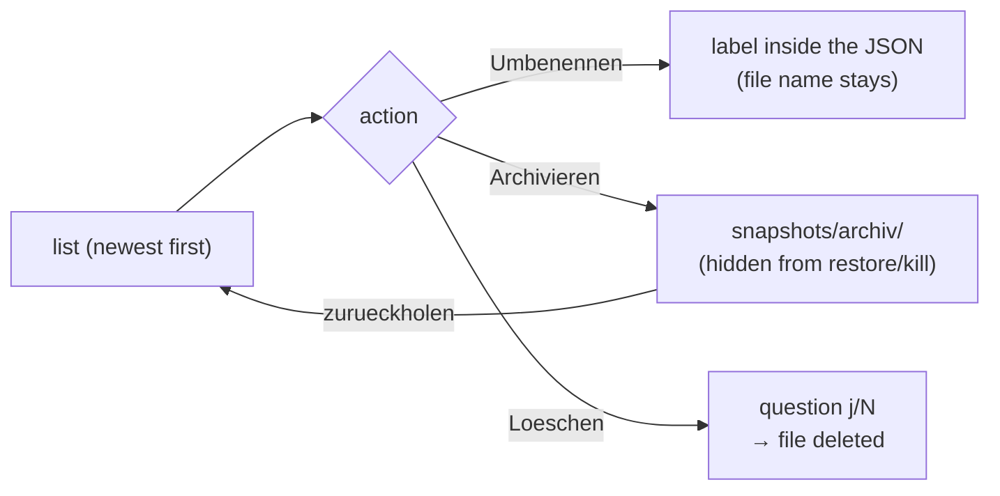

**Expected result:** restore and kill offer only the snapshots that are not archived; the renamed snapshot shows its new label everywhere; a deleted snapshot is gone, the log names it. *Verified by:* T63.

## UC19 — Close the browsers and get them back with all tabs

**Goal:** Chrome with several profiles and Firefox should be closed and later reopened with all windows and tabs.

```bash
session-snap save -y -l "Browser"
session-snap kill -s latest --all
session-snap restore -s latest --all
```

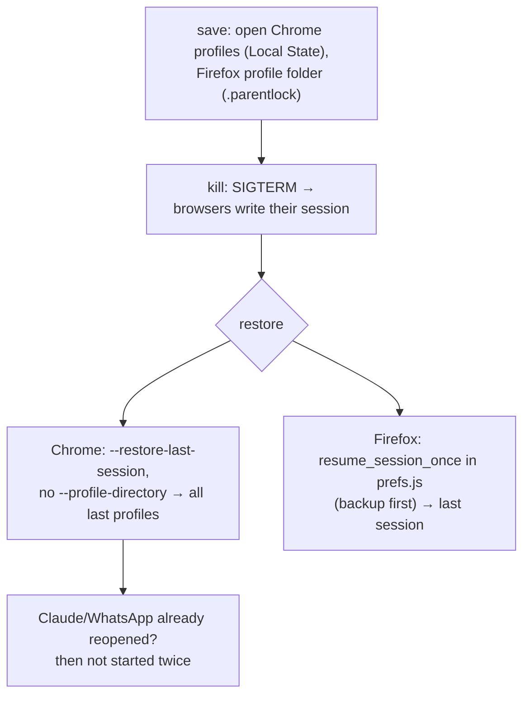

**Expected result:** Chrome opens every profile that was open, each with its windows and tabs; Firefox opens its last session; app windows appear once. The terminal prints one line per browser ("Chrome-Sitzung: Profile …", "Firefox-Sitzung …: wird wiederhergestellt"). *Verified by:* T65, T66 (simulated browsers); not yet confirmed with the real browsers on the target system.

## UC20 — Terminate everything without questions about players

**Goal:** all recorded programs should end; a video player that hangs at exit must not cause a question.

```bash
session-snap kill -s latest --all
```

**Expected result:** every program receives SIGTERM; after the grace period, players and image viewers that are still running receive SIGKILL without a question ("Player/Bildbetrachter, keine ungespeicherten Daten"); for other programs the question appears only in an interactive run, or `--force` answers it in advance. The busy overlay is shown during the run. *Verified by:* T21, T59.

<a id="sec-troubleshooting"></a>

# Troubleshooting

Table: Symptoms, causes and actions.

| Symptom | Likely cause | Action |
|------------------------|----------------------|--------------------------|
| `session-snap: … ~/.local/bin/session-snap: No such file or directory` right after the migration | the open shell remembers the old location | `hash -r` or a new terminal |
| `session-snap update` finds no newer release | the newest tag is installed already, or no network access to GitHub | `./install.sh --list` in the clone lists the tags |
| "ACHTUNG: Fensterliste nicht verfuegbar" when saving or terminating | the compositor did not answer within 2 s and 6 s (heavy load) | wait until the load drops, then repeat; the image count is incomplete meanwhile |
| Restored programs light although the desktop is dark | no session process found (e.g. SSH) or the cause is not an environment variable | `session-snap diagnose`: line "Desktop-Sitzung (Vorlage …)" |
| Alt-Tab order not restored | background process not running at save time (fallback used), or COSMIC not available | `session-snap watch --status`; `session-snap watch --start` |
| "n von m Fenstern geordnet" with n < m | a window did not appear within `maximize_timeout`, or its title does not name its file | raise `maximize_timeout`; check titles with `diagnose` |
| Only one image of a viewer recorded | no COSMIC window list, or the viewer's titles do not contain file names | check the window list at the top of `diagnose` |
| A COSMIC helper or another background program appears under *Sonstige* | it has a visible desktop entry | add its name to `exclude` in `config.ini` |
| A program you use is missing from the snapshot | no visible desktop entry, or binary name differs from `Exec` | add its name to `include`, `video_players` or `image_viewers` |
| An installed viewer is not offered in the program menu | its desktop entry lacks `MimeType`, or it is `NoDisplay=true` | `grep MimeType /usr/share/applications/<name>.desktop` |
| Claude is not started again after `kill` | no launcher entry with the same `--app-id`, or `--no-relaunch` | `grep -l -- '--app-id=' ~/.local/share/applications/*.desktop` |
| Chrome reopens all old windows when Claude is relaunched | Chrome's startup setting restores the previous session | change Chrome's "on startup" setting, or use `--no-relaunch` |
| `Datei fehlt` | file moved, renamed or on an unmounted drive | mount the drive or restore the file |
| Nothing starts, warning about missing graphical session | run from SSH or a TTY without Wayland | run in a terminal of the desktop session |
| "Fenster werden nicht maximiert - …" | no Wayland session, not COSMIC, or inside a sandbox | run in a terminal of the COSMIC session; `echo "$WAYLAND_DISPLAY"` |
| Videos still start playing | player not listed in `[player-options]`, or `--play` used | add the player with its pause option |
| Muting one VLC window sometimes mutes or unmutes another | VLC's PulseAudio output keeps no own mute state; a new audio stream gets the volume and mute state that WirePlumber stored for *all* VLC streams together [[vlcpulse]](#ref-vlcpulse), [[wpstream]](#ref-wpstream) | use VLC's ALSA output, which keeps volume and mute inside each VLC: `aout=alsa` in `~/.config/vlc/vlcrc` (see below) |
| A VLC window jumps to the front at the end of a video and takes the keyboard focus | VLC option `qt-auto-raise` (default *Video*) raises the window for every new input [[vlcqt]](#ref-vlcqt) | `qt-auto-raise=0` in `~/.config/vlc/vlcrc` |
| Images not borderless although fullscreen | viewer without an own fullscreen option (COSMIC image viewer) — only the compositor fullscreen applies | key `f` in the viewer; or use eog / nomacs |
| Chrome reports "laeuft bereits" but no window is open | Chrome runs in the background without a window (≤ 1.7.5) | update; switch off "Continue running background apps" in Chrome |
| Chrome with Claude/WhatsApp not ended by `kill` | snapshot from a plain Chrome start, running Chrome started through an app (≤ 1.7.7) | update to 1.7.8 or later |
| Chrome session not restored | Chrome still had a window (e.g. Claude) when restoring, or no COSMIC window list | close Chrome completely first, then restore |
| Firefox session not restored | Firefox ran with that profile during the restore, or the profile was not detected at save | `session-snap show`: profile line under the Firefox entry |
| Only a notification appears, no progress card | helper cannot run: package `gir1.2-gtklayershell-0.1` missing, no Wayland session | `grep "overlay" ~/.local/state/session-snap/logs/session-snap.log`; install the packages listed under [overlay](#sec-overlay) |
| No overlay appears | `overlay = off`, or no Wayland session and no `gdbus` / session bus (SSH) | run from a terminal of the desktop session; `command -v gdbus` |
| No session-snap in the application menu | entry not written (installed before it existed) | `session-snap desktop-entry` |

**VLC settings outside session-snap.** The two VLC symptoms above are caused by VLC itself and are fixed in VLC's own configuration, so that they apply to every VLC start. With VLC's PulseAudio output, a mute set in one VLC window is written to the audio stream; when the next stream is created (a new item), the sound server restores the mute state stored for all VLC streams together [[wpstream]](#ref-wpstream), and VLC shows it (`sink_input_info_cb()` → `aout_MuteReport()` in `pulse.c` [[vlcpulse]](#ref-vlcpulse)). The ALSA output keeps volume and mute in each VLC instance and applies them again to every new stream (`aout_SoftVolumeStart()` in `volume.h` [[vlcvolume]](#ref-vlcvolume)); the sound still goes through PipeWire via the package `pipewire-alsa`. The setting `volume-save` off keeps one VLC from passing its volume to the next one through `vlcrc`. Run as the normal user, with all VLC windows closed (VLC writes `vlcrc` when it ends):

```bash
dpkg -l pipewire-alsa
sed -i -e 's/^#\?aout=.*/aout=alsa/' -e 's/^#\?qt-auto-raise=.*/qt-auto-raise=0/' -e 's/^#\?volume-save=.*/volume-save=0/' ~/.config/vlc/vlcrc
grep -E '^(aout|qt-auto-raise|volume-save)=' ~/.config/vlc/vlcrc
```

The last command must print the three lines without `#`. Applied and confirmed on the target system on 1 November 2026 (two instances, one muted, independent).
| A menu reacts to keys you did not press | several commands were pasted at once; the menu read the rest as keys | run interactive commands one by one |

<a id="sec-limitations"></a>

# Limitations

* **Window state:** positions, sizes, workspaces, playback positions and unsaved documents are not restored; windows are maximized or fullscreened, and their Alt-Tab order is rebuilt. Browsers bring back their windows and tabs through their own session restore, which session-snap triggers ([browser sessions](#sec-browsersession)).
* **Browser sessions:** Chrome's switch works only when Chrome starts; a Chrome that still has an app window open is not ended. Firefox is restored per detected profile only.
* **Fullscreen:** viewers without an own fullscreen option get the compositor fullscreen only (window enlarged, frame of the viewer visible).
* **Terminate:** whether a program shows a "save changes?" dialog cannot be seen from outside; therefore only players and pure viewers are ended with SIGKILL without a question.
* **COSMIC only for window functions:** maximizing, the window list of single-instance viewers and the Alt-Tab order use COSMIC's own protocols. Under other compositors the programs start normally.
* **Window matching:** the COSMIC protocols carry no process ID. Windows are assigned by app_id and window title; two windows with the same app_id and title cannot be told apart.
* **Alt-Tab order:** see the limits in [Alt-Tab order](#sec-order); the order of unrelated windows is not changed.
* **Appearance:** only environment variables are adjusted ([appearance](#sec-look)).
* **Shared browser process:** normal Chrome windows and the Claude app window cannot be terminated separately ([browsers](#sec-browser)).
* **Category *Sonstige* is heuristic:** it relies on visible desktop entries ([troubleshooting](#sec-troubleshooting)).
* **Flatpak:** recognition relies on `/proc/<pid>/root/.flatpak-info`; its readability for sandboxed processes was not verified on a live system.
* **Exec field codes:** `%i` (icon) and `%c` (translated name) are dropped instead of expanded ([Exec expansion](developer.md#sec-desktop)).
* **Verification environment:** the end-to-end runs used a cosmic-comp built from source in a nested session without GPU, without `cosmic-panel` and without the real launcher. The autostart of the background process and the switcher's list were checked in the source code ([[cosmicsession]](#ref-cosmicsession), [[poplauncher]](#ref-poplauncher)), not on the live desktop.


## References

Checked between 14 October and 1 November 2026; **[V]** content verified, **[I]** found in the search index, **[X]** not retrievable (kept for documentation).

- <a id="ref-xdgbasedir"></a>**[xdgbasedir]** freedesktop.org: *XDG Base Directory Specification* — defaults `~/.local/share`, `~/.config`, `~/.local/state` for unset or empty variables. <https://specifications.freedesktop.org/basedir/latest/> — **[I]**
- <a id="ref-pycurses"></a>**[pycurses]** Python documentation: *curses*. <https://docs.python.org/3/library/curses> — **[I]**
- <a id="ref-ctlseqs"></a>**[ctlseqs]** T. Dickey: *XTerm Control Sequences*. <https://www.invisible-island.net/xterm/ctlseqs/ctlseqs.html> — **[I]**
- <a id="ref-escdelay"></a>**[escdelay]** ncurses: *curs_variables(3x)* (`ESCDELAY`). <https://www.man7.org/linux/man-pages/man3/curs_variables.3x.html> — **[I]**
- <a id="ref-notifyspec"></a>**[notifyspec]** freedesktop.org: *Desktop Notifications Specification — D-BUS Protocol* (`Notify` with `replaces_id`, `actions`, `hints`, `expire_timeout`; signal `ActionInvoked`). <https://specifications.freedesktop.org/notification-spec/latest/ar01s09.html> — **[I]** (direct retrieval refused by the build machine's allowlist; content confirmed from the search-index excerpt)
- <a id="ref-layershell"></a>**[layershell]** wlroots: *wlr-layer-shell-unstable-v1* protocol (layers `background` … `overlay`, `keyboard_interactivity` `none` / `exclusive` / `on_demand`), copy in the gtk-layer-shell repository `protocol/wlr-layer-shell-unstable-v1.xml`. <https://github.com/wmww/gtk-layer-shell/blob/master/protocol/wlr-layer-shell-unstable-v1.xml> — **[V]** (repository cloned on 23 Nov 2026)
- <a id="ref-gtklayershell"></a>**[gtklayershell]** wmww: *gtk-layer-shell* — `gtk_layer_set_keyboard_mode()`, `GTK_LAYER_SHELL_KEYBOARD_MODE_EXCLUSIVE` (`include/gtk-layer-shell.h`); Ubuntu 24.04 package `gir1.2-gtklayershell-0.1` 0.8.2. <https://github.com/wmww/gtk-layer-shell> — **[V]** (repository cloned, package installed on 23 Nov 2026)
- <a id="ref-cosmicfocus"></a>**[cosmicfocus]** System76: *cosmic-comp* source code, `src/shell/focus/mod.rs` — while an exclusive layer surface exists, only exclusive layer surfaces of the highest such layer get the keyboard focus. <https://github.com/pop-os/cosmic-comp> — **[V]** (repository cloned on 23 Nov 2026, commit `0681eaf`)
- <a id="ref-cosmicterm"></a>**[cosmicterm]** System76: *cosmic-term* source code, `src/main.rs` — options `-e` / `--command` / `--` followed by program and arguments. <https://github.com/pop-os/cosmic-term> — **[V]** (repository cloned on 23 Nov 2026)
- <a id="ref-desktopentry"></a>**[desktopentry]** freedesktop.org: *Desktop Entry Specification* — keys `Exec`, `Icon`, `Terminal`. <https://specifications.freedesktop.org/desktop-entry-spec/latest/> — **[I]**
- <a id="ref-cosmicnotif"></a>**[cosmicnotif]** System76: *cosmic-notifications* source code — capabilities `body`, `icon-static`, `persistence`, `actions` (`src/subscriptions/notifications.rs`); timeout 0 = no expiry (`src/app.rs`). <https://github.com/pop-os/cosmic-notifications> — **[V]** (repository cloned on 1 Nov 2026)
- <a id="ref-kdepwa"></a>**[kdepwa]** KDE Discuss: *Chrome PWA opens a new instance from App Launcher …* — native Wayland PWA window class `chrome-hnpfjngllnobngcgfapefoaidbinmjnm-Profile_1`. <https://discuss.kde.org/t/chrome-pwa-opens-a-new-instance-from-app-launcher-instead-of-focusing-existing-window-kde-plasma-6-6-wayland-fedora-44/46833> — **[V]**
- <a id="ref-chromiumudd"></a>**[chromiumudd]** Chromium docs: *User Data Directory* — two running instances cannot share a user data directory; default `~/.config/google-chrome`. <https://chromium.googlesource.com/chromium/src/+show/HEAD/docs/user_data_dir.md> — **[V]**
- <a id="ref-pscheck"></a>**[pscheck]** Local observation on the target system (Pop!_OS 24.04, the developer's user account): `ps` output with one Chrome main process carrying `--app-id`, 15 Oct 2026. — **[V]** (local)
- <a id="ref-chromeprefs"></a>**[chromeprefs]** Chromium: `chrome/common/pref_names.h` — `kProfilesLastActive = "profile.last_active_profiles"`. <https://github.com/chromium/chromium/blob/main/chrome/common/pref_names.h> — **[V]** (raw, 1 Nov 2026)
- <a id="ref-chromestartup"></a>**[chromestartup]** Chromium: `chrome/browser/ui/startup/startup_browser_creator.cc` — `ShouldRestoreLastSession()`, `pref.type = SessionStartupPref::LAST` with `--restore-last-session`, `LaunchBrowserForLastProfiles()`. <https://github.com/chromium/chromium/blob/main/chrome/browser/ui/startup/startup_browser_creator.cc> — **[V]** (raw, 1 Nov 2026)
- <a id="ref-chromerestore"></a>**[chromerestore]** Chromium code review 2469363002 — the switch is documented as "restored on startup"; behaviour when a Chrome process already runs. <https://codereview.chromium.org/2469363002> — **[V]**
- <a id="ref-fflock"></a>**[fflock]** Mozilla: `toolkit/profile/nsProfileLock.cpp` — lock file `.parentlock` on Linux. <https://github.com/mozilla/gecko-dev/blob/master/toolkit/profile/nsProfileLock.cpp> — **[V]** (sparse `git clone`, 1 Nov 2026)
- <a id="ref-ffstartup"></a>**[ffstartup]** Mozilla: `browser/components/sessionstore/SessionStartup.sys.mjs` — "set the browser.sessionstore.resume_session_once pref to true, and the session will be restored the next time the browser starts". <https://github.com/mozilla/gecko-dev/blob/master/browser/components/sessionstore/SessionStartup.sys.mjs> — **[V]** (raw, 1 Nov 2026)
- <a id="ref-ffsessionstore"></a>**[ffsessionstore]** Mozilla: `browser/components/sessionstore/SessionStore.sys.mjs` — `resume_session_once` is set back to `false` after the session was resumed. <https://github.com/mozilla/gecko-dev/blob/master/browser/components/sessionstore/SessionStore.sys.mjs> — **[V]** (raw, 1 Nov 2026)
- <a id="ref-pymimetypes"></a>**[pymimetypes]** Python documentation: *mimetypes* — `knownfiles` incl. `/etc/mime.types`, `guess_type(strict=False)`. <https://docs.python.org/library/mimetypes.html> — **[V]**
- <a id="ref-mpvsrc"></a>**[mpvsrc]** mpv 0.37.0 source code, Ubuntu source package `mpv_0.37.0-1ubuntu4` (`apt-get source`): `DOCS/man/options.rst` (`--pause`, `--window-maximized`), `video/out/wayland_common.c` (`xdg_toplevel_set_maximized`). Inspected on 20 Oct 2026. — **[V]** (local)
- <a id="ref-vlcinput"></a>**[vlcinput]** VideoLAN: VLC 3.0.20 source, `src/input/input.c` (`MainLoopTryRepeat()`: `input-repeat` seeks to the start of the same input). <https://github.com/videolan/vlc/blob/3.0.20/src/input/input.c> — **[V]** (raw, 1 Nov 2026)
- <a id="ref-vlc2110"></a>**[vlc2110]** VideoLAN issue #2110: *Maximize video on startup*. <https://code.videolan.org/videolan/vlc/-/issues/2110> — **[V]**
- <a id="ref-eogsrc"></a>**[eogsrc]** GNOME: *eog* 45.3 source — `src/main.c` (option `--fullscreen`), `src/eog-application.c` (startup flags passed to the running instance as platform data), `src/eog-window.c` (`eog_window_run_fullscreen()`). <https://github.com/GNOME/eog/blob/45.3/src/main.c> — **[V]** (raw, 1 Nov 2026)
- <a id="ref-nomacssrc"></a>**[nomacssrc]** nomacs: `ImageLounge/src/main.cpp` — option `-f`/`--fullscreen` "Start in fullscreen" (tag 3.16.224 and main branch). <https://github.com/nomacs/nomacs/blob/master/ImageLounge/src/main.cpp> — **[V]** (raw, 1 Nov 2026)
- <a id="ref-cosmicviewer"></a>**[cosmicviewer]** System76: *cosmic-viewer* — `cosmic-viewer/src/main.rs` takes `args().nth(1)` as image path; fullscreen key `f` (`key_binds.rs`). <https://github.com/pop-os/cosmic-viewer> — **[V]** (repository cloned on 1 Nov 2026, commit `300210f`)
- <a id="ref-cosmicproto"></a>**[cosmicproto]** System76: *cosmic-protocols* (`unstable/cosmic-toplevel-info-unstable-v1.xml`, `unstable/cosmic-toplevel-management-unstable-v1.xml`). <https://github.com/pop-os/cosmic-protocols> — **[V]** (repository cloned on 20 Oct 2026)
- <a id="ref-cosmiccomp"></a>**[cosmiccomp]** System76: *cosmic-comp* source code. <https://github.com/pop-os/cosmic-comp> — **[V]** (repository cloned on 20 Oct 2026; `src/state.rs`, `src/wayland/protocols/toplevel_info.rs`; tags `epoch-1.0.0`, `epoch-1.5.0` and main branch commit `742b800b` compared; built and run)
- <a id="ref-procfdinfo"></a>**[procfdinfo]** Linux man-pages: *proc_pid_fdinfo(5)* — inotify lines `wd`, `ino` (inode, hexadecimal), `sdev` (device, hexadecimal). <https://man7.org/linux/man-pages/man5/proc_pid_fdinfo.5.html> — **[V]**
- <a id="ref-inotify7"></a>**[inotify7]** Linux man-pages: *inotify(7)* — watches can be viewed via `/proc/<pid>/fdinfo`. <https://man7.org/linux/man-pages/man7/inotify.7.html> — **[V]**
- <a id="ref-xbel"></a>**[xbel]** freedesktop.org: *Desktop Bookmark Specification* (XBEL; replaces the Recent Files Storage Specification; `recently-used.xbel`; `application` element with `name` and `exec`). <https://wiki.freedesktop.org/www/Specifications/desktop-bookmark-spec/> — **[V]**
- <a id="ref-gtktheme"></a>**[gtktheme]** Baeldung on Linux: *dark theme for GTK applications* — `GTK_THEME` forces a theme for one application, e.g. `GTK_THEME=Adwaita:dark gnome-calculator`. <https://www.baeldung.com/linux/gtk-applications-dark-theme> — **[V]**
- <a id="ref-poplauncher"></a>**[poplauncher]** System76: *pop-launcher* source code, plugin `plugins/src/cosmic_toplevel/mod.rs` (activated window moved to the end of the list). <https://github.com/pop-os/launcher> — **[V]** (repository cloned on 28 Oct 2026, commit `86c2639b`)
- <a id="ref-cosmicsession"></a>**[cosmicsession]** System76: *cosmic-session* source code, `data/cosmic-session.target` (`Wants=xdg-desktop-autostart.target`), `src/main.rs` (own autostart scan only without systemd). <https://github.com/pop-os/cosmic-session> — **[V]** (repository cloned on 28 Oct 2026, commit `4b0a0a24`)
- <a id="ref-xdgautostartgen"></a>**[xdgautostartgen]** systemd: *systemd-xdg-autostart-generator(8)* — services generated from autostart entries, started through `xdg-desktop-autostart.target`. <https://man7.org/linux/man-pages/man8/systemd-xdg-autostart-generator.8.html> — **[V]**
- <a id="ref-autostart"></a>**[autostart]** freedesktop.org: *Desktop Application Autostart Specification* — user autostart directory `~/.config/autostart/`. <https://specifications.freedesktop.org/autostart-spec/latest> — **[V]**
- <a id="ref-signal7"></a>**[signal7]** Linux man-pages: *signal(7)* (Ubuntu manpages). <https://manpages.ubuntu.com/manpages/bionic/man7/signal.7.html> — **[I]**
- <a id="ref-vlcpulse"></a>**[vlcpulse]** VideoLAN: VLC 3.0.20 source, `modules/audio_output/pulse.c` (`MuteSet()`, `sink_input_info_cb()`, `flags_force`). <https://github.com/videolan/vlc/blob/3.0.20/modules/audio_output/pulse.c> — **[V]** (retrieved via raw.githubusercontent.com, 1 Nov 2026)
- <a id="ref-wpstream"></a>**[wpstream]** WirePlumber documentation: *Stream configuration* — volume and mute state of streams are remembered and restored when the same application appears. <https://pipewire.pages.freedesktop.org/wireplumber/daemon/configuration/stream.html> — **[V]**
- <a id="ref-vlcqt"></a>**[vlcqt]** VideoLAN: VLC 3.0.20 source, `modules/gui/qt/main_interface.cpp` (`onInputChanged()`, `setRaise()`) and `modules/gui/qt/qt.cpp` (`qt-auto-raise`, default *Video*; X11 preferred over Wayland). <https://github.com/videolan/vlc/blob/3.0.20/modules/gui/qt/main_interface.cpp> — **[V]** (raw, 1 Nov 2026)
- <a id="ref-vlcvolume"></a>**[vlcvolume]** VideoLAN: VLC 3.0.20 source, `modules/audio_output/volume.h` (`aout_SoftVolumeStart()`, `soft_mute`). <https://github.com/videolan/vlc/blob/3.0.20/modules/audio_output/volume.h> — **[V]** (raw, 1 Nov 2026)
